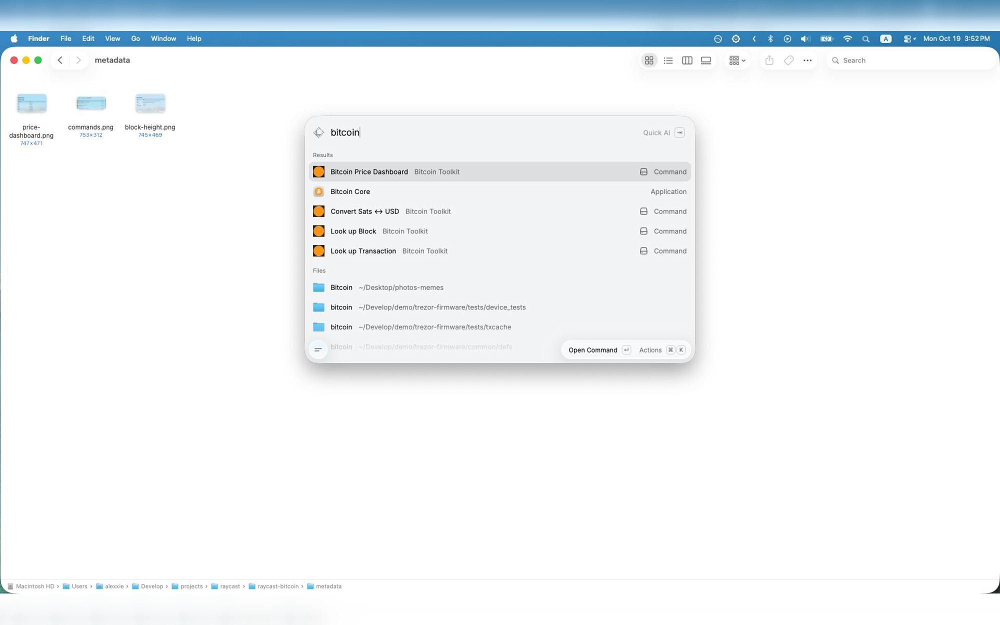
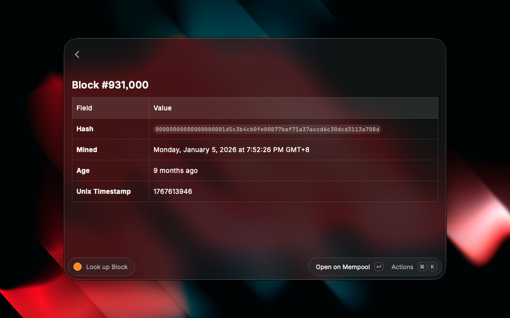
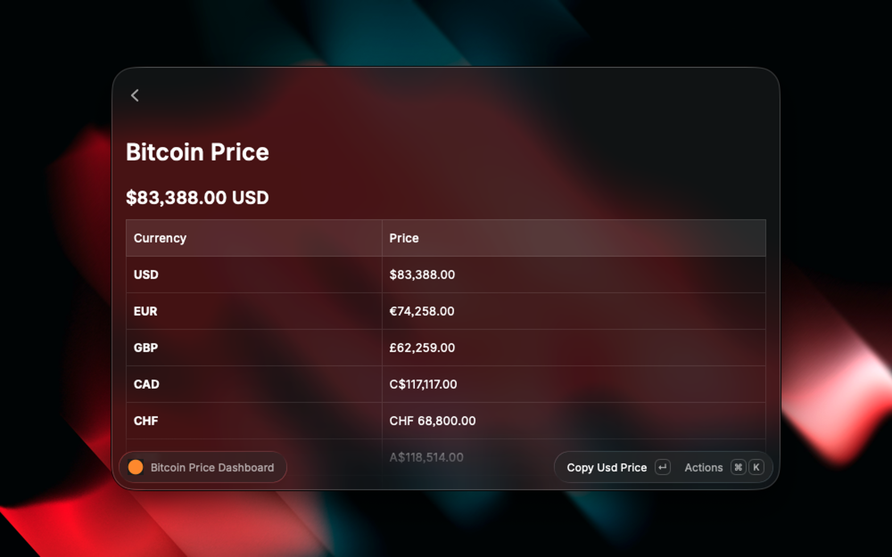

# Bitcoin Toolkit

A **Raycast** extension for Bitcoin data — look up blocks, transactions, the current BTC price, and convert between satoshis and USD without leaving your keyboard.



## Motives

Block explorers are essential tools for Bitcoin developers, researchers, and enthusiasts. But switching context to a browser, typing a URL, and waiting for a full explorer page to load is slow. This extension brings the same data directly into Raycast — type a height, TXID, or amount and see the result in under a second.

The [Mempool.space](https://mempool.space) API is used because it returns exactly the data needed (no transactions when looking up a block header, no bloat), keeping responses tiny and fast.

## Features

### 🔍 Look up Block
Enter a Bitcoin mainnet block height and instantly see:
- Block hash
- Exact mined date and time
- Relative age (e.g. "2 years ago")
- Unix timestamp

For blocks that haven't been mined yet, the extension shows an **estimated** date/time based on the chain tip and the 10-minute average block interval (clearly labeled as such).



### 🔍 Look up Transaction
Enter a Bitcoin transaction ID (TXID) and see:
- Confirmation status (confirmed / unconfirmed)
- Block height (if confirmed)
- Transaction size and weight
- Fee and fee rate (sat/vB)
- Input / output counts and total values

### 📈 Bitcoin Price Dashboard
Open the dashboard with no arguments to see:
- Current Bitcoin price in USD, EUR, GBP, CAD, CHF, AUD, JPY
- Timestamp of the latest price data
- One-click copy for the USD price or all prices as JSON



### 💱 Convert Sats ↔ USD
Convert between satoshis and US dollars at the live Bitcoin price:
- Enter an amount (sats or USD)
- Choose direction with a dropdown (Sats → USD or USD → Sats)
- See the converted result alongside the current BTC price and timestamp

## Instructions

### Prerequisites

- [Raycast](https://raycast.com) installed
- Node.js 22.22.2+

### Setup

```bash
cd bitcoin-toolkit
npm install
npm run dev
```

Raycast will open a development window. All four commands are available from the root search.

### Usage

| Command | Arguments | Description |
|---|---|---|
| **Look up Block** | `height` (required) | Enter a block height to fetch its details |
| **Look up Transaction** | `txid` (required) | Enter a TXID to see its fee, status, inputs, and outputs |
| **Bitcoin Price Dashboard** | _(none)_ | Shows live BTC prices across multiple currencies |
| **Convert Sats ↔ USD** | `amount` (required), `direction` (dropdown) | Convert between satoshis and USD at the live rate |

## Project Structure

```
bitcoin-toolkit/
  assets/
    icon.png                      512×512 extension icon
  media/
    commands.png                  Overview of the commands in Raycast
    block-height.png              Screenshot of the block lookup command
    price-dashboard.png           Screenshot of the price dashboard command
  metadata/
    commands.png                  Store screenshot: command overview
    block-height.png              Store screenshot: block lookup
    price-dashboard.png           Store screenshot: price dashboard
  src/
    lib/
      api.ts                      Mempool.space block API client
      prices.ts                   BTC price fetching
      types.ts                    Shared TypeScript interfaces
      utils.ts                    Pure helper functions (time, conversion, formatting)
    look-up-block.tsx             Block lookup command
    look-up-transaction.tsx       Transaction lookup command
    price-dashboard.tsx           Price dashboard command
    sats-usd-converter.tsx        Sats ↔ USD converter command
  package.json                    Extension manifest, dependencies, scripts
  tsconfig.json                   TypeScript configuration
```

Each file has a single responsibility:
- **`lib/api.ts`** — network layer: fetches block data from Mempool.space, resolves exact vs estimated results
- **`lib/prices.ts`** — fetches current BTC prices from Mempool.space
- **`lib/utils.ts`** — pure functions with no side effects (time formatting, satoshi/BTC/USD conversion)
- **`lib/types.ts`** — shared types used across all commands
- **`look-up-block.tsx`** — block lookup rendering and user interaction
- **`look-up-transaction.tsx`** — transaction lookup rendering and user interaction (includes API call inline)
- **`price-dashboard.tsx`** — price dashboard rendering and user interaction
- **`sats-usd-converter.tsx`** — sats ↔ USD converter rendering and user interaction

## API

This extension uses the public [Mempool.space API](https://mempool.space/docs/api/rest). No API key is required.

| Endpoint | Used by |
|---|---|
| `GET /api/block-height/{height}` | Look up Block |
| `GET /api/block/{hash}` | Look up Block |
| `GET /api/blocks/tip/hash` | Look up Block (for estimates) |
| `GET /api/tx/{txid}` | Look up Transaction |
| `GET /api/v1/prices` | Price Dashboard, Convert Sats ↔ USD |

Rate limiting is generous and sufficient for interactive use.

## License

MIT