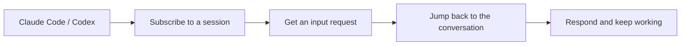

<picture>
  <source media="(prefers-color-scheme: dark)" srcset="media/app-icon@dark.png">
  
</picture>

# Agent Inbox

Subscribe to Claude Code and Codex sessions, get notified when they need your input, and jump back to the conversation.

**English** | [简体中文](README.zh-CN.md)

A Raycast extension for macOS, built for developers working across multiple AI coding sessions. Subscribe to the conversations you care about, get notified when an agent needs an answer or permission, and return to the right desktop conversation or terminal.

Workflow overview:

- **Find your sessions.** Search by title, project, or session ID. Subscribe to a past conversation or the one in your current window.
- **See what needs you.** Check session status in the subscription list and menu bar, with system notifications for requests that need attention.
- **Return to the right context.** Focus a desktop conversation, terminal tab, or tmux pane. If an exact match is unavailable, get a recovery option.
- **Search conversations when you choose.** Full-text indexing is off by default. Enable it to search user and agent messages locally.

## Quick start

Requires **macOS, Raycast**, and an existing Claude Code or Codex setup. Clickable notifications also require `terminal-notifier`.

After installing the extension:

1. Search for **Agent Inbox** in Raycast. Open **All Sessions → Actions (⌘K) → Connect an Agent** and connect Claude Code or Codex. For Codex, approve the new hooks with `/hooks` in the client.
2. From your agent window, invoke Raycast and run **Subscribe to Current Conversation**. Or open **All Sessions**, select a session, and press ⌘Return.
3. Open **Subscriptions** to see its status and press Return to jump back. Sessions with monitoring support notify you about new requests; importing historical state does not send old notifications.

The interface and notifications use English. Open **Actions → Open Extension Preferences** for terminal, notification, and full-text search options.

Connecting an agent installs local hooks and a user background collector, backing up existing configuration before editing it. See the [setup guide](help.md) for permissions, clickable notifications, data locations, and removal instructions.

## Everyday use

| Raycast command                   | Purpose                                                     | Shortcuts                                                  |
| --------------------------------- | ----------------------------------------------------------- | ---------------------------------------------------------- |
| Subscribe to Current Conversation | Subscribe to the focused conversation                       | Assign a global hotkey in Raycast Preferences → Extensions |
| All Sessions                      | Search and filter sessions; subscribe to the current window | ↵ jump back · ⌘↵ subscribe · ⌘I details                    |
| Subscriptions                     | Act on the sessions you follow                              | ↵ jump back · ⌘↵ unsubscribe · ⌘D mark handled             |
| Session Menu Bar                  | Show subscribed sessions and the waiting count              | Enable or disable in Raycast's command preferences         |

**Waiting for input** includes questions, permission requests, and failures, quota limits, or interruptions that need attention. **Turn ended** means the agent stopped this turn; **Completed** requires an explicit completion event. Marking a session handled hides it until its state changes or a new request arrives.

See the [usage guide](help.md) for all shortcuts, status rules, title synchronization, and navigation fallbacks.

## Compatibility

The current platform is **Raycast** and the operating system is **macOS**. Session monitoring relies on local hooks or transcripts; cloud-only sessions have the limits listed below.

| Source                          | Available features                                                                       | Limits                                                                                                    |
| ------------------------------- | ---------------------------------------------------------------------------------------- | --------------------------------------------------------------------------------------------------------- |
| Claude Code CLI / local desktop | History, subscriptions, state collection through hooks and local transcripts, navigation | Exact window matching depends on permissions and available session mappings                               |
| Codex CLI / desktop             | History, subscriptions, state collection through hooks and local rollouts, navigation    | Client formats may change; exact targeting requires a supported client                                    |
| Cloud-only Claude Code          | Subscribe and navigate using an explicit window session ID; sync titles of open windows  | Without local transcripts or hooks, monitoring is unavailable: no input notifications or full-text search |
| Terminals                       | Terminal, iTerm2, Ghostty, and tmux targeting                                            | Exact Ghostty targeting uses the tty interface in 1.4; missing interfaces fall back to recovery options   |

Agent Inbox manages conversations you already run. It does not host agents, assign tasks, approve requests, or sync across devices. If you work in one session and rarely switch windows, the original client may be all you need. Extension interfaces exist for other agents and network notification channels, but those integrations are not built in.

## Data and preferences

State, subscriptions, configuration, and the notification queue live in `~/.sessions/`. Agent transcripts are read-only; there is no conversation upload service.

| Setting              | Values / default                                 | Behavior                                                                                                |
| -------------------- | ------------------------------------------------ | ------------------------------------------------------------------------------------------------------- |
| Default terminal     | Terminal / iTerm2 / Ghostty; Terminal by default | Resumes a CLI session when the original window cannot be found                                          |
| System notifications | On / off; on by default                          | Alerts only for subscribed, unhandled sessions that still need attention                                |
| Menu bar             | Raycast command enable/disable                   | Shows subscribed sessions and the waiting count                                                         |
| Full-text search     | On / off; off by default                         | Indexes user and agent messages locally when enabled in preferences; excludes tool output and reasoning |

Changes to native preferences sync to the background collector when you next open an extension command.

The full-text index is stored at `~/.sessions/cache/conversation-search.sqlite`. Turning search off stops indexing and content queries; it does not delete the existing index. See [search and privacy](help.md#search).

For questions and suggestions, use [Issues](https://github.com/0xFANGO/agent-inbox/issues).

Platform icons: [Simple Icons](https://github.com/simple-icons/simple-icons), licensed under [CC0 1.0](https://github.com/simple-icons/simple-icons/blob/develop/LICENSE.md). Trademarks belong to their respective owners.
