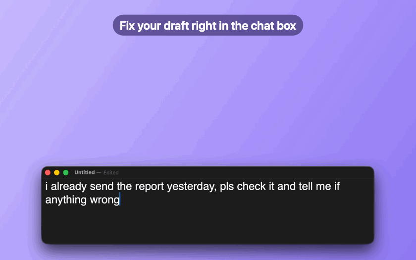
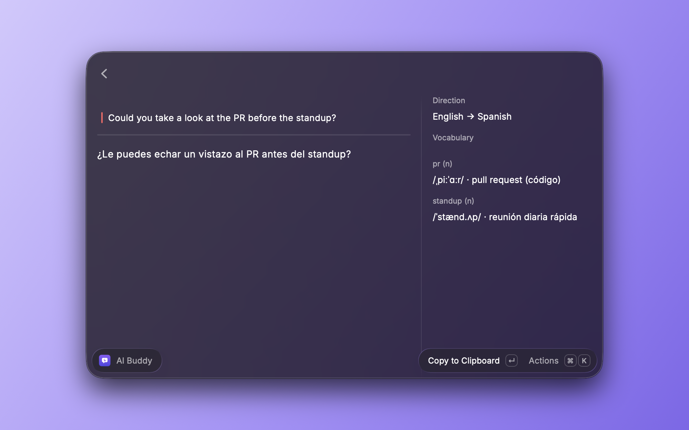
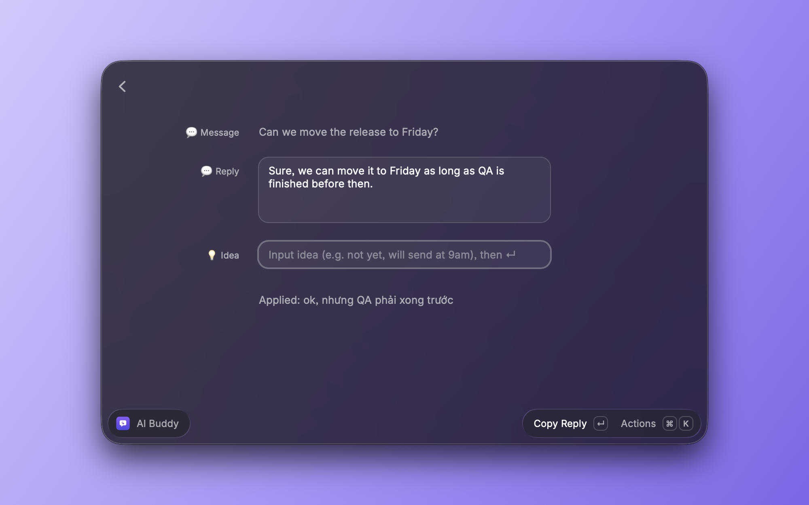
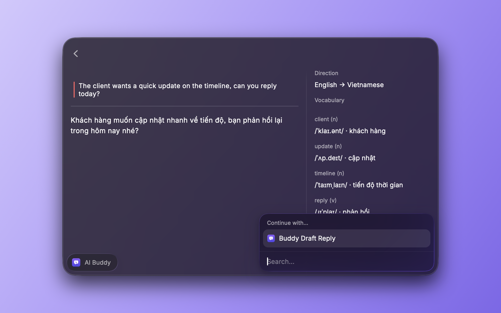

# AI Buddy

Read, reply and write English at work, and learn as you go, in your own language.

Select a message in any app, press a hotkey, and AI Buddy walks the whole chat loop with you: **understand** it, **reply** to it, **polish** your English, **send**. Every step teaches you something along the way.

## Highlights

- **Learn while you work.** Words get a dictionary card (IPA, meaning, usage, examples you can listen to), sentences get a vocabulary panel, and every polished draft comes with short grammar lessons, all explained in your language.
- **Replies in your words.** Type your idea in your own language (*"ok, but QA must finish first"*) and AI Buddy writes the reply in the language of the message.
- **Fix it right in the chat box.** With **Quick Replace**, your selected draft is swapped for the polished one in place. ⌘Z undoes it.
- **One flow, no reselecting.** **Continue with** (⌘B) hands a result to the next buddy: translate a message, then reply to it.
- **Your choice of AI.** Raycast AI with Raycast Pro (no key needed), or your own key for Google Gemini, OpenAI, Claude, Groq, OpenRouter or a local model. A different model per buddy, and prompts you can edit.
- **12 languages.** Vietnamese, Chinese (Simplified), Japanese, Korean, Thai, Indonesian, Hindi, Russian, Spanish, French, German and Portuguese. The screenshots below use a few of them.

## Commands

Every buddy works on the **selected text** in any app (Slack, Teams, Mail, a browser…). You can also type the text as the command's argument in Raycast. With nothing selected, a form opens with the clipboard text ready.

Assign hotkeys in Raycast Settings → Extensions → AI Buddy. Suggested: **⌃⌘T** Translate, **⌃⌘R** Draft Reply, **⌃⌘E** Polish English.

### 🌐 Buddy Translate

Translates between English and your Native Language, in whichever direction the text needs. Tech terms (PR, deploy, ticket…) stay as they are.

- **A sentence or message** shows the translation under the original, with a **Vocabulary** panel: the harder English words with part of speech, IPA and meaning.
- **A word or short phrase** becomes a **dictionary card**: part of speech, IPA, meaning, usage, common phrases and three examples, each with its own IPA and translation.
- **Read aloud** with the macOS voice, at normal speed or slowly.

| In the result | |
|---|---|
| ↵ | Copy the translation |
| ⌘L / ⌘⇧L | Listen to the English side / slowly |
| ⌘1 ⌘2 ⌘3 | Listen to each example (dictionary card) |
| ⌘O | Open the word in the Cambridge Dictionary |
| ⌘B | Continue with Draft Reply (reply to this message) or Polish English (polish your English translation) |
| ⌘R | Translate again |

### ↩️ Buddy Draft Reply

Drafts a reply to the selected message. Select the last few messages for more context. The reply is in an editable field, so you can touch it up before sending.

- **Idea:** type the point you want to make, in any language, for example *"not yet, will send at 9am"*, and press ⌘↵. The reply is rewritten around it. Each idea revises the current version, your edits included.
- **Command setting: Reply Language.** *Match their language* (default) replies in the language of the message; *Always English* replies in English whatever the message is in. Find it in Raycast Settings → Extensions → AI Buddy → Buddy Draft Reply.

| In the result | |
|---|---|
| ⌘↵ | Copy the reply, or apply the idea once one is typed |
| ⌘B | Continue with Translate, to check the reply in your language |
| ⌘R | Start over |

### ✏️ Buddy Polish English

Rewrites your English draft into correct, natural English, and lists **Lessons**: each mistake it fixed and the grammar rule behind it, explained in your language.

- Select the draft in the chat box and press the hotkey. **Replace Draft** pastes the polished version over the draft, which is still selected.
- **Idea:** ask for a change, for example *"add a point"* or *"more polite"*, and press ⌘↵.
- **Command setting: Quick Replace** (off by default). The hotkey replaces the selected draft right away, with no window and no lessons; a small HUD says *Polished* or *Already good*. ⌘Z in the app undoes it. If you switch apps or change the selection while it works, the result is copied instead of pasted. Find it in Raycast Settings → Extensions → AI Buddy → Buddy Polish English, or press ⌘⇧R on this buddy in AI Buddy.

| In the result | |
|---|---|
| ⌘↵ | Replace the draft, or apply the idea once one is typed |
| ⌘⇧C | Copy |
| ⌘B | Continue with Translate, to read the result in your language |
| ⌘R | Start over |

### Continue with (⌘B)

Hands the result to the next buddy, so you never reselect the text:

| From | Continue with |
|---|---|
| Translate a message | **Draft Reply** to that message |
| Translate your sentence into English | **Polish English** on the translation |
| Draft Reply or Polish English | **Translate**, to check the result in your language |

### 🤖 AI Buddy

The home of the extension:

- **Run any buddy on typed text:** type or paste in the search bar, pick a buddy, press ↵.
- **Connection:** the provider and whether it answers. ↵ opens **AI Setup**, ⌘R checks again.
- **On each buddy:** ⌘M chooses its model, ⌘E edits its prompt (tone, style, extra rules; the output format the extension needs is added for you).
- **Settings row:** open Raycast Settings, AI Setup, the data folder, or clear the dictionary cache.

## Setup

1. Open **AI Buddy** (any buddy opens it the first time). **AI Setup** asks for:
   - **Provider**: **Raycast AI** if you have Raycast Pro (no key to paste, chosen for you when available), or Google Gemini, OpenAI, Claude, Groq, OpenRouter, or **Custom** for any OpenAI-compatible server (your own proxy, Ollama, LM Studio). Custom also asks for its **API Host**, for example `http://localhost:11434/v1`.
   - **API Key** (not for Raycast AI): checked while you type; the status line says right away whether it works. A local server may need no key.
   - **Model**: picked from the provider's list, a fast, low-cost one by default.
2. In Raycast Settings → Extensions → AI Buddy, choose your **Native Language**. Translate goes between English and it; meanings and lessons are written in it.

### Get an API key

Not needed for Raycast AI. For the other providers:

| Provider | Where |
|---|---|
| Google Gemini | [Google AI Studio → Get API key](https://aistudio.google.com/app/apikey) |
| OpenAI | [OpenAI Platform → API keys](https://platform.openai.com/api-keys) |
| Claude | [Anthropic Console → API keys](https://console.anthropic.com/settings/keys) |
| Groq | [GroqCloud → API keys](https://console.groq.com/keys) |
| OpenRouter | [OpenRouter → Keys](https://openrouter.ai/keys) |

To change the AI later, press ↵ on the **Connection** row at the top of AI Buddy. Each provider keeps its own key, so switching back needs no retyping.

## All settings

| Setting | Where | Default | What it does |
|---|---|---|---|
| **Native Language** | Extension | (you choose) | Translate goes between English and it; meanings and lessons use it |
| **Speed** | Extension | On | Asks the model to skip its thinking step for faster answers. Turn it off if your model gives poor results |
| **Reply Language** | Buddy Draft Reply | Match their language | Or *Always English* |
| **Quick Replace** | Buddy Polish English | Off | The hotkey replaces the selected draft in place |
| Provider, API key, model | AI Buddy → AI Setup | Raycast AI with Pro, else Gemini | The AI every buddy uses |
| Model per buddy | AI Buddy → ⌘M | Same as AI Setup | A different model for one buddy |
| Prompt per buddy | AI Buddy → ⌘E | Built in | Tone, style and extra rules |

## Privacy

Text is sent only to the provider you choose: Raycast AI, or another provider with your own key. Word pronunciations come from Wiktionary via [dictionaryapi.dev](https://dictionaryapi.dev) (only the word is sent), otherwise from your provider. Your API keys, settings, chosen models and edited prompts stay on your Mac (keys in Raycast's encrypted local storage).
