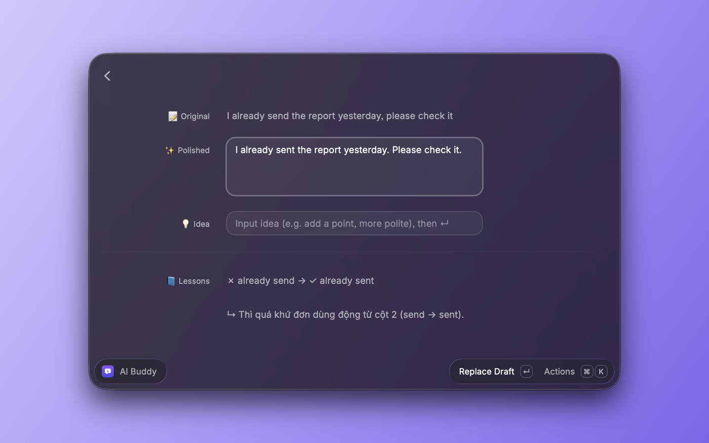
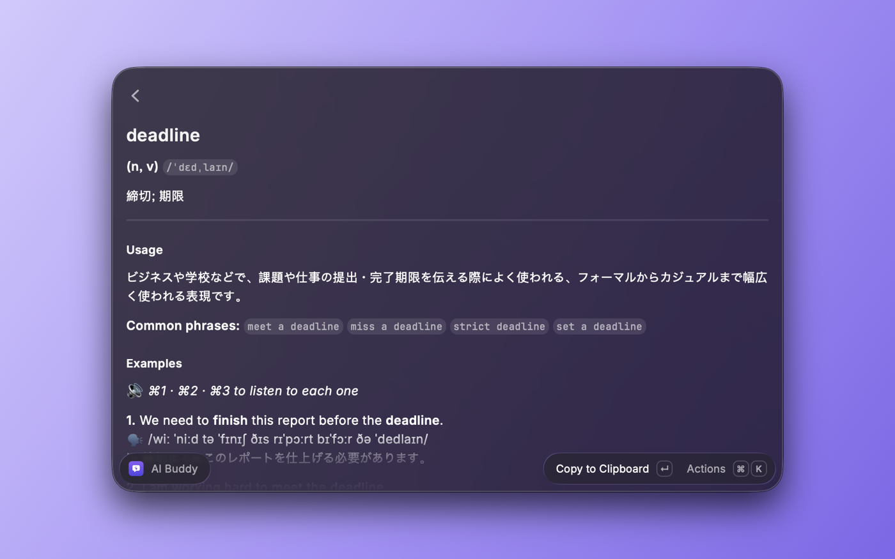
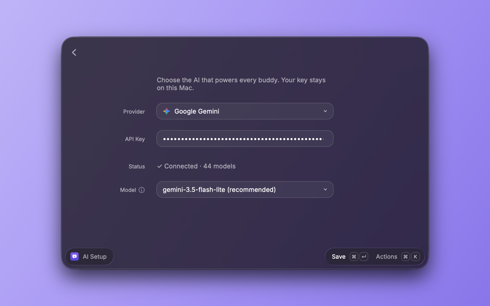
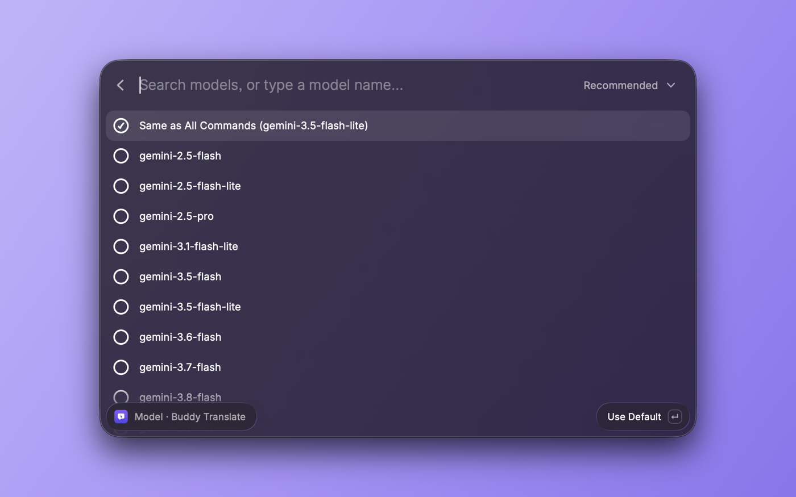
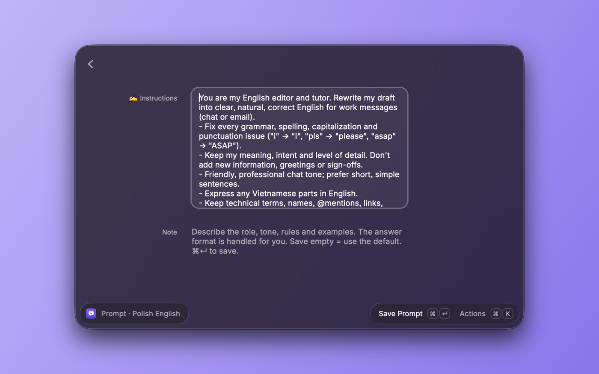

# AI Buddy

Read, reply and write English at work, and learn as you go, in your own language.

Select a message in any app, press a hotkey, and AI Buddy walks the whole chat loop with you: **understand** it, **reply** to it, **polish** your English, **send**. Every step teaches you something along the way.

## What makes it different

- **Learn while you work.** Look up a word and get a dictionary card: IPA, meaning, usage and examples you can listen to. Translate a sentence and the hard words come with IPA and meaning on the side. Polish a draft and get short grammar lessons, explained in your native language.
- **Replies in your words.** Type your idea in your own language (*"ok, but QA must finish first"*) and Buddy Draft Reply writes it in the language of the message, then revises with each new idea.
- **Fix it right in the chat box.** Turn on **Quick Replace** and Buddy Polish English swaps your selected draft for the polished one in place. ⌘Z undoes it. Leave it off when you want to see the lessons.
- **One flow, no reselecting.** **Continue with…** (⌘B) hands a result to the next buddy: translate a message, then draft the reply; translate your sentence into English, then polish it.

All from any app with a selection and a hotkey. Use Raycast AI with Raycast Pro (no key needed) or bring your own: Google Gemini, OpenAI, Claude, Groq, OpenRouter or a local model, with a different model per buddy and prompts you can edit.

## Learn as you go

Every polished draft comes with the mistakes it fixed and the rule behind each one, in your language:

Every word you look up gets a dictionary card with IPA, usage, common phrases and examples to listen to:

## Commands

| Command | What it does |
|---|---|
| **Buddy Translate** | English ⇄ your language. Words and short phrases get a dictionary card; sentences get a vocabulary panel with IPA. Read aloud with the macOS voice. |
| **Buddy Draft Reply** | Drafts a reply to the selected messages, in their language. Add an idea and it rewrites the draft around it. |
| **Buddy Polish English** | Makes your English draft correct and natural, with the lessons behind each fix. Or Quick Replace it in place. |
| **AI Buddy** | Run any buddy on typed text, check your API key, choose models and edit prompts. |

Assign hotkeys in Raycast Settings → Extensions → AI Buddy (suggested: ⌃⌘T Translate, ⌃⌘R Draft Reply, ⌃⌘E Polish English). With nothing selected, a form opens with the clipboard text ready.

## Setup

1. Open **AI Buddy** (any buddy opens it the first time). **AI Setup** asks for:
   - **Provider**: **Raycast AI** if you have Raycast Pro (no key to paste, chosen for you when available), or Google Gemini, OpenAI, Claude, Groq, OpenRouter, or **Custom** for any OpenAI-compatible server (your own proxy, Ollama, LM Studio). Custom also asks for its **API Host**, for example `http://localhost:11434/v1`.
   - **API Key** (not for Raycast AI): checked while you type; the status line says right away whether it works. A local server may need no key.
   - **Model**: picked from the provider's list, a fast, low-cost one by default.
2. In Raycast Settings → Extensions → AI Buddy, choose your **Native Language** (12 languages). Translate goes between English and it; meanings and lessons are written in it.

### Get an API key

Not needed for Raycast AI. For the other providers:

| Provider | Where |
|---|---|
| Google Gemini | [Google AI Studio → Get API key](https://aistudio.google.com/app/apikey) |
| OpenAI | [OpenAI Platform → API keys](https://platform.openai.com/api-keys) |
| Claude | [Anthropic Console → API keys](https://console.anthropic.com/settings/keys) |
| Groq | [GroqCloud → API keys](https://console.groq.com/keys) |
| OpenRouter | [OpenRouter → Keys](https://openrouter.ai/keys) |

To change the AI later, press ↵ on the **Connection** row at the top of AI Buddy. Each provider keeps its own key, so switching back needs no retyping.

**Speed** (on by default) asks the model to skip its thinking step, which makes answers faster. Turn it off if your model gives poor results.

## Customize

In **AI Buddy**, on a buddy:

- **⌘M** chooses its model.
- **⌘E** edits its prompt (tone, style, extra rules). The output format the extension needs is added automatically.
- **Reply Language** is under the Buddy Draft Reply command in Settings: *Match their language* (default) or *Always English*.
- **Quick Replace** (off by default) is under the Buddy Polish English command in Settings; ⌘⇧R on that buddy opens Settings.

### AI Setup, models and prompts

## Privacy

Text is sent only to the provider you choose: Raycast AI, or another provider with your own key. Word pronunciations come from Wiktionary via [dictionaryapi.dev](https://dictionaryapi.dev) (only the word is sent), otherwise from your provider. Your API keys, settings, chosen models and edited prompts stay on your Mac (keys in Raycast's encrypted local storage).
