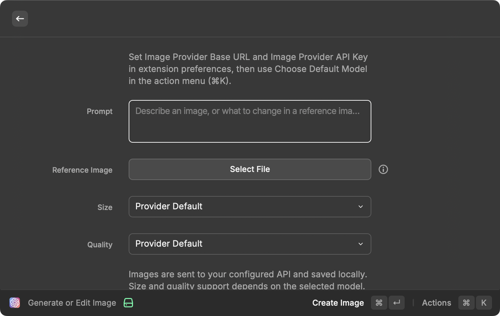

# OpenAI Image and Text Generator

The OpenAI Generator extension uses the OpenAI [Image Generation](https://beta.openai.com/docs/guides/images) API — colloquially known as [DALL·E 2](https://openai.com/dall-e-2/) — and the [Text Completion](https://beta.openai.com/docs/guides/completion) API to generate results from a text-based prompt.

## Usage

This extension provides 5 commands:

1. **Complete Text** - uses the GPT-3 AI models to generate a text completion that attempts to match whatever context or pattern you gave it
2. **Create Image** - uses the DALL•E AI model to generate new images
3. **Create Image Variation** - uses the DALL•E AI model to create a variation on an image you upload from your local disk
4. **Create Image Edit** - uses the DALL•E AI model to extend an image you upload using a mask
5. **Generate or Edit Image** - uses your chosen OpenAI-compatible image provider and model, with local saving and Raycast AI tools

## API Keys

In order to use OpenAI's APIs, you have to create an account and create [a new API key](https://beta.openai.com/account/api-keys). Once you have a key, paste it into the extension's settings.

Please make sure to [familiarize yourself](https://beta.openai.com/docs/guides/images/introduction) with the API's limits. While it's super fun to just start immediately generating images, the Create Image API is heavily rate-limited (you'll be limited to 10 images per minute, and 25 per 5 minutes) and even the Text Completion API can run up a bill if you push it hard enough.

When you create a free account, you're granted $18 worth of credits for 12 months. Once you blow through your free credits, you'll be blocked from making more requests until you enter billing information.

## [Pricing](https://openai.com/api/pricing/)

The DALL·E Create Image API is priced based on image dimensions:

| Size      | Price          |
| --------- | -------------- |
| 1024×1024 | $0.020 / image |
| 512×512   | $0.018 / image |
| 256×256   | $0.016 / image |

The [GPT-3](https://beta.openai.com/docs/models/gpt-3) Text Completion API is priced based on [token](https://beta.openai.com/tokenizer) usage:

| AI Model                | Price               |
| ----------------------- | ------------------- |
| Ada (Fastest)           | $0.0004 / 1K tokens |
| Babbage                 | $0.0005 / 1K tokens |
| Curie                   | $0.0020 / 1K tokens |
| Davinci (Most powerful) | $0.0200 / 1K tokens |

## Custom image providers and AI tools

**Generate or Edit Image** is a separate workflow. The existing four commands continue to use the original **API Key** and OpenAI endpoints. Existing keys stay under the same preference; custom-provider requests never fall back to the OpenAI key. Users of only the new workflow do not need an OpenAI key.

1. Set **Image Provider Base URL** (including the version path, e.g. `https://your-provider.example/v1`) and **Image Provider API Key** in extension preferences. No provider or model is preconfigured.
2. Open **Generate or Edit Image**, then **⌘K → Choose Default Model**. Select a discovered model or enter its exact ID manually. Model discovery is optional and does not establish Images API compatibility or generate a billable test image.
3. Enter a prompt. Optionally choose one PNG, JPEG, or WebP reference image to edit it. This workflow does not send a mask; the provider and model must support mask-free editing. Use **Create Image Edit** for the original OpenAI mask workflow.

The model selection is stored separately for each provider URL and key. Reopen the picker after changing provider settings. Images are saved to `~/Pictures/OpenAI Generator/`, or **Save Provider Images To**. Results support opening, copying, revealing in Finder, editing again, and **Save as…**. Save As keeps the original and refuses to overwrite another file or convert formats.

In Raycast AI Chat, select **OpenAI Generator** (`@ai-gen`) to use its generation and editing tools with the same custom-provider settings and saved model. Editing requires an accessible absolute local file path, with a confirmation showing the file, destination, model and instructions before upload. Chat attachments without local paths must be saved first or selected through the form. Local previews depend on Raycast; tool results also contain the file path.

### Provider contract and privacy

- Bearer authentication, `POST /images/generations` JSON and `POST /images/edits` multipart with `model`, `prompt`, `n: 1` and one `image` for edits.
- Optional `GET /models` with a `data[]` list; manual model IDs work without this endpoint.
- Responses must contain `data[0].b64_json` or an HTTPS `data[0].url` downloadable without authentication or redirects.
- HTTPS is required except for localhost. Size and quality are omitted when Provider Default is selected; other values depend on model support.
- PNG/JPEG/WebP references and results are limited to 50 MiB; JSON responses have a bounded limit allowing base64 overhead. Multiple reference images, masks, streaming and Chat Completions/Responses image protocols are not supported by the new workflow.
- Prompts and reference images go to the configured provider. Its key uses a Raycast password preference and is never sent to returned image URLs. No analytics or shared backend is added.
- Generation requests time out after five minutes and are not retried automatically: a provider may have charged for a request even when the client sees a timeout.

### Development and validation

Run `npm ci`, `npm run build`, `npm run check`, and `npm run lint`. The mock tests cover provider routing, credential separation, model discovery, multipart uploads, bounded responses and non-overwriting saves without calling a paid API.

Generation was confirmed with a real API in the original Image Atelier extension. On 2026-10-25, the integrated development command was opened in Raycast and its form layout was visually checked. Real-provider editing, interactive end-to-end checks and regression testing of the original commands under the upgraded SDK remain outstanding.

The following is an unmodified capture of the integrated command in development mode (including its local-extension indicator), not a Store-formatted screenshot or evidence of successful API generation/editing.

