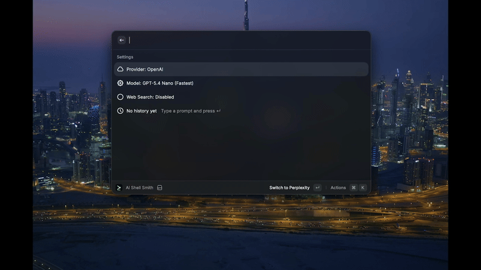

# ⚡️ AI Shell Smith

> Describe what you want in plain English — get a shell command worth running.

**AI Shell Smith** is a sharp little bridge between fuzzy intent and runnable CLI. Plug in OpenAI, Perplexity, local Ollama, or Raycast AI; optionally pull live docs via Context7 — then copy it or run it in your terminal.

🧠 Natural language → shell · 🔄 Smart cache · 📜 Persistent history · 🖥 Multiple terminals

---

## ✨ Why bother?

| You type…                            | You get…                                            |
| ------------------------------------ | --------------------------------------------------- |
| _“Show disk usage sorted by folder”_ | A real `du` / `dust` command, ready to tweak        |
| _“Bump version in package.json”_     | A focused one-liner, not ten tabs of Stack Overflow |

It’s opinionated toward **actually useful terminal work** — git, npm, Docker, macOS quirks, the usual suspects.

---

## 🚀 Setup

1. Open **Preferences** → **AI Shell Smith**
2. Pick a provider and drop in the right key

**Providers**

- 🤖 **OpenAI** — fast models + optional **GPT-5 Search** for web-grounded answers
- 🔮 **Perplexity** — `sonar-pro` out of the box
- 🦙 **Ollama** — local / self-hosted; API key optional
- ✨ **Raycast AI** — built-in, no API key (requires Raycast Pro)
- 📚 **Context7** _(optional)_ — feeds fresh library docs to the model before it answers [`context7.com`](https://context7.com)
- 📜 **Shell history** _(optional, off by default)_ — sends your last 10 commands as context; lines that look like secrets are skipped

**Power moves**

- ↵ **Convert** right away (or just pause typing for 2.5 s)
- ↵ on a history row **copies** the best command for your OS (or the OS your prompt names, e.g. "on ubuntu")
- ⌘**1**–⌘**3** **Copy an alternative** (another installer, package manager or OS — tagged in ⌘K)
- ⌘↵ **Run** in your favorite terminal (Warp, iTerm, Ghostty, WezTerm, Kitty, Alacritty, cmux, Terminal.app)
- ⌘⇧**E** **Execute** in your login shell and copy the output
- ⌘**E** **Refine** — "only files over 100 MB", "keep the originals"… and get an updated command
- ⌘**D** **Toggle details** — the command, what it does, risk, missing tools, alternatives
- ⌘⇧**X** **Drop** a line from history
- ⌘**L** **Jump** to preferences

---

## 🛡️ Safety (read this once)

AI suggests text; **you** decide what runs. Execution only happens when **you** choose it — nothing auto-runs in the background.

- 🟡 **Caution** tag: `sudo`, `rm`, `curl | sh`, file overwrites
- 🔴 **Destructive** tag: `rm -rf`, `dd`, disk erase, force push, `git reset --hard`, `DROP TABLE`… — running one asks for confirmation first
- 🟠 **needs X** tag: the command uses a program that isn't installed on this Mac

The rules catch the usual suspects, not everything — still read the command before you run it.

---

**Platform:** macOS (Terminal integration uses AppleScript).
