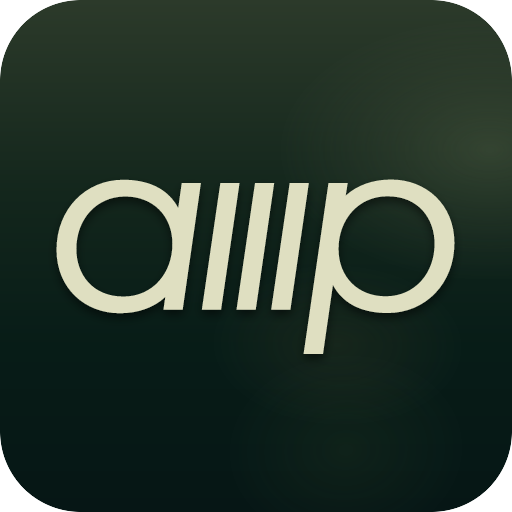
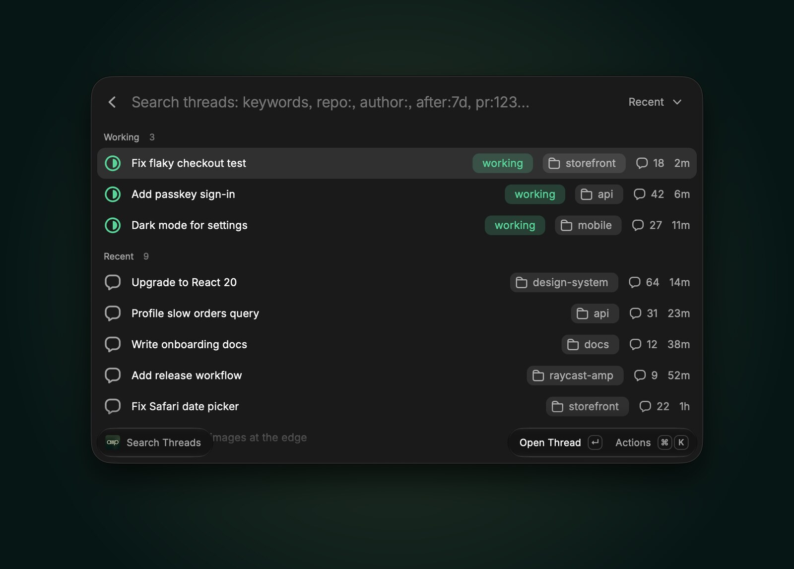
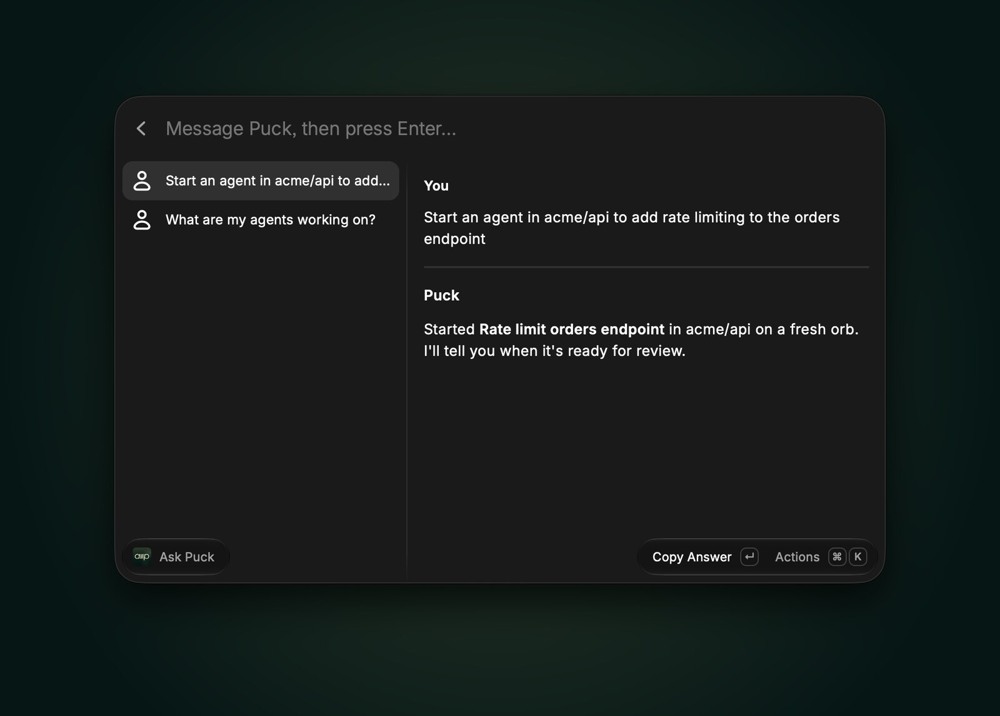
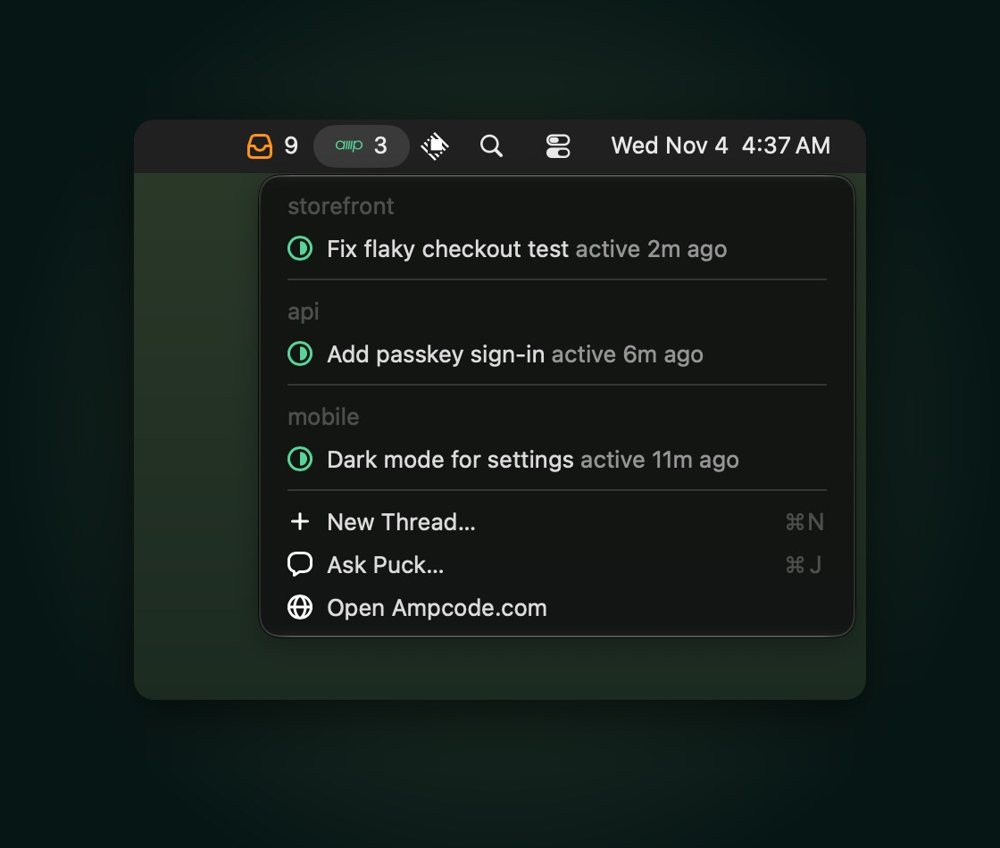
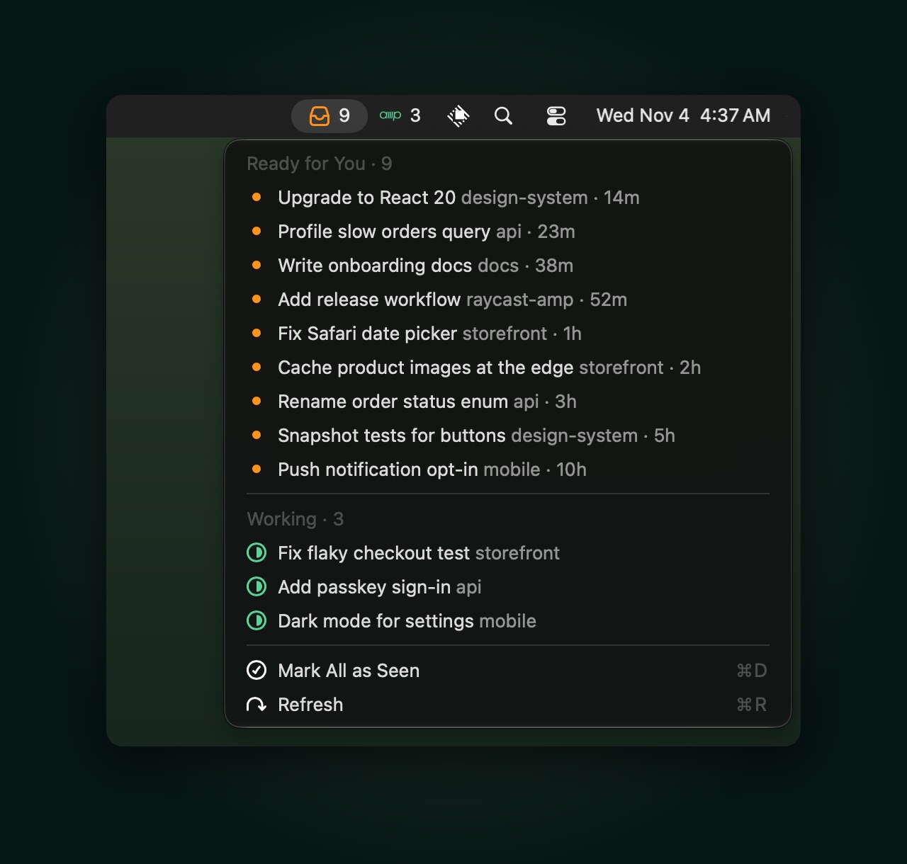
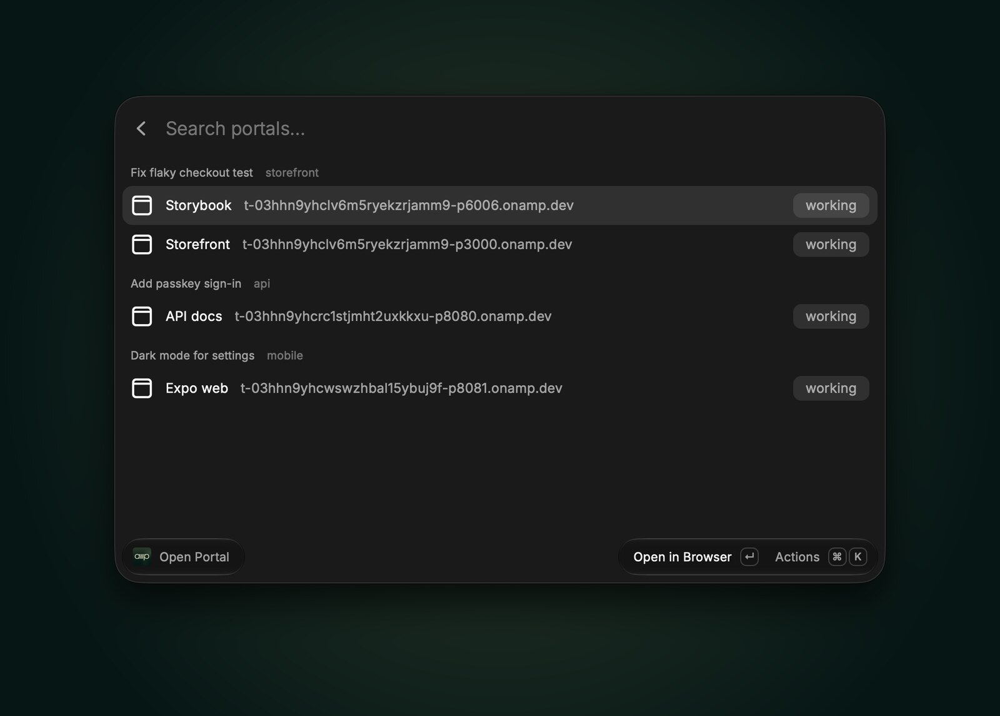
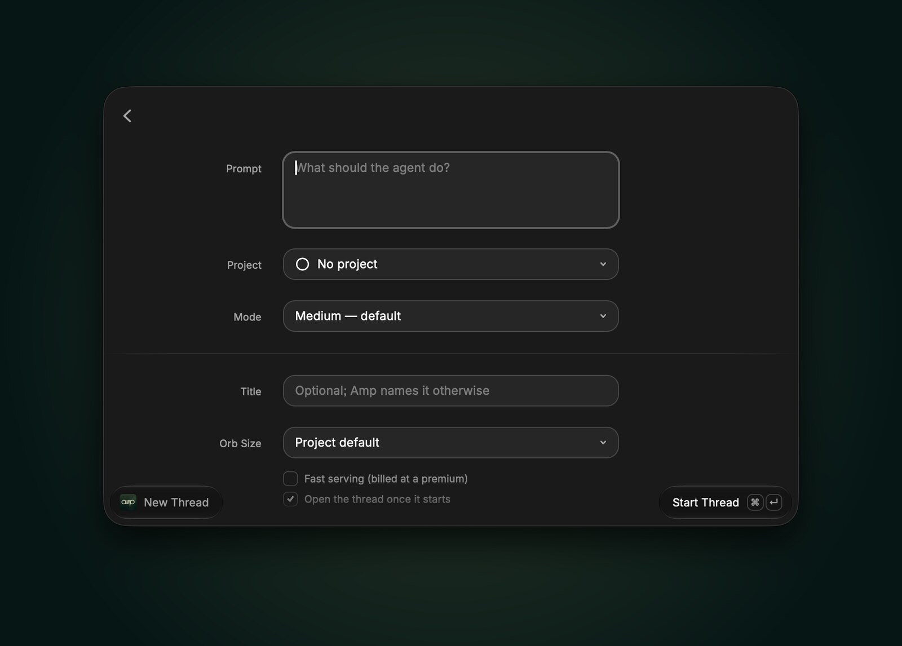
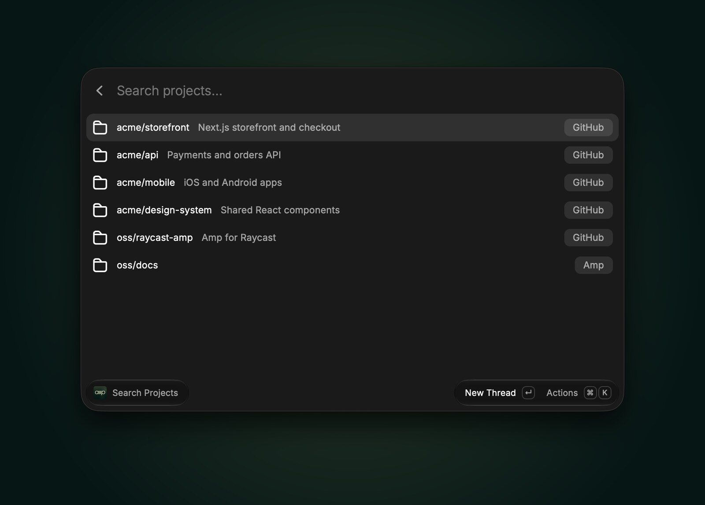

<h1 align="center">Amp for Raycast</h1>

Start, find, steer, and watch [Amp](https://ampcode.com) threads without leaving Raycast. Chat with Puck, see which agents are working from the menu bar, and jump into your orbs' portals.

  
  

> An unofficial, community extension. Not affiliated with Amp.

## Commands

| Command | What it does |
| --- | --- |
| **New Thread** | Form with prompt, project, mode, title, orb size, and Fast. Starts an orb thread, copies its URL, and opens it. |
| **Start Thread** | The same from the root search: `Start Thread <prompt> [project]`, using your default project and mode. |
| **Search Threads** | Amp's query syntax (`repo:`, `author:`, `after:7d`, `pr:`), quick filters, and one filter per project. Threads that are working right now stay on top and update live. Actions: open, send a message, read the transcript, copy the URL, `@T-…` mention, or `amp threads continue` command, rename, and archive. |
| **Thread Activity** (menu bar) | Inbox of threads that finished since you last opened them. Shows a HUD when a thread it saw working finishes. |
| **Currently Running** (menu bar) | How many agents are working right now, grouped by project. |
| **Ask Puck** | Chat with Puck: type in the search bar and press Enter. Continues your latest Puck conversation; ⌘N starts a new one. |
| **Call Puck** | Runs the *Call Puck* shortcut that the Amp Mac app adds. Without the app, opens ampcode.com, where ⌃⇧/ starts a call. |
| **Search Projects** | Your Amp projects. Start a thread in one or list its threads. |
| **Open Portal** | Portals of your running orbs. |

  
  

  
  

  

## Setup

Install the [Amp CLI](https://ampcode.com/install) and sign in with `amp login`. The extension finds the CLI on its own; if yours lives somewhere else, set **Amp CLI Path** in the extension preferences.

## Preferences

| Preference | Default | Notes |
| --- | --- | --- |
| Amp CLI Path | auto | Looks in `~/.amp/bin`, `~/.local/bin`, Homebrew, and `/usr/local/bin`. |
| Access Token | – | Only needed when the CLI isn't signed in. Create one at ampcode.com/settings/security. |
| Default Project | – | `namespace/name` for Start Thread when none is given. |
| Default Mode | Medium | Agent mode for new threads. |
| Open Threads In | Browser | Choose *Amp for Mac* to open links in the Mac app. |

## How it works

Everything goes through public Amp CLI commands: `threads list/search/export/markdown/rename/archive`, `projects list`, `--execute --orb-execute` to start and message threads, and `top --stream-jsonl` for live working state. No private APIs or stored credentials beyond the optional access token.

- **Puck** conversations are ordinary threads in `puck` mode. Ask Puck sends with `threads continue` and waits for the reply, using `amp top` to tell when Puck stops working.
- **Portals** have no CLI listing. Portal hosts embed the thread UUID in base36 (`t-<uuid36>-p<port>.onamp.dev`), so Open Portal reads the transcripts of threads whose orbs are connected and picks out URLs on their own hosts. Portals an agent never printed, and custom portal hostnames, don't appear.

