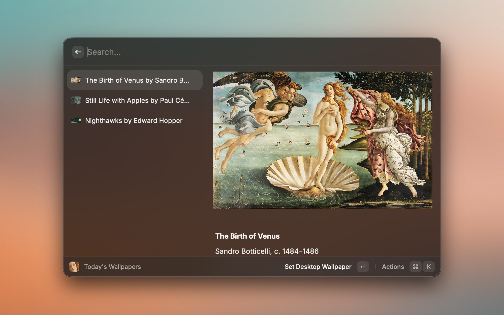
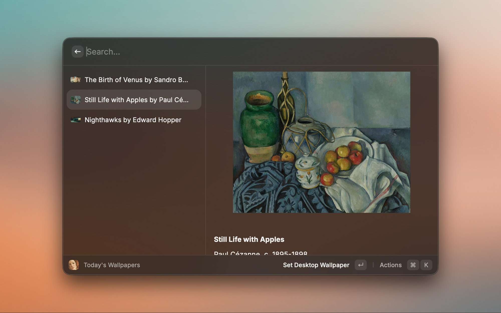
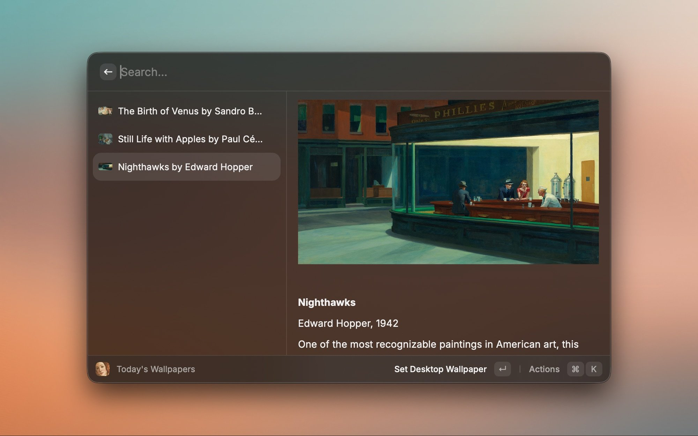

# Art Wallpapers

Another boring piece. Daily.

A Raycast extension for [anotherboring.day](https://anotherboring.day) — a daily wallpaper service of hand-picked fine art.

## What It Does

Browse and set wallpapers without leaving Raycast. The collection is classic paintings and artworks, all chosen by hand — no algorithmic slop.

## Commands

**Ask Art Wallpapers**

Use Raycast AI to browse today's artworks, find a random wallpaper, review your history, or set and download wallpapers.
Search history by words, artist, artwork year, usage dates, or action type, and set a wallpaper from the results. History date ranges include both days in your local timezone.

**Today's Wallpapers**

Shows the three most recent wallpapers. Preview them, see the details (title, artist, year), set one as your background, or download it.

**Set Random Wallpaper**

Instantly sets a random wallpaper. No UI, no prompts — just a fresh background.

**History**

Shows wallpapers you selected or downloaded, including automatic wallpaper switches, with options to set or download them again.
Each wallpaper appears once, ordered by its latest action. Its details show every recorded action and timestamp, newest first. Deleting an item removes all history entries for that wallpaper.

**Auto Switch Wallpaper**

Rotates your wallpaper on a schedule in the background. Pick the refresh interval (30 minutes, 1 hour, or 1 day) and optionally show a brief HUD when the wallpaper changes.

> Note: Raycast background commands run only while the Raycast app is open. If you quit Raycast, the schedule pauses until you reopen it.

## Requirements

None. The extension talks directly to the wallpaper service — no Mac app needed.

## Screenshots

