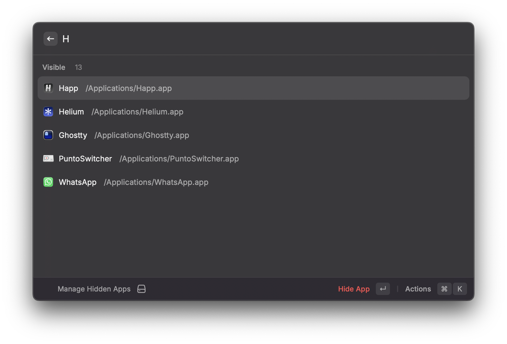

<p align="center">
  
</p>

<h1 align="center">App Hider for Raycast</h1>

<p align="center">
  Hide Mac apps from Launchpad, Spotlight and Finder — and bring them back with one keystroke.
</p>

<p align="center">
  
  
  
  
</p>

---

App Hider moves selected `.app` bundles out of `/Applications` into a hidden, Spotlight-excluded folder in your home Library. It also removes them from LaunchServices and refreshes Launchpad. You can still launch hidden apps from Raycast, and restore them to their original location at any time.

<p align="center">
  
</p>

> [!IMPORTANT]
> This is **concealment, not security**. Anyone with access to your user account can find hidden apps. For real access control, use a separate macOS account and FileVault.

## Contents

- [Features](#features)
- [Installation](#installation)
- [Usage](#usage)
- [Settings](#settings)
- [How it works](#how-it-works)
- [Limitations](#limitations)
- [Recovery](#recovery)
- [Development](#development)
- [License](#license)

## Features

- 🙈 **Hide and restore** any app from `/Applications` or `~/Applications`
- 🔍 **Out of Spotlight**: apps are stored in a `.noindex` folder
- 🚀 **Out of Launchpad**: unregisters apps from LaunchServices and refreshes Launchpad automatically, using the right method for your macOS version
- ▶️ **Launch hidden apps** straight from Raycast
- 🛑 **Safe with running apps**: offers to quit an app before moving it
- 🔐 **App Store apps**: system-owned bundles are moved with your administrator password, after confirmation
- ↩️ **Never loses an app**: every move is rolled back if the restore record can't be saved
- 🧹 Detects hidden apps that were deleted or moved manually and lets you clean up their records

## Installation

### From the Raycast Store

Open Raycast, run **Store**, search for **App Hider** and press <kbd>↵</kbd> to install.

### From source

**Requirements:** [Raycast](https://raycast.com) and [Node.js](https://nodejs.org) 22 or newer.

```bash
git clone https://github.com/LeonidAlekseev/app-hider-raycast.git
cd app-hider-raycast
npm install
npm run dev
```

Wait for the build to finish. **Manage Hidden Apps** then appears in Raycast. You can stop `npm run dev` with <kbd>Ctrl</kbd>+<kbd>C</kbd>, and the extension stays installed.

> [!NOTE]
> Keep the folder where it is. Raycast runs the extension from it.

### Grant permission

On macOS 13 Ventura and later, Raycast needs permission to move other apps:

1. Open **System Settings → Privacy & Security → App Management**.
2. If Raycast isn't listed, click **+** and add it from the Applications folder.
3. Turn Raycast on, then quit and reopen Raycast.

## Usage

Open Raycast and run **Manage Hidden Apps**. Apps are grouped into **Hidden**, **Missing** and **Visible**.

| Action | Shortcut | Available for |
|---|---|---|
| Hide App | <kbd>↵</kbd> | Visible apps |
| Launch App | <kbd>↵</kbd> | Hidden apps |
| Restore App | <kbd>⌘</kbd> <kbd>↵</kbd> | Hidden apps |
| Show in Finder | <kbd>⌘</kbd> <kbd>⇧</kbd> <kbd>F</kbd> | Hidden and visible apps |
| Remove Record | <kbd>↵</kbd> | Missing apps |
| Copy Path | <kbd>⌘</kbd> <kbd>K</kbd> menu | All |
| Refresh Launchpad Now | <kbd>⌘</kbd> <kbd>K</kbd> menu | All |
| Refresh List | <kbd>⌘</kbd> <kbd>R</kbd> | All |

Hiding and restoring always ask for confirmation first.

## Settings

Open **Raycast Settings → Extensions → App Hider**.

| Setting | Default | Description |
|---|---|---|
| Refresh Launchpad after hiding or restoring | On | Updates the app launcher right away so the change is visible. |

The refresh method depends on your macOS version:

| macOS | Command | Side effect |
|---|---|---|
| 15 Sequoia and older | `defaults write com.apple.dock ResetLaunchPad -bool true; killall Dock` | ⚠️ Resets Launchpad folders and icon order |
| 26 Tahoe and newer | `killall Spotlight` (Launchpad was replaced by the Apps view in Spotlight) | None |

## How it works

```
/Applications/Example.app
        │  hide
        ▼
~/Library/Application Support/App Hider/Hidden.noindex/Example.app
        │
        ├── folder name ends in .noindex   → skipped by Spotlight
        ├── chflags hidden                 → hidden in Finder
        ├── lsregister -u                  → removed from LaunchServices
        └── registry.json                  → original path, used for restore
```

- Apps are moved with an atomic `rename` on the same volume. Nothing is copied, so signatures and extended attributes stay intact.
- Only real top-level bundles are listed. Symlinks are skipped.
- `/System/Applications` and other protected system locations are never touched.

## Limitations

- **Launching a hidden app re-registers it** with LaunchServices, so it may show up in Launchpad again until you restore and hide it once more.
- **Raycast's own root search** may still list hidden apps. Disable them under Raycast Settings → Extensions → Applications.
- Apps may stop updating while hidden. This mostly affects apps with auto-updaters, privileged helpers, login items or hard-coded paths.
- Spotlight and Launchpad caches can take a moment to refresh.
- App names can still appear elsewhere: recent items, logs, app databases, backups and other search tools.

## Recovery

If Raycast is unavailable, open the hidden folder in Finder:

```bash
open "$HOME/Library/Application Support/App Hider/Hidden.noindex"
```

Drag the app back to its original location. `registry.json` in the same folder lists the original path of each app. Moving system-owned apps may require your administrator password.

> [!TIP]
> Upgrading from the first version? The old `Hidden` folder is renamed to `Hidden.noindex` automatically on first launch.

## Development

```bash
npm run dev       # develop with hot reload
npm run build     # production build into dist/
npm run lint      # lint with Raycast rules
npm run fix-lint  # auto-fix lint issues
```

All logic lives in [`src/manage-apps.tsx`](src/manage-apps.tsx). The icon source is [`media/extension-icon.svg`](media/extension-icon.svg); export it to `assets/extension-icon.png` at 512×512.

## License

[MIT](LICENSE)
