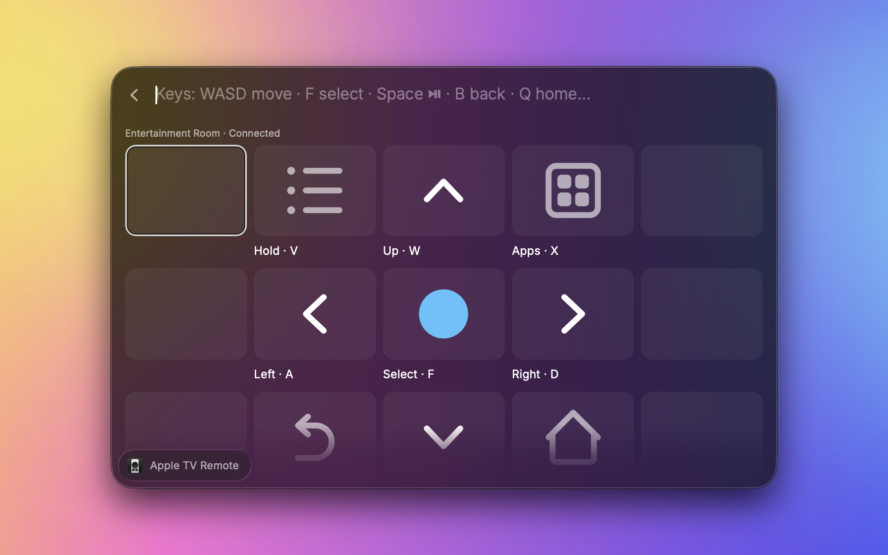
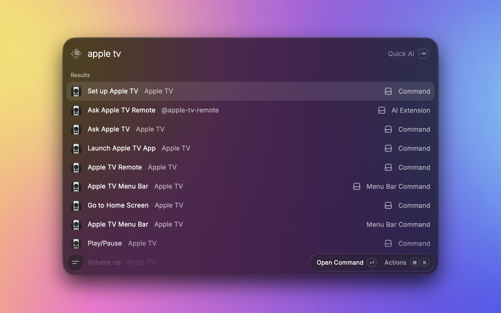

# Apple TV Remote

Control your Apple TV from Raycast. No Python, no helper apps, nothing to install beyond the extension. It talks to the Apple TV directly over Apple's Companion protocol in pure TypeScript.



## Features

- **Apple TV Remote.** A clickable on-screen remote that keeps one live connection open, so every press lands instantly. D-pad, select, back, home, hold-select context menu, app switcher, Control Center, playback, 10-second skip, and typing into TV search fields.
- **Launch Apple TV App.** A grid of the apps on your Apple TV. Open any of them, or save one as a hotkey-able Quicklink.
- **Ask Apple TV.** One-off natural language, like `pause`, `open netflix`, `play severance`, `play the latest MKBHD video`, `what's playing`, `type stranger things`, or `sleep`.
- **Menu bar.** Quick taps for play/pause, skip, navigation, opening apps, and sleep/wake, plus one click through to the full remote.
- **Per-key hotkey commands.** Every remote function is also its own command (most are off by default). Enable the ones you want and give them global hotkeys.
- **AI tools.** Drive it from Raycast AI, like `@apple-tv-remote pause` or `@apple-tv-remote play Rick and Morty on Netflix` (needs Raycast Pro).



## Setup

1. Run **Set up Apple TV**.
2. Pick your Apple TV from the list, or add it by IP and port if discovery is blocked on your network.
3. Type the 4-digit PIN that appears on the TV.

Pairing is interactive because the Apple TV shows the PIN on screen, which is why setup is a command rather than an extension preference.

## The remote

Open **Apple TV Remote** and either click the buttons or use the keyboard.

| Control                    | Bare key                             | With ⌥              |
| -------------------------- | ------------------------------------ | ------------------- |
| Navigate                   | `W` `A` `S` `D` (or `H` `J` `K` `L`) | `⌥↑` `⌥↓` `⌥←` `⌥→` |
| Select                     | `F` (or `G`)                         | `⌥↩`                |
| Back                       | `B`                                  | `⌥⌫`                |
| Home                       | `Q`                                  |                     |
| Play/Pause                 | `Space`                              | `⌥P`                |
| Skip 10s                   | `,` / `.`                            |                     |
| Previous / Next            | `[` / `]`                            |                     |
| Context menu (hold select) | `V`                                  |                     |
| App switcher               | `X`                                  |                     |
| Control Center             | `C`                                  |                     |
| Type text on TV            | `T`                                  |                     |
| Screensaver                |                                      | `⌥S`                |

The bare keys work because the view treats your typing as button presses, so no modifiers are needed. Volume has optional hotkey commands (`Volume Up` and `Volume Down`), but they only do anything when the Apple TV controls volume over HDMI-CEC. Most TVs handle volume themselves.

## Playing a show

`play <title> [on <app>]` looks the title up on JustWatch, prefers a streaming service installed on the Apple TV (the closest signal to a subscription), and opens the title there. It does not guess at app IDs. Netflix ignores deep links on tvOS and keeps its catalog out of Apple TV Search, so for Netflix the extension types the title into Netflix's own search and opens the top result, accepting the highlighted profile if Netflix asks for one. Titles that do not resolve go to the Apple TV's universal Search. By default it then presses the title page's Play button, which resumes from the last episode watched in Netflix, Disney+, and Max, and confirms playback started from the Apple TV's own now-playing reports before saying so. The **Play Automation** preference can stop at the title page instead.

YouTube requests skip all of that. `play <query> on youtube` plays YouTube's top result, and `play the latest <channel> video` plays that channel's newest full-length upload.

## Preferences

- **Streaming Country.** Two-letter code for the where-to-watch lookup. Leave it blank to detect your Mac's region.
- **Play Automation.** How far `play <title>` goes once it finds the title: press Play or Resume (the default), stop on the title page, or only type the title into search. Apps not known to land on a Play button or a profile picker stay on the title page, and a purchase is never started.

## How it works

The extension speaks Apple's Companion protocol, the same one the iOS Remote uses, straight from Raycast's Node runtime through [`@bharper/atv-js`](https://github.com/bsharper/atvjs), a pure-TypeScript port of [pyatv](https://pyatv.dev). Discovery is Bonjour, pairing is HAP SRP with the on-screen PIN, and the session is chacha20-poly1305 encrypted. App launching, app listing, sleep/wake, Control Center, hold-select, and 10-second skip are built on top of the library in this extension, ported from pyatv's reference implementation.

### Credential storage

Pairing produces machine-generated key material rather than a password you type, so it lives in Raycast's encrypted [LocalStorage](https://developers.raycast.com/api-reference/storage), scoped to this extension. The extension never touches the macOS Keychain, and it sends nothing off your local network. Its only internet requests are title lookups: JustWatch for shows and movies, and youtube.com for YouTube requests.

## Development

```bash
npm install
npm run dev      # ray develop, hot-reloads into Raycast
npm run lint     # ray lint
npm run build    # ray build
```

| Module                                 | Role                                                                                              |
| -------------------------------------- | ------------------------------------------------------------------------------------------------- |
| `src/lib/actions.ts`                   | Every remote action by id, with phrases and HUD text; all commands, tools and views dispatch here |
| `src/lib/connection.ts`                | `openConnection()` with timeout and error classification, plus per-command `withConnection()`     |
| `src/lib/use-persistent-connection.ts` | One live session for the remote view: wakes the TV, coalesces connects, tracks drops              |
| `src/lib/companion-extras.ts`          | Companion requests ported from pyatv (refusal checks, launch app, app list, HID press, skip)      |
| `src/lib/apps.ts`                      | Curated app catalog (bundles, providers, deep-link quirks), installed-app cache, launch by name   |
| `src/lib/play-flow.ts`                 | Deep link, then universal-search typing, then app launch                                          |
| `src/lib/justwatch.ts`                 | Title to deep-link resolution (keyless GraphQL, cached)                                           |
| `src/lib/pairing.ts`                   | The paired device and its credentials (JSON in LocalStorage)                                      |
| `src/lib/errors.ts`                    | Errors that carry their own toast title and "Set up" action                                       |

## Credits

- [pyatv](https://pyatv.dev) by Pierre Ståhl (MIT). The reference implementation and protocol docs this extension is built on. The Companion payloads for app launching, app listing, power, and gestures are ported from it.
- [`@bharper/atv-js`](https://github.com/bsharper/atvjs) by Brian Harper (MIT). The TypeScript Companion-protocol port, itself derived from pyatv (© Pierre Ståhl).

See [NOTICE](NOTICE) for third-party license details.

## License

MIT
