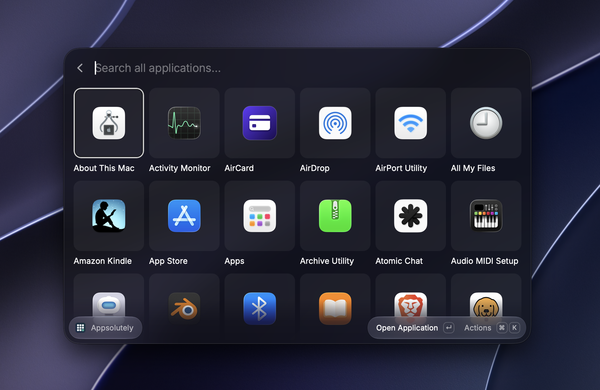

<h1 align="center">
  Appsolutely
</h1>

**Miss good old App Launchpad before macOS 27?**

A Launchpad-inspired launcher for Raycast.



## Features

Open Raycast and select **Open Appsolutely**. Arrow keys select a tile; Return opens the application or folder. Escape clears active search first, then returns to the parent folder.

Browse applications in a compact eight-column **Grid**, a six-column **Grid (Large)** with app names, high-resolution icons and folder previews, or a **List** with application and folder names. Grid items also show their names in hover tooltips; typing searches all installed applications, including apps inside folders.

Home shows apps recently opened through Appsolutely above your organized apps: up to three in List, or one row in either Grid view. Recent history starts accumulating after this version is installed.

Use the **Grid / Grid (Large) / List** selector at the top right, or cycle views through the Action Panel (**⌘⇧V**). Appsolutely remembers your choice across Home, folders, search, and future launches.

## Organize your apps

- Open the Action Panel with **⌘K** for the selected app or folder.
- **Create Folder** makes a folder at Home; inside a folder this becomes **Create Subfolder**.
- **Move to Folder** opens a searchable destination picker, with full folder paths. Select **Appsolutely / Home** to move an app to root.
- Folders also have **Create Subfolder**, **Rename Folder**, **Move Folder**, and **Delete Folder** actions. Moving a folder preserves its contents. Moving it into itself or any descendant is prevented.
- Deleting a folder deletes its subfolders and returns all contained apps to Home. It never deletes or uninstalls an application. Deletion and layout reset require confirmation.
- Empty folders offer the same global actions as populated grids.
- In **Grid (Large)**, folder icons preview up to nine applications, including apps in nested subfolders. Previews update automatically as you organize apps. Empty folders and the other view modes use the standard folder icon.

| Shortcut | Action                                          |
| -------- | ----------------------------------------------- |
| Return   | Open application or folder                      |
| ⌘K       | Open Action Panel                               |
| ⌘N       | Create folder in the current location           |
| ⌘⇧M      | Move the selected application or folder         |
| ⌘⇧U      | Return selected application to root             |
| ⌘E       | Rename selected folder                          |
| ⌘Return  | Show selected application in Finder             |
| ⌘⇧F      | Open Search All Applications                    |
| ⌘R       | Refresh installed applications                  |
| ⌘⇧V      | Cycle Grid, Grid (Large), and List views        |
| Escape   | Clear search / return through native navigation |

Your app organization is saved locally. Resetting the layout keeps your selected view. See [Privacy](docs/PRIVACY.md) for details about local data.

## Run locally

Requires macOS, Raycast, and Node.js **24 or newer** with npm.

```sh
npm ci
npm run dev
```

With development running, open Raycast and select **Open Appsolutely**.

## Development and validation

```sh
npm test                 # Node's built-in runner; no test dependencies
npm run typecheck
npm run lint             # Official Raycast manifest, icon, and ESLint validation
npm run build            # Official Raycast production build
npm run benchmark        # Synthetic assignment and icon-store benchmarks
npm run format
node scripts/generate-icon.mjs  # Regenerate the 512×512 extension icon
```

Tests cover hierarchy operations, deep nesting, cycle prevention, application discovery and identity, search, serialization, schema migration, recovery backups, future-version protection, save failures, and concurrent actions.

The performance workflow compares pull requests with their base revision and pushes to `main` with the preceding commit. It reports median assignment lookup time and simulated icon-store work in the GitHub Actions summary. The comparison fails on large lookup regressions or increased icon work; it does not measure Raycast UI or native icon extraction. To compare locally, run `npm run benchmark -- /path/to/baseline-checkout` with Node 24 or newer.

Source layout:

```text
src/launcher.tsx              Command entry
src/components/              Native grid, items, folder forms, destination picker, actions
src/hooks/                   Shared catalog and layout subscriptions
src/models/                  Application, folder, and storage types
src/services/                Discovery, application identity, storage codec, save queue
src/utils/                   Folder operations and sorting
src/__tests__/               Pure-logic and persistence tests
assets/extension-icon.png    Original 512×512 icon
```
