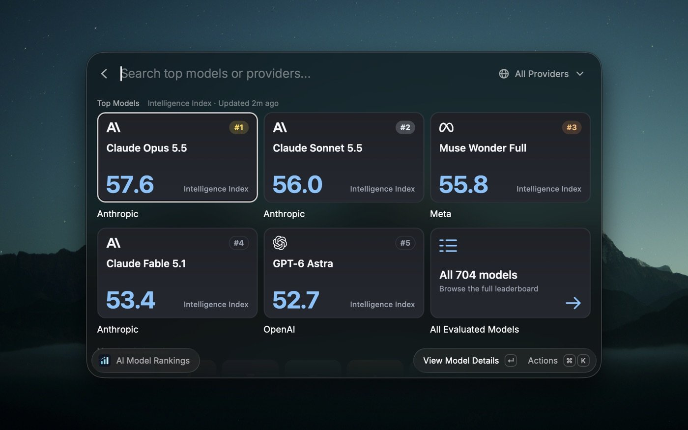
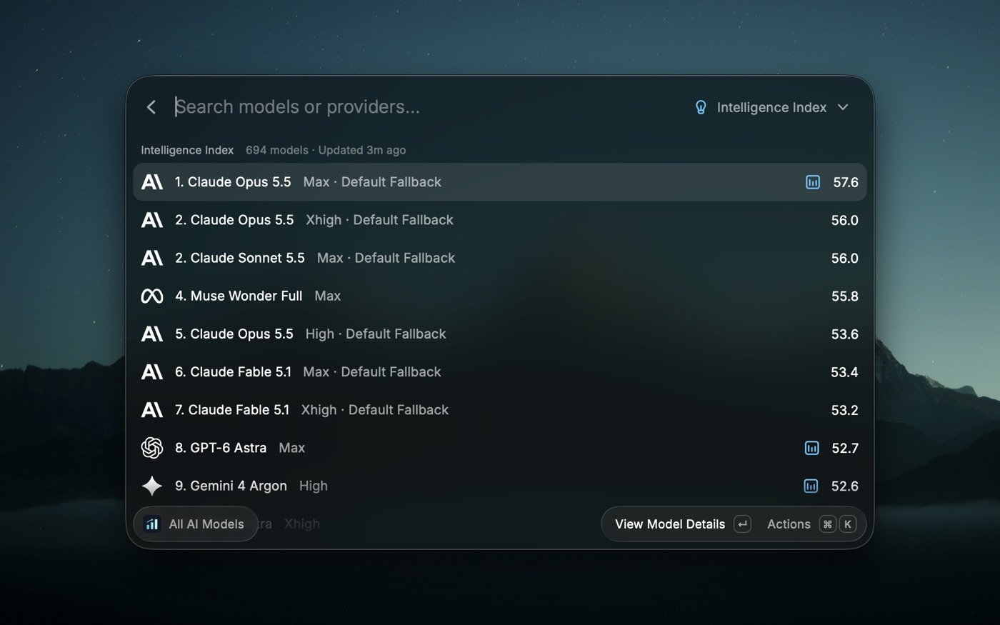
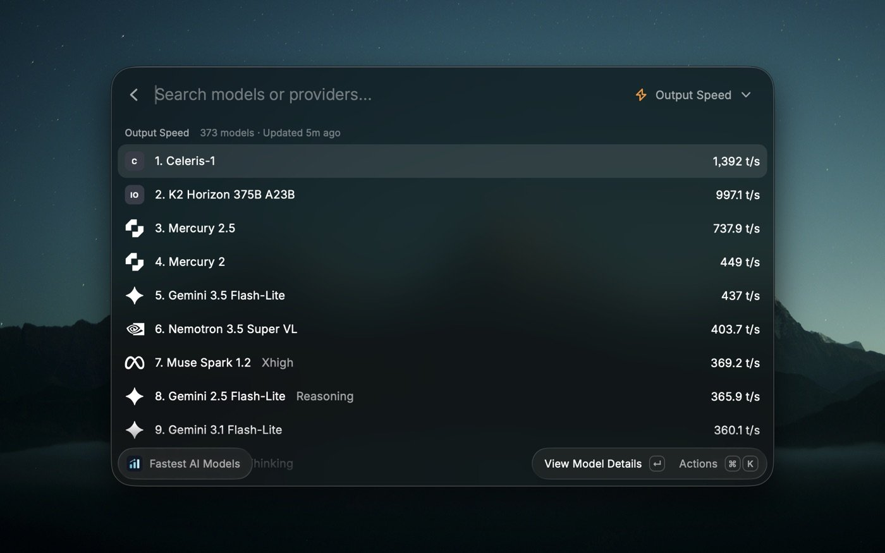
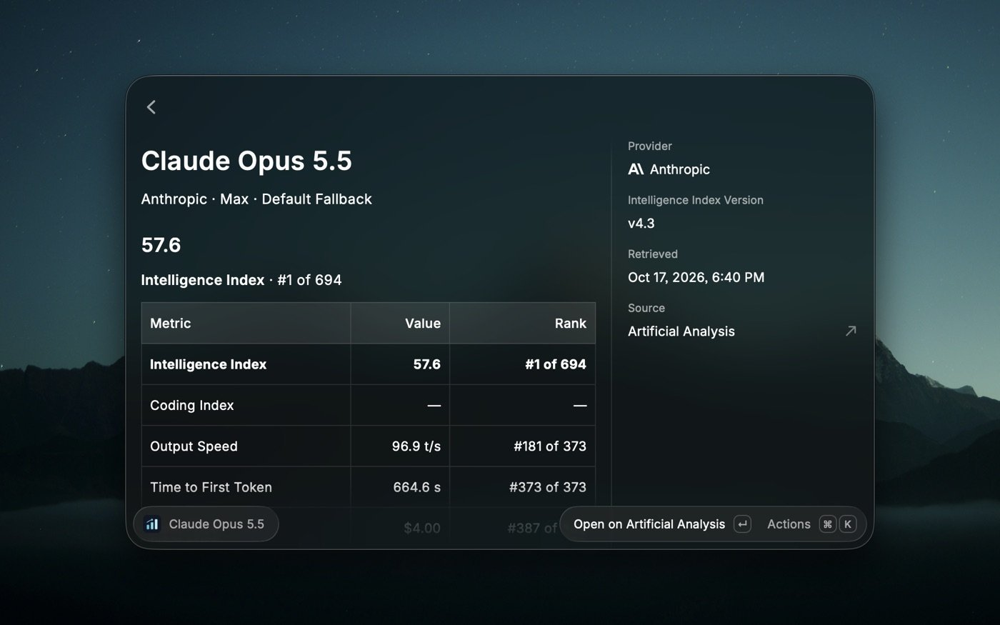
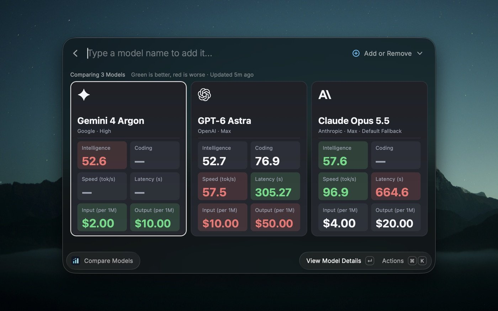

  

<h1 align="center">Artificial Analysis for Raycast</h1>

  Compare AI models by intelligence, coding, speed, latency, and price, without leaving Raycast.

  
  
  

## Features

- **Top models at a glance:** the five strongest model families on the Intelligence Index.
- **Six leaderboards:** intelligence, coding, output speed, latency, input price, and output price.
- **Model details:** every metric for a model, with its rank against all others.
- **Side-by-side comparison:** up to four models in columns, with better values in green and worse in red.
- **Favorites and filters:** star models, filter by provider, and search by name.

## Screenshots

**Top models:** the five strongest model families, with a link to every ranking.

**Full ranking:** every model ranked by Intelligence Index, with its configuration beside the name.

**Other leaderboards:** switch the metric with `⌘ P`, here ranking models by output speed.

**Model details:** every metric for a model, with its rank against all others.

**Compare models:** up to four models side by side, with better values in green and worse in red.

## Setup

1. Create a free API key at [Artificial Analysis](https://artificialanalysis.ai/api-key-management-redirect).
2. Open **AI Model Rankings** in Raycast, press `↵`, and paste the key into the extension preferences.

The preferences also let you choose which statistics appear in model details.

## Comparing Models

Open **Compare Models**, or the **Compare** tile on the dashboard. Each model gets its own card with every metric in large type: green marks the best value and red the worst. Two models get large cards; with three or four, the columns narrow so everything stays in view. Add or remove models from the small **Add or Remove** menu beside the search bar, or type a model name to add it.

## Commands

| Command               | Shows                                                    |
| --------------------- | -------------------------------------------------------- |
| AI Model Rankings     | The top five models, with shortcuts to every leaderboard |
| All AI Models         | Every model, ranked by Intelligence Index                |
| Best Coding Models    | Models ranked by Coding Index                            |
| Fastest AI Models     | Models ranked by output tokens per second                |
| Lowest Latency Models | Models ranked by time to first token                     |
| Model Pricing         | Models ranked by input or output price per 1M tokens     |
| Compare Models        | Up to four models side by side, best and worst marked    |

## Keyboard Shortcuts

| Shortcut | Action                                             |
| -------- | -------------------------------------------------- |
| `↵`      | View model details                                 |
| `⌘ ↵`    | Open the model on Artificial Analysis              |
| `⌘ P`    | Switch the ranking metric, or the dashboard filter |
| `⌘ D`    | Show or hide the details panel                     |
| `⌘ .`    | Add or remove a favorite                           |
| `⌘ ⇧ C`  | Copy a model summary                               |
| `⌘ R`    | Refresh rankings                                   |

## Privacy

Your API key is stored by Raycast and sent only to Artificial Analysis. Rankings are cached locally and refreshed when they are more than an hour old.

## Credits

Data from [Artificial Analysis](https://artificialanalysis.ai/). This is an independent project, not affiliated with Artificial Analysis. Provider logos from [Lobe Icons](https://github.com/lobehub/lobe-icons) (MIT). Released under the [MIT License](LICENSE).
