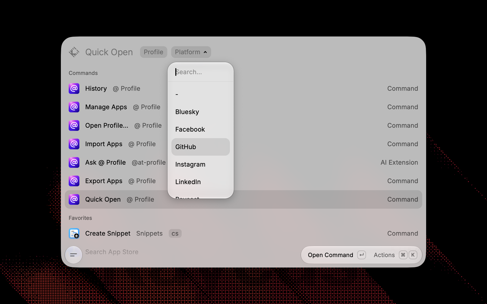

# @ Profile

<div align="center">
  <a href="https://github.com/chrismessina">
    
  </a>
  <a href="https://github.com/chrismessina/raycast-at-profile/stargazers">
    
  </a>
  <a href="https://www.raycast.com/chrismessina/at-profile">
    
  </a>
</div>

Quickly visit social profiles. Access a history of the profiles you visit and add your favorite social apps.



## Features

- **Open Profile Command**: Quickly open profiles across multiple social apps
- Support for profiles, handles, and profile IDs
- **Find Profile Command**: Find the sites where a username has a profile
- **Manage Apps Command**: Add and remove custom social apps, or import them from the catalog

Includes support for major social apps:

- X, Instagram, LinkedIn, GitHub, Reddit, YouTube, and more

## Usage

### Quickly Open Profile

1. Use the "Quick Open" command
2. Enter a Profile identifier
3. Select your desired app from the dropdown
4. Press Enter to open the profile in your browser

### Open Profile

1. Use the "Open Profile" command
2. Enter a Profile identifier
3. Select your desired app from the dynamic dropdown
4. Press Enter to open the profile in your browser

### Find Profile

1. Use the "Find Profile" command, with or without a username
2. Type a username and press Return
3. Results come in as each site answers: Found, Couldn't Check (the site refused or didn't answer), Not Checked (the site can't be checked, so open it to see), and Not Found
4. Choose Search Everywhere (⌘⇧Return) to check every site in the catalog that answers reliably. History has the same action on each profile.

Once results arrive, the search bar filters them; type a new username and press Return to search again. Ask AI can search too: "@at-profile where does nickelback have profiles?"

Each site's answers are tested before they're trusted: the catalog sync checks it with a username that exists and one that doesn't. A site that gives a wrong answer is never checked, only opened. Search Everywhere adds only the sites that answered both correctly.

## Managing Apps

1. Use the "Manage Apps" command to access the management interface
2. **Default Apps**: Show/hide built-in apps
3. **Custom Apps**: Add, edit, and remove custom apps; manage visibility
4. **YAML Settings**: Export/import your configuration for backup or sharing

### Adding Custom Apps

1. In the "Manage Apps" command, select "Add Custom App"
2. Fill in the app details:
   - **Name**: Display name for the app
   - **URL Template**: Template with `{profile}` placeholder (e.g., `https://example.com/user/{profile}`)
3. Save and the app will be immediately available

### Importing from the Catalog

Manage Apps' "Import from Catalog…" (⌘⇧N) lists the sites in the [Sherlock project's](https://github.com/sherlock-project/sherlock) catalog. Each shows whether Find Profile can check it. NSFW sites are labeled, and hidden unless you turn on Include NSFW Apps in the extension's preferences.

### Updating the Catalog

Import from Catalog's "Update Catalog" (⌘R) downloads Sherlock's latest list and tests every site from your own connection, which takes about half a minute. The result replaces the catalog that ships with the extension.

### Platforms

A custom app on a Mastodon server, Lemmy instance, Discourse forum or GitLab server is checked through that software's own API, with its username rules. When you leave a custom app's URL field, @ Profile asks the site which software it runs and fills in the Platform field; you can also pick it yourself, and saving never waits for the answer.

Apps on the AT Protocol (Bluesky, Blacksky and others) are checked with [Slingshot](https://slingshot.microcosm.blue)'s handle lookup, which finds an account on any server. Pick "AT Protocol" by hand and give the app's handle domain, so a bare name like `example` means `example.bsky.social`.

### YAML Configuration

Export your settings to YAML format for:

- Backing up your custom apps, including visibility settings
- Sharing configurations with team members
- Version control of your app settings

## Credits

The site catalog comes from the [Sherlock project](https://github.com/sherlock-project/sherlock), MIT License, Copyright (c) 2019 Sherlock Project. The platform checks are this extension's own, inspired by [social-analyzer](https://github.com/qeeqbox/social-analyzer)'s shared detections.

## Development

### Architecture

The extension now uses a dynamic app system:

- App data is managed through `src/helpers/apps.ts`
- Custom apps are stored using Raycast's local storage
- App settings (show/hide) are persisted separately

### Adding Built-in Apps

To add new default apps, edit `src/utils/default-apps.ts`:

```typescript
export const defaultApps: App[] = [
  // ... existing apps
  {
    name: "New App",
    value: "newapp",
    urlTemplate: "https://newapp.com/{profile}",
    placeholder: "username",
  },
];
```
