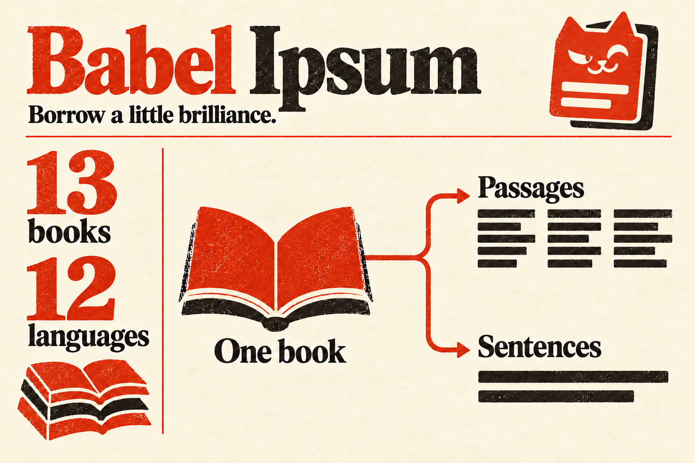

# Babel Ipsum

**Borrow a little brilliance.**

Generate placeholder text from **13 classic books in 12 languages**. Pick a book, choose sentences or passages, and copy or paste. All offline in Raycast for macOS.

## Use

1. Open **Generate Sentences** or **Generate Passages** in Raycast.
2. Choose a book and enter how many sentences (1–20) or passages (1–10) you want.
3. Press **Enter** to copy. Use **Actions** to paste into the active app, or **⌘R** to regenerate.

Preview the text and its word and character counts before copying. Passages preserve poetry and dialogue line breaks. **Information** shows the selected book's edition, source, and attribution. **Copy with Attribution** includes these details when needed.

## Settings

In **Raycast Settings → Extensions → Babel Ipsum**, choose your default book, sentence and passage counts, and whether Enter copies or pastes.

The defaults are Cicero's _De finibus bonorum et malorum_, Book I, three sentences or passages, and Copy to Clipboard.

## More

- [Books, sources, and attribution](NOTICE.md)
- [Development, corpus rebuilds, and publishing](https://github.com/frovere/babel-ipsum/blob/3897a81732fa88ade7c72a0c72fe8c93de9b571f/DEVELOPMENT.md)

Code is [MIT licensed](LICENSE); book text follows its [source terms](assets/corpus-license.txt).
