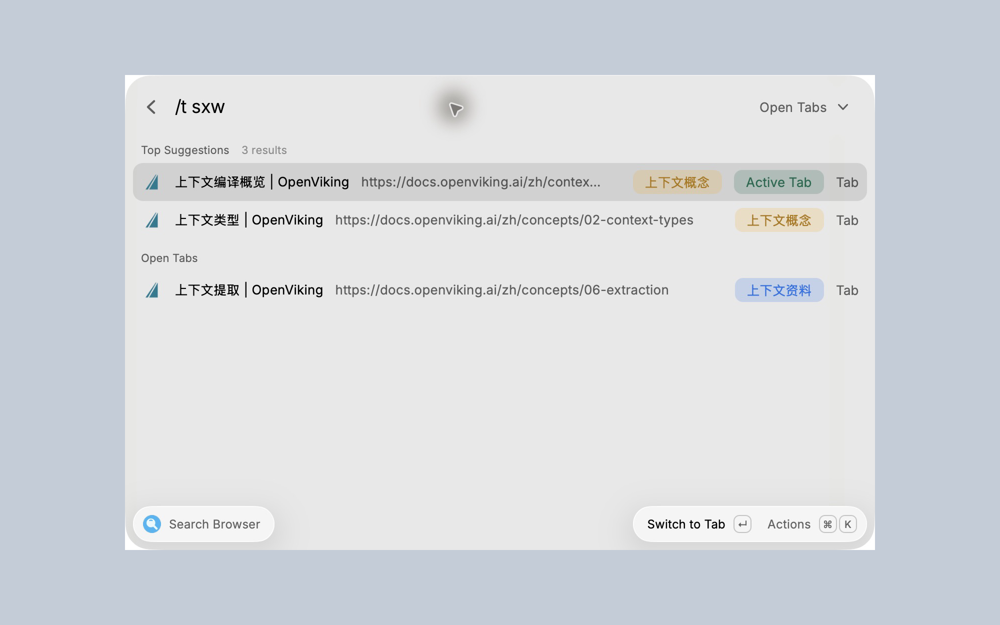
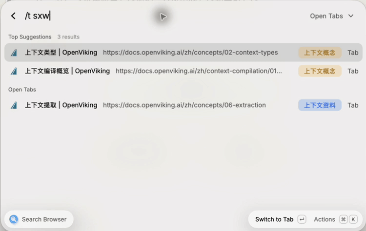
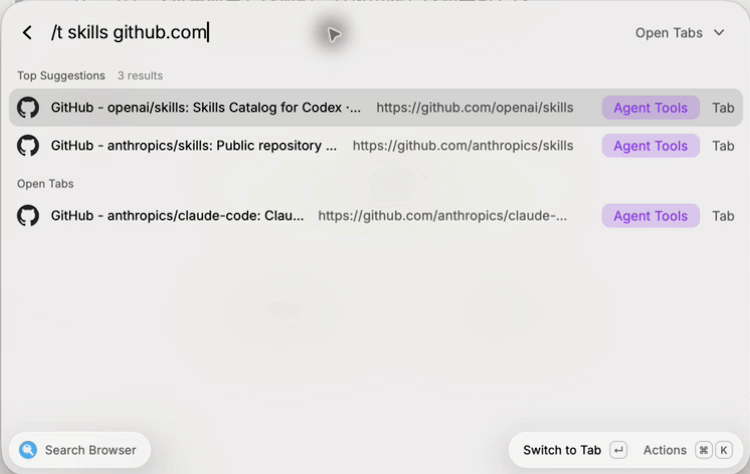
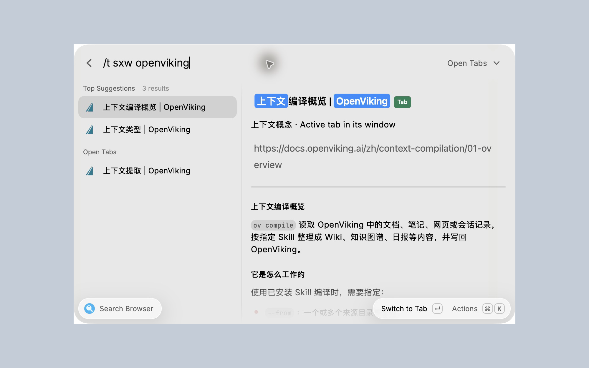
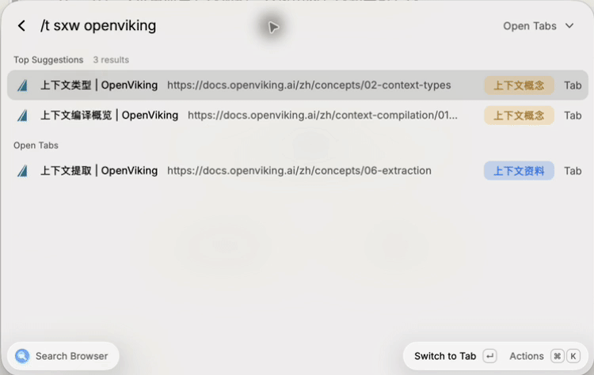
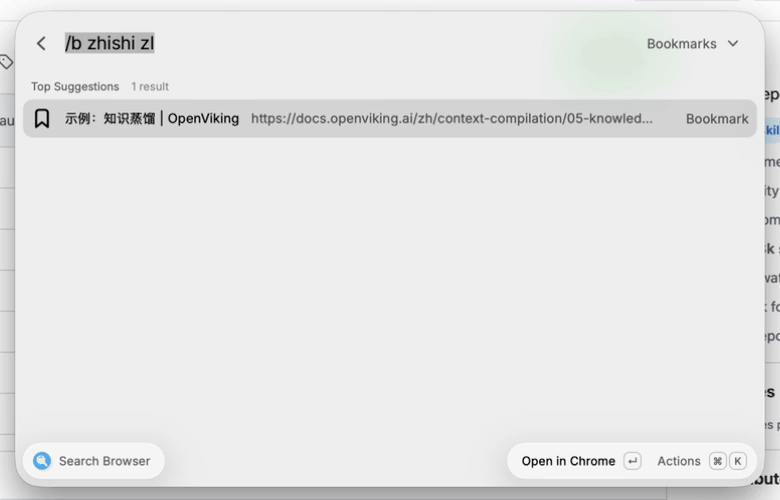
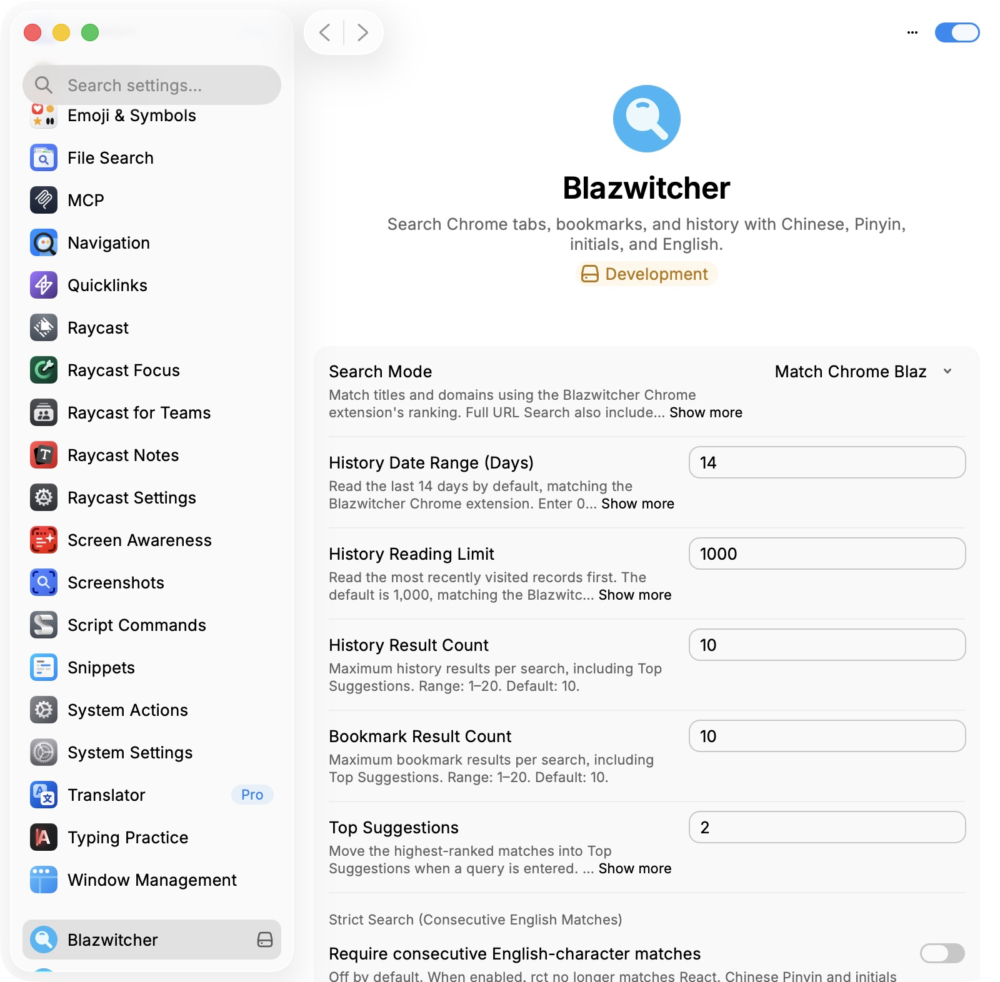

<p align="center">
  
</p>

# Blazwitcher for Raycast

Search Chrome tabs, bookmarks, and history with Chinese, Pinyin, initials, or English — from one Raycast command.

[English](README.md) | [简体中文](README.zh-CN.md)

Open **Search Browser** in Raycast to search tabs, bookmarks, and history in one list.



Blazwitcher for Raycast is the Raycast edition of Blazwitcher, a Chrome extension for searching tabs, bookmarks, and history with fuzzy Pinyin search. Install the browser edition from the [Chrome Web Store](https://chromewebstore.google.com/detail/blazwitcher-search-and-sw/fjgablnemienkegdnbihhemebmmonihg) or explore its [GitHub source](https://github.com/cjinhuo/blazwitcher).

Use the keyboard to switch to an open tab or reopen a saved or previously visited page. The interface uses Raycast's native list, action menu, and shortcuts. Both editions use [text-search-engine](https://github.com/cjinhuo/text-search-engine) for search.

**Page-content preview requires the official [Raycast Browser Extension](https://www.raycast.com/browser-extension) to be installed and enabled in Chrome.** Select an open tab and press **`⌘D`** to preview its extracted page content in Raycast's detail panel.

## How it connects to Chrome

| Data or action                       | Access method                                                                                                                                                    |
| ------------------------------------ | ---------------------------------------------------------------------------------------------------------------------------------------------------------------- |
| Open tabs and navigation             | JXA scripts read Chrome's current windows and tabs, focus a specific tab, or open a URL in the captured current tab or a new tab                                 |
| Bookmarks                            | Read and parse Chrome's local `Bookmarks` and `AccountBookmarks` JSON files                                                                                      |
| History                              | Query Chrome's local `History` SQLite database without modifying the original                                                                                    |
| Page preview and available tab icons | The official Raycast Browser Extension provides `BrowserExtension.getTabs()` and `BrowserExtension.getContent()`; `getContent()` supplies the Markdown page body |

JXA runs through macOS's `osascript` and uses the same automation mechanism as AppleScript. Allow Raycast to control Google Chrome when prompted. Basic search and navigation work without the browser companion; page-content preview requires it.

## Features

### Fuzzy Pinyin search

Search input is debounced. The previous results stay visible until the next search finishes, reducing flicker while typing or switching sources.

Powered by [text-search-engine](https://github.com/cjinhuo/text-search-engine), fuzzy search supports mixed Chinese and English queries. More consecutive matches rank higher; equally relevant history results are ordered by most recent visit to help you locate the target quickly. Search capabilities include:

- Pinyin initials and full Pinyin search, with mixed Chinese, Pinyin, and English input.
- Domain and space-separated word search, with words matched in any order.

By default, it searches titles and domains using the matching and ranking rules of the [Blazwitcher Chrome extension](https://chromewebstore.google.com/detail/blazwitcher-search-and-sw/fjgablnemienkegdnbihhemebmmonihg) ([GitHub source](https://github.com/cjinhuo/blazwitcher)). This mode appears as **Match Chrome Blaz** in preferences; "Chrome Blaz" refers to the Blazwitcher browser edition. To search URL paths, query parameters, or fragments, select **Full URL Search**, which also retains title-first ranking.

Start with `sxw` to find three related “上下文” pages, then use `sxwlx` for **上下文类型**. Full Pinyin works too: `shangxiawen` finds the same three pages; add `tq` to locate **上下文提取**.



[Watch the Pinyin-search recording (MP4)](media/pinyin-search.mp4).

English searches work the same way. In this demo, `/t skills github.com` finds three tabs with similar titles. Add the project name with `/t skills github.com openai` to narrow the list to two results, with **openai/skills** ranked first. The GitHub title and URL make the matching project easy to identify.



[Watch the English-search recording (MP4)](media/english-search.mp4).

Refine `kuaisu` to `kuaisu rm`, then add `claude.com` to find **快速入门 - Claude Code Docs**. Reordering the query to `rm claude.com kuaisu` finds the same page.


[Watch the domain and word-search recording (MP4)](media/domain-search.mp4).

### `⌘D` page preview

Install and enable the official [Raycast Browser Extension](https://www.raycast.com/browser-extension) to make the preview available. Select a result and press `⌘D`, or choose **Expand Preview** in Actions, to show the native detail panel. It starts collapsed each time you open the command.



The preview highlights matching title and URL text when those fields contribute to the match, and labels each result as **Tab**, **History**, or **Bookmark**. These highlights appear in the detail panel.

For ordinary HTTP(S) tabs, the panel can display the page's extracted Markdown. Bookmarks, history, incognito tabs, and special-protocol pages show existing metadata only. **Refresh Preview** rereads the selected tab's content without reloading the Chrome page.

Some existing tabs may fail to connect, and dynamic pages may produce incomplete content. The preview entry is hidden when the browser-extension capability is unavailable. See the [preview notes](docs/详情预览试用说明.md) for known limitations.



[Watch the page-preview recording (MP4)](media/page-preview.mp4).

### Tabs, bookmarks, and history in one list

Use the source dropdown, a query prefix, or a shortcut to narrow your search.

| Source      | Query prefix | Default shortcut |
| ----------- | ------------ | ---------------- |
| All sources | —            | `⌘⇧0`            |
| Open tabs   | `/t`         | `⌘⇧1`            |
| Bookmarks   | `/b`         | `⌘⇧2`            |
| History     | `/h`         | `⌘⇧3`            |

Switching sources keeps the keywords and removes the previous prefix.

In the default mode, duplicates are merged after source filtering and matching. Separate open tabs remain separate; bookmarks and history with identical titles or full URLs are merged, keeping tabs, then history, then bookmarks. History-only and bookmark-only searches also merge duplicates. Full URL Search uses its original ranking and duplicate handling; see the [search strategy notes](docs/默认搜索策略对齐.md).

With keywords entered, the first **2** results appear in **Top Suggestions**, followed by the remaining results in tab, history, and bookmark sections. History and bookmarks each show up to **10** results by default, including any results in Top Suggestions. Both counts and the suggestion count are configurable.



### Search modes and preferences

Open **`⌘K` → Extension Preferences** to choose a search mode and customize its parameters. Both modes support the same result counts and strict-search option.

| Preference                                  | Default           | Options                                                                                                  |
| ------------------------------------------- | ----------------- | -------------------------------------------------------------------------------------------------------- |
| Search Mode                                 | Match Chrome Blaz | Titles and domains; choose Full URL Search to include the rest of the URL and retain title-first ranking |
| History Date Range (Days)                   | 14 days           | 0–36,500 days; 0 removes the date limit                                                                  |
| History Reading Limit                       | 1,000             | 1–100,000 records, read by most recent visit                                                             |
| History Result Count                        | 10                | 1–20 per search, including Top Suggestions                                                               |
| Bookmark Result Count                       | 10                | 1–20 per search, including Top Suggestions                                                               |
| Top Suggestions                             | 2                 | 1–10 when keywords are entered; hidden for an empty query                                                |
| Strict Search (Consecutive English Matches) | Off               | Require consecutive English-character matches; Chinese Pinyin and initials remain supported              |

The reading limit controls how many history records can be searched; result counts control how many matches appear. Top Suggestions moves the first results into its own section without adding results. Save preferences, then reopen the command. Values above a setting's maximum are capped; invalid input uses its default.

Existing saved preferences are preserved. Raycast and the Chrome edition save their settings independently; matching defaults do not automatically synchronize custom settings or guarantee identical tab ordering. See the [search strategy notes](docs/默认搜索策略对齐.md) for details.



### Open the page you mean

Press `Enter` on a tab to focus that exact tab. For a bookmark or history result, it opens in the Chrome profile the record belongs to.

You can also open any result in a new tab or in the tab that was active when you launched the command. These actions retain the captured Chrome target; if it is no longer available, the extension reports the failure rather than choosing another tab.

Use `⌘Enter` for a new tab or `⇧Enter` for the captured current tab. See the shortcut table below for all keyboard actions.

### Keyboard control and custom shortcuts

| Action                                  | Default shortcut     |
| --------------------------------------- | -------------------- |
| Select a result                         | `↑` / `↓`            |
| Open a result or focus a tab            | `Enter`              |
| Open in a new tab                       | `⌘Enter`             |
| Open in the captured current tab        | `⇧Enter`             |
| Copy the full URL                       | `⌘C`                 |
| Open Actions                            | `⌘K`                 |
| Expand or collapse the optional preview | `⌘D`, when available |

Open Actions → **Shortcut Settings** to customize additional bindings or restore defaults. Changes persist across command sessions. Raycast controls the primary `Enter` and `⌘Enter` actions.

To launch the command directly, assign a hotkey or alias in Raycast Settings → Extensions. The Raycast edition has no predefined global activation hotkey.

<!-- Demo: media/shortcut-settings.gif -->

### Chrome profiles and local startup cache

Bookmarks and history initially use Chrome’s most recently used profile. Open Actions → **Switch Chrome Profile** to choose a specific profile or **All Profiles**. The choice applies to the current command session; reopening the command uses Chrome’s most recently used profile again. Open tabs always come from all readable Chrome windows, regardless of this selection.

New installations read up to **1,000 history records from the last 14 days**. Adjust both values in extension preferences; the reading limit can reach **100,000**, and **0** days means all dates. The limit also applies to combined history across profiles. Existing saved preferences are retained. Incognito tabs are excluded by default and can be enabled in preferences.

The startup cache is enabled by default. It displays a small local snapshot of bookmarks and history while fresh data loads, with cached results labeled. Cached history is filtered by the current date range. Disable the cache in preferences or clear it from Actions → **Clear Startup Cache**.

<!-- Demo: media/profile-settings.gif -->

## Install and get started

The extension is currently installed from source; a Raycast Store installation link will be added after publication.

Requirements: **macOS**, **Google Chrome**, **Raycast**, and **Node.js 22.22.2 or later** for installing from source. Start Chrome at least once before using the extension.

```bash
git clone https://github.com/cjinhuo/blazwitcher-raycast.git
cd blazwitcher-raycast
npm ci
npm run dev
```

After the build succeeds, open Raycast, search for `Blazwitcher`, and run **Search Browser**. The command and menu labels use US English; Chinese titles and search queries are fully supported.

1. Enter a title, Pinyin, initials, or domain fragment.
2. Select the result with `↑` / `↓`.
3. Press `Enter` to focus or open the page, or `⌘K` for more actions.
4. For page preview, install and enable the official [Raycast Browser Extension](https://www.raycast.com/browser-extension) in Chrome, then select an open tab and press `⌘D`.

`npm run dev` imports the extension and watches for changes. After import, `Ctrl+C` stops the watcher; the installed command remains available. For updates, run `git pull`, `npm ci`, and `npm run dev` again. More setup and troubleshooting details are in the [contributing guide](CONTRIBUTING.md).

### macOS automation permission

The first tab operation may ask you to allow **Raycast to control Google Chrome**. This permission lets the local automation scripts read and switch tabs. If access was denied, open System Settings → Privacy & Security → Automation, enable Google Chrome under Raycast, and reopen the command.

## Scope and privacy

- This edition supports **Google Chrome on macOS** and runs inside Raycast. The separate [Blazwitcher browser extension](https://github.com/cjinhuo/blazwitcher) provides the browser-side interface and AI tab grouping.
- Default search covers titles and domains; Full URL Search adds URL paths, query parameters, and fragments. The optional preview does not add page-body search, summaries, or AI features.
- Matched characters are highlighted in the detail panel, while list rows retain Raycast’s native text rendering.
- Browser data is searched locally. Chrome bookmarks, history, and favicon databases are read without modifying the originals. The extension does not read Chrome cookies or send browsing data to a search or AI service.
- The optional startup cache stores at most 100 bookmarks and 100 history records per profile for five minutes, within a 512 KB total limit. It includes titles and URLs; it excludes tabs and incognito data.
- Page-preview text stays in memory for the current command session. It is not written to disk or added to the search index. Favicon images returned by the official browser extension may be loaded from their supplied URLs.

## Contribute

See [CONTRIBUTING.md](CONTRIBUTING.md) for development and troubleshooting, and the [verification records](docs/验证记录.md) for the boundaries of previous tests. Report reproducible issues in [GitHub Issues](https://github.com/cjinhuo/blazwitcher-raycast/issues).

Preparing screenshots or GIFs? Follow the [recording checklist](docs/media-guide.md) for scenes and filenames. See the [Store submission guide](docs/store-submission.md) for screenshots and publishing.

[MIT License](LICENSE) · [Third-party notices](THIRD_PARTY_NOTICES.md)
