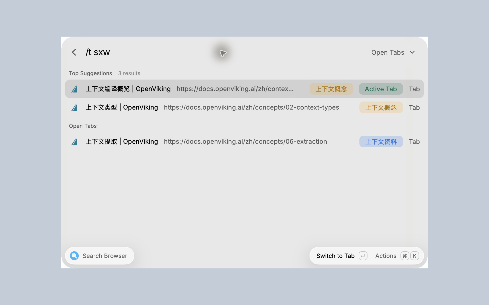
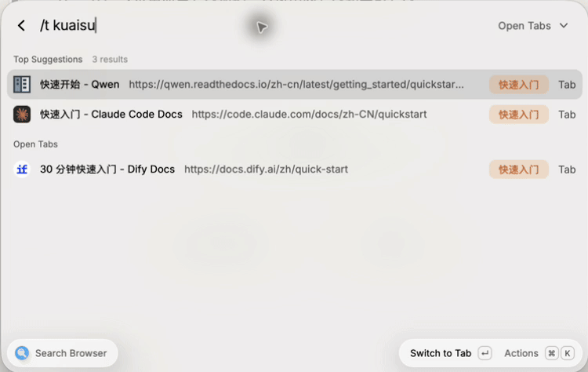
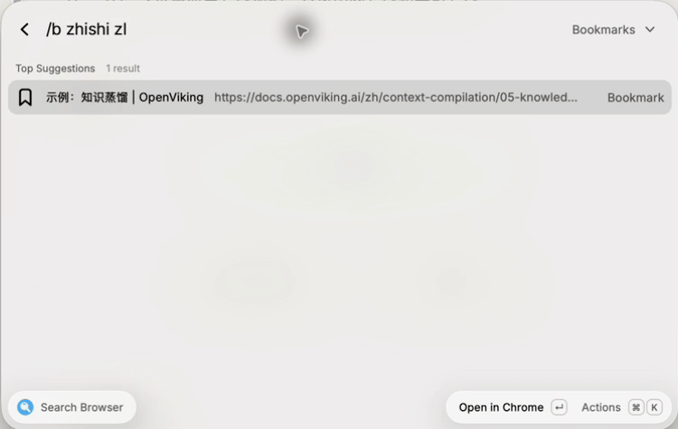

# Blazwitcher - Fuzzy Chrome Search

Search Google Chrome tabs, bookmarks, and history with fuzzy matching for Chinese, English, full Pinyin, and Pinyin initials. Mix them in the same query, all from one Raycast command.

## Get started

Requires **macOS**, **Raycast**, and **Google Chrome**. Start Chrome at least once, then run **Search Browser** in Raycast.

1. Enter a title, Pinyin, initials, or a domain fragment.
2. Select a result with `↑` / `↓`.
3. Press `Enter` to focus or open the page, or `⌘K` for more actions.

### Chrome automation permission

Allow **Raycast to control Google Chrome** when macOS prompts you. This lets Blazwitcher read and switch tabs. If access was denied, open **System Settings → Privacy & Security → Automation**, enable **Google Chrome** under **Raycast**, then reopen the command.

### Optional page preview

Install and enable the official [Raycast Browser Extension](https://www.raycast.com/browser-extension) in Chrome. Select an open tab and press `⌘D`, or choose **Expand Preview** in Actions, to show its extracted page content. Basic search and navigation work without the browser extension.

## Search in Chinese, Pinyin, and English

Use Pinyin initials such as `sxw` to find “上下文”, or full Pinyin such as `shangxiawen`. Mix Chinese, Pinyin, and English in the same query.

Combine a title keyword and a domain, such as `skills github.com openai`. Space-separated words can appear in any order.

By default, **Match Chrome Blaz** searches titles and domains using the matching and ranking rules of the [Blazwitcher Chrome extension](https://chromewebstore.google.com/detail/blazwitcher-search-and-sw/fjgablnemienkegdnbihhemebmmonihg). Select **Full URL Search** in Extension Preferences to also search URL paths, query parameters, and fragments. Both modes keep title matches first.

## Choose a source

Use the source dropdown, a query prefix, or a shortcut. Switching sources keeps your keywords and removes the previous prefix.

| Source      | Query prefix | Default shortcut |
| ----------- | ------------ | ---------------- |
| All sources | —            | `⌘⇧0`            |
| Open tabs   | `/t`         | `⌘⇧1`            |
| Bookmarks   | `/b`         | `⌘⇧2`            |
| History     | `/h`         | `⌘⇧3`            |

With a query entered, the first two results appear in **Top Suggestions**. History and bookmarks each show up to ten results by default, including suggestions. These counts can be changed in Extension Preferences.

In the default search mode, duplicate titles or URLs are merged after filtering and matching, preferring tabs, then history, then bookmarks. Separate open tabs remain separate.

## Open and preview results

Press `Enter` on a tab to focus that exact tab. A bookmark or history result opens in its Chrome profile. **Open in Current Tab** uses the tab that was active when you launched the command; if that target is no longer available, the action reports a failure.

| Action                           | Default shortcut     |
| -------------------------------- | -------------------- |
| Open a result or focus a tab     | `Enter`              |
| Open in a new tab                | `⌘Enter`             |
| Open in the captured current tab | `⇧Enter`             |
| Copy the full URL                | `⌘C`                 |
| Open Actions                     | `⌘K`                 |
| Expand or collapse preview       | `⌘D`, when available |

Open **Actions → Shortcut Settings** to customize additional bindings or restore defaults. Raycast controls the primary `Enter` and `⌘Enter` actions. Assign a launch hotkey or alias in **Raycast Settings → Extensions**.

The preview starts collapsed each time you open the command. It highlights matching title and URL text in the detail panel and identifies each result as a Tab, History, or Bookmark.

Ordinary HTTP(S) tabs can show extracted Markdown. Bookmarks, history, incognito tabs, and special-protocol pages show metadata only. **Refresh Preview** rereads the selected tab without reloading the Chrome page. Some existing tabs may fail to connect, and dynamic pages may produce incomplete content. Preview actions are hidden when the browser-extension capability is unavailable.

## Preferences and Chrome profiles

Open **Actions → Extension Preferences** to change search settings, then reopen the command.

| Preference                | Default           | Options                                         |
| ------------------------- | ----------------- | ----------------------------------------------- |
| Search Mode               | Match Chrome Blaz | Titles and domains, or Full URL Search          |
| History Date Range (Days) | 14                | 0–36,500; 0 removes the date limit              |
| History Reading Limit     | 1,000             | 1–100,000 most recent records                   |
| History Result Count      | 10                | 1–20, including suggestions                     |
| Bookmark Result Count     | 10                | 1–20, including suggestions                     |
| Top Suggestions           | 2                 | 1–10; hidden for an empty query                 |
| Strict Search             | Off               | Require consecutive English-character matches   |
| Startup Cache             | On                | Show cached bookmarks and history while loading |
| Incognito Tabs            | Off               | Include incognito tabs in memory only           |

The history reading limit controls how many records can be searched; result counts control how many matches appear. Strict Search preserves Chinese Pinyin and initials matching. Raycast and the Chrome edition save their preferences independently.

Bookmarks and history initially use Chrome's most recently used profile. Choose **Actions → Switch Chrome Profile** for a specific profile or **All Profiles**. This choice lasts for the current command session. Open tabs always come from all readable Chrome windows.

## Privacy

- Browser data is searched locally. Chrome's bookmark, history, and favicon files are read without modifying the originals. Blazwitcher does not read cookies or send browsing data to a search or AI service.
- The optional startup cache stores at most 100 bookmarks and 100 history records per profile for five minutes, within a 512 KB total limit. It includes titles and URLs, but excludes tabs and incognito data. Disable it in preferences or use **Actions → Clear Startup Cache**.
- Page-preview text stays in memory for the command session. It is not saved to disk or included in search. Favicon images returned by the browser extension may load from their supplied URLs.

[MIT License](LICENSE) · [Third-party notices](THIRD_PARTY_NOTICES.md)
