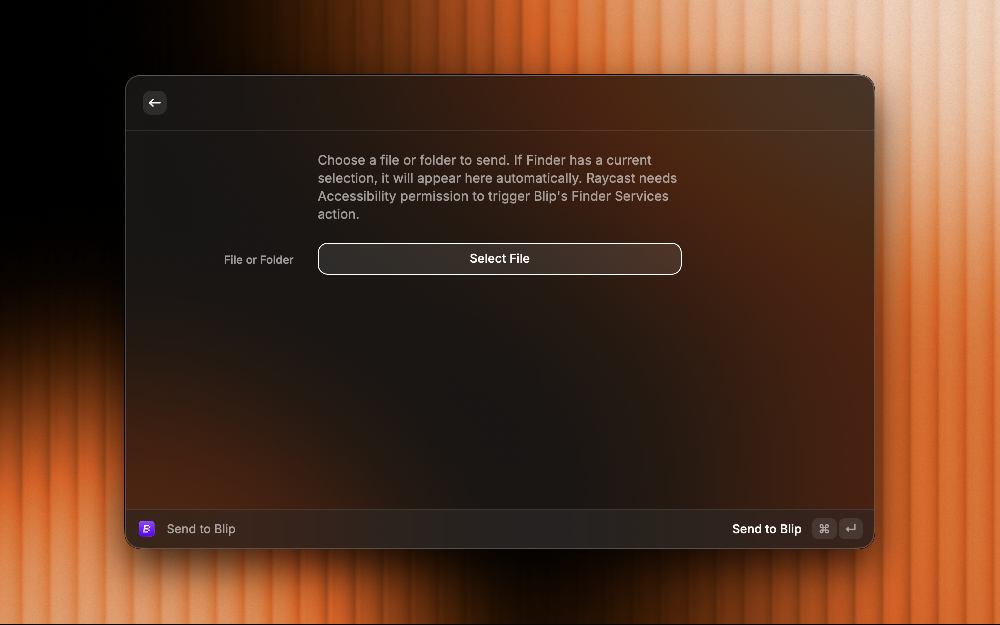

# Blip

Send files, folders, text and your clipboard to any of your Blip devices or contacts, and manage transfers, without leaving Raycast. Blip's own windows never open.



## Commands

| Command | What it does |
| --- | --- |
| **Send** | Pick a device or contact, then send the Finder / File Explorer selection, the clipboard, typed text, or files you choose. |
| **Send Clipboard** | Pick a recipient and send whatever is on the clipboard: copied files, text, or an image. |
| **Send Selected Files** | Pick a recipient and send everything selected in Finder / File Explorer. |
| **Quick Send Clipboard** | Sends the clipboard to your Quick Send recipient immediately, no window. Give it a hotkey. |
| **Quick Send Selected Files** | Sends the Finder / File Explorer selection to your Quick Send recipient immediately. Give it a hotkey. |
| **Manage Transfers** | Live progress and speed. Accept or decline incoming files, pause, resume or cancel, open or reveal received files, and clear finished transfers from history. |

Sending is two steps: pick **what** (the clipboard, the Finder selection, typed text or chosen files), then **who**. Every button names what you're sending, e.g. *Send “Report.pdf” to Windows PC*.

Recipients show your other devices (with online status) and your contacts. Type a name or email to find other people on Blip.

Text is sent the same way Blip's own **Paste** button sends it: as a `.txt` file named after the first 128 characters.

## Quick Send

Give **Quick Send Clipboard** and **Quick Send Selected Files** hotkeys in Raycast Settings → Extensions → Blip. The first time you use one, it asks who to send to and remembers your choice (marked ⚡). After that it sends straight away without opening anything.

To change the recipient later, select another one in any recipient list and choose **Use for Quick Send** (⌘⇧D, Ctrl+Shift+D on Windows).

## Blip settings

Blip's own settings live in the extension preferences (Raycast Settings → Extensions → Blip): auto-accept, save media to Photos (macOS), where received files are saved, and sending/receiving speed limits.

Raycast can't show Blip's current values there, so every setting starts as *Keep Blip's setting*. When you change one, the extension applies it to Blip the next time you open any Blip command. Clear it again to stop managing that setting from Raycast.

## Requirements

- Blip installed and signed in. If Blip isn't running, the extension starts it in the background.
- No Accessibility permission is needed.

## How it works

Blip's app is a native UI on top of an engine (`BlipKit`) that it talks to over a local socket using [DRPC](https://github.com/storj/drpc) and protobuf. The engine exposes two calls:

- `GetState` returns the whole app state (devices, contacts, transfers, settings). With the last state id it long-polls until something changes, which gives the Transfers view live updates.
- `Dispatch` performs an action, e.g. `TransferCreateRequested`, `TransferAddContentRequested`, `TransferInviteRequested`.

The extension speaks that protocol directly. A send is: create transfer for the recipient → add files → invite → dismiss. Dismissing in the same instant stops Blip from ever drawing its transfer window; the transfer itself continues and stays in Blip's history.

The schema in `src/generated/blip-schema.json` was extracted from BlipKit 1.2.8. Credential fields (the login and push tokens) are removed from the schema, so the extension never decodes them.

**This is Blip's internal interface, not a public API.** A Blip update can change it. When that happens the extension shows a "Blip changed" message instead of failing silently.

## Development

```sh
npm install
npm run dev         # import into Raycast
npm test            # unit tests
BLIP_LIVE=1 npm test  # also run read-only checks against the Blip running on this machine
```
