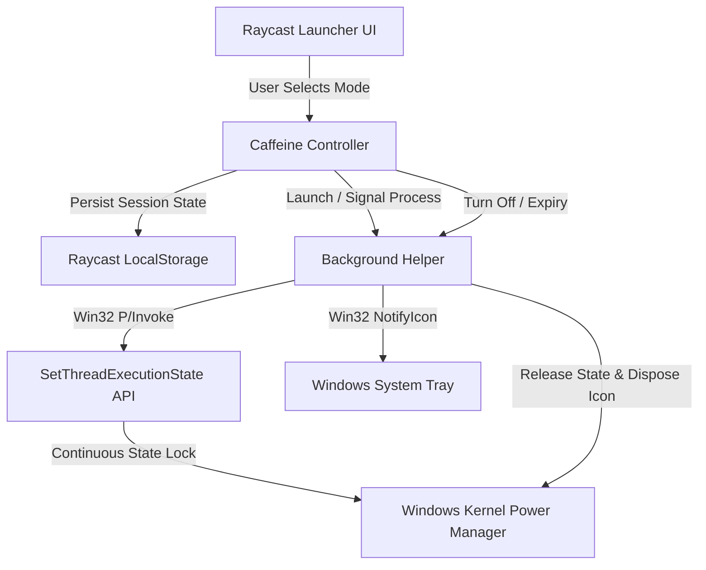

# Caffeine for Windows — Raycast Extension

  

  <strong>A lightweight, native Raycast extension that temporarily prevents Windows PCs from going to sleep or turning off displays.</strong>

  
  
  
  

---

## 📖 Overview

Windows users frequently encounter situations where their computer goes to sleep or turns off the display during active operations:

- Downloading or uploading large files
- Long-running builds, 3D rendering, or data processing
- Presenting slides or sharing screens during meetings
- Monitoring real-time telemetry or dashboards
- Reading long technical documents

**Caffeine for Windows** solves this with a keyboard-first, native Raycast experience. It allows users to temporarily keep Windows awake either **indefinitely** or for a **precise timed duration**, complete with a dynamic **Windows System Tray** indicator.

---

## ✨ Features

- **⚡ Keyboard-First Activation**: Activate indefinite keep-awake or timed sessions in seconds directly from the Raycast launcher (`Alt + Space`).
- **⏱️ Flexible Duration Control**:
  - **Indefinite Mode**: Keep awake until manually stopped.
  - **Quick Presets**: 1-click presets for **15 Minutes**, **30 Minutes**, and **1 Hour**.
  - **Custom Duration**: Enter any custom duration in minutes (1 to 10,080 minutes / up to 7 days).
- **🖥️ Native Windows System Tray Integration**:
  - Automatically displays a dynamic tray icon in the Windows notification area while active.
  - Shows real-time hover countdown tooltips (e.g. `Caffeine - Active (45m remaining)`).
  - Quick-action context menu to stop Caffeine or adjust durations on the fly.
  - Instantly disappears when Caffeine is stopped without leaving ghost icons.
- **🛡️ Non-Invasive Power Management**:
  - Uses the official Win32 `SetThreadExecutionState` API.
  - **Zero permanent changes**: Never modifies the Windows Registry, power plans, or system sleep timeouts.
  - **No fake input**: Never simulates mouse movement or fake keystrokes.
- **👁️ Display vs. System Sleep Control**: Configurable option in extension preferences to keep both the display and system awake, or keep only the system awake while allowing the monitor to sleep.
- **🔄 Self-Healing & Crash-Resilient**: Gracefully reconciles state and releases system execution locks if Raycast restarts or the system reboots.
- **🍃 Ultra-Lightweight**: Zero active CPU polling and zero background console windows.

---

## 🏗️ High-Level Architecture

1. **Presentation Layer**: Built with React and the Raycast API (`@raycast/api`), providing an intuitive, keyboard-accessible command interface.
2. **State Management**: Asynchronous state machine backed by persistent `LocalStorage`, guaranteeing atomic transitions between indefinite and timed modes.
3. **Execution State Bridge**: Communicates with the Windows kernel via `SetThreadExecutionState` (`ES_CONTINUOUS | ES_SYSTEM_REQUIRED | ES_DISPLAY_REQUIRED`).
4. **Shell Notification Area**: Employs Win32 `Shell_NotifyIcon` with graceful Named Event signaling to manage tray icon lifecycle and prevent ghost artifacts.

---

## 🛠️ Technology Stack

- **Frontend / UI**: React, Raycast Extension API (`@raycast/api`, `@raycast/utils`)
- **Core Language**: TypeScript 5.5+
- **System Integration**: Win32 API (`kernel32.dll`, `user32.dll`), Windows PowerShell Runtime
- **Power Management**: Win32 `SetThreadExecutionState`
- **Shell Integration**: Windows `NotifyIcon` (Taskbar Notification Area / Tray)
- **Code Quality & Testing**: ESLint, Prettier, Node.js Test Suite

---

## 📱 User Experience

### 1. Indefinite Mode

Press `Turn On` to keep Windows awake indefinitely until explicitly toggled off.

### 2. Timed Keep-Awake

Open `Timer…` to enter a custom duration or choose from quick duration presets (**5m**, **10m**, **15m**, **30m**, **45m**, **1h**, **2h**).

### 3. System Tray Indicator

While active, an icon appears in the Windows system tray showing remaining duration and providing quick-stop options. Turning off Caffeine instantly removes the indicator.

---

## 🔒 Source Code & Availability

> [!NOTE]
> **Source Code Notice**:
> This repository is a **public portfolio showcase** demonstrating the features, architecture, and design of the Caffeine extension.
> The full source code, scripts, and implementation details are maintained in a **private repository**.
>
> If you are interested in collaborating, reviewing the code, or have inquiries, please feel free to reach out via GitHub.

---

## 👤 Author

- **Afaan Bhat** — [GitHub Profile](https://github.com/afaanbhat-9)

---

## 📄 License

This showcase project is documented under the [MIT License](LICENSE).
