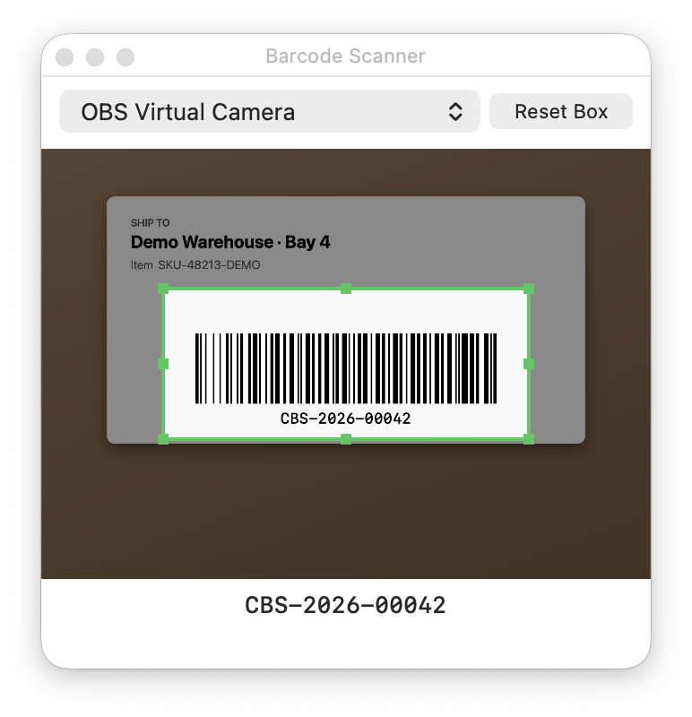

# Camera Barcode Scanner

Use your Mac camera or your iPhone as a barcode scanner. The extension reads a code and types it into the app in front, like a USB scanner. It works in any app with a text field.

It reads QR codes, Data Matrix, Aztec, PDF417, Code 128, Code 39, EAN, UPC, GS1 DataBar and more. Everything runs on your Mac. No code or image leaves your computer.

## Setup

The extension needs two permissions. macOS asks for both the first time. Both are for Raycast.

1. **Camera.** Needed to see the barcode. Turn on Raycast in System Settings > Privacy & Security > Camera.
2. **Accessibility.** Needed to type the code into other apps. Turn on Raycast in System Settings > Privacy & Security > Accessibility.

## Commands

- **Toggle Barcode Scanner.** Opens a small scanner window above all other apps. The window never takes the keyboard focus, so your text field stays active. Each code is typed as you scan it. Run the command again to stop.
- **Scan Barcode Once.** Opens the same window, types the first code it reads, and closes.

Tip: give Toggle Barcode Scanner a hotkey, for example ⌥⌘B. Open Raycast Settings > Extensions > Camera Barcode Scanner.

## The Scan Box

Only codes inside the green box are read.

- Drag inside the box to move it.
- Drag an edge or a corner to resize it.
- Double-click the box to reset it. The Reset Box button does the same.

The scanner remembers the box for the next time.

## Settings

- **After Each Code.** Press Enter or Tab after each code, or press nothing. Default: nothing.
- **GS1 Group Separator.** Some GS1 codes hold a hidden separator character (ASCII 29). Leave it out, type it as is, or replace it with your own text. Default: leave out.
- **Separator Replacement.** The text typed when you choose Replace. Default: `|`.
- **Camera.** Automatic uses a nearby iPhone first and the built-in camera second. You can also choose one. You can change the camera in the scanner window too.
- **Ignore Repeats For.** After a read, the same code is ignored for this long. This stops double reads when a code stays in view. Default: 2 seconds.
- **Code Types.** Turn off the types you do not use. Fewer types means fewer false reads.

## Notes

- Quitting Raycast does not stop the scanner. Run Toggle Barcode Scanner again, or close the scanner window.
- Codes are typed into whatever app is in front. This includes password fields.
- Scan Barcode Once waits up to 30 seconds for a code.
- Only one scanner runs at a time.
- Requires macOS 14 or later.

## Troubleshooting

**Nothing is typed.** Check the Accessibility permission for Raycast. Then click the text field you want to fill, and scan again.

**No camera found.** Close other apps that use the camera. Then run the command again.

**The iPhone does not show up.** Continuity Camera needs all of these:

1. The iPhone and the Mac use the same Apple Account.
2. Wi-Fi and Bluetooth are on, on both devices.
3. The iPhone is near the Mac and has Continuity Camera turned on in Settings > General > AirPlay & Continuity.

You can also connect the iPhone with a cable, or choose the built-in camera in the settings.

**A code is not read.** Hold it flat and steady. Add light. Make sure its type is turned on in the settings.
