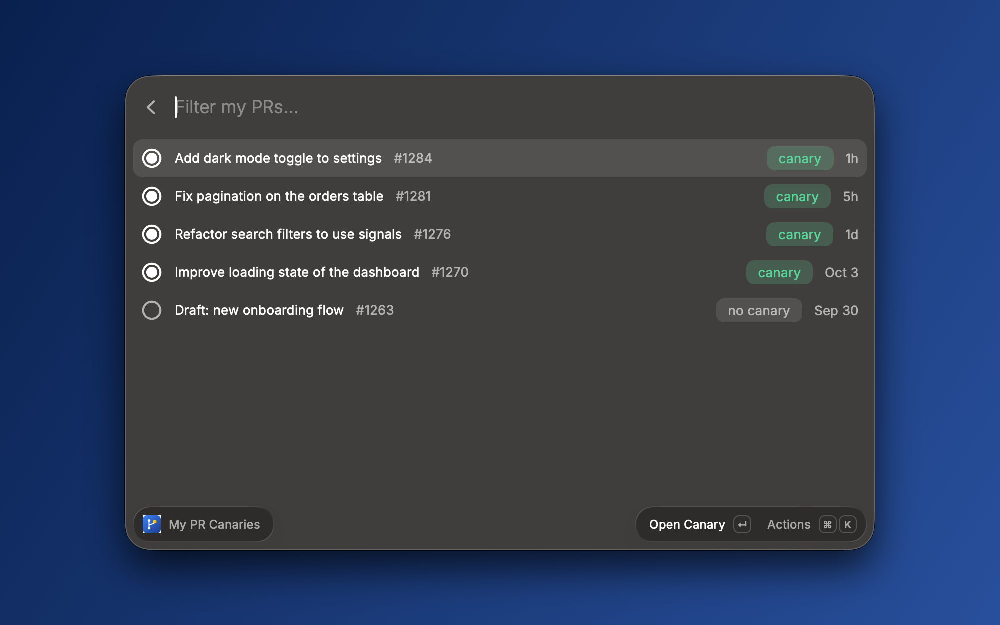
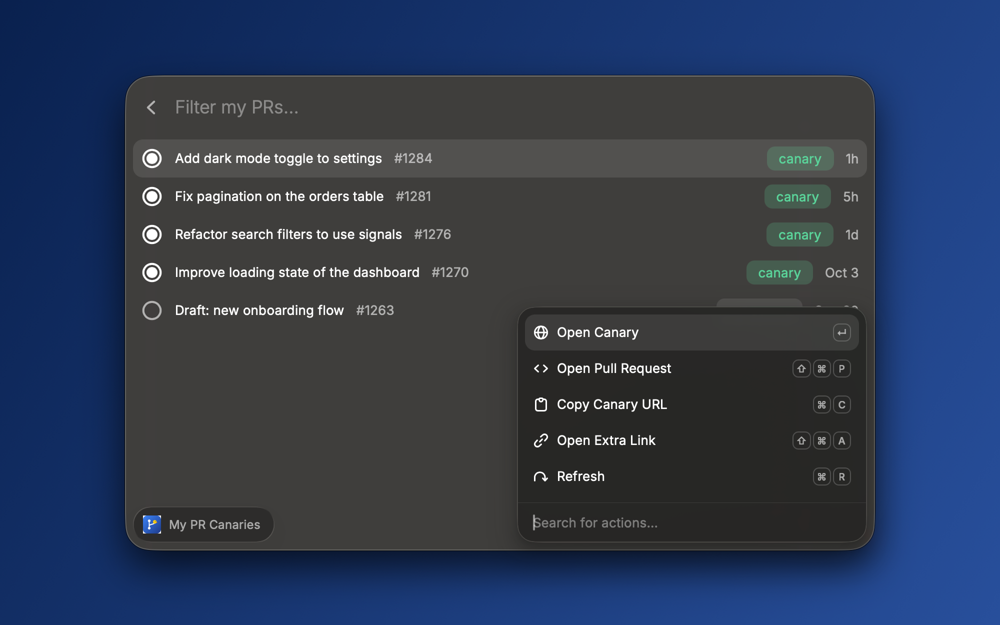

# PR Canary

Lists your open GitHub pull requests and opens the preview environment ("canary") that your CI posts as a PR comment, with the arrow keys and Enter.

## Requirements

- A GitHub account with access to the repository.
- A CI job that comments the preview URL on the pull request.

The extension reads your pull requests and their comments through the GitHub API. On first run it asks you to sign in with GitHub (`repo` and `read:org` scopes). If your organization restricts third-party OAuth apps, set a **Personal Access Token** instead (see below).

## Setup

| Preference                | Description                                                                                                                                                                                                                                                                                  |
| ------------------------- | -------------------------------------------------------------------------------------------------------------------------------------------------------------------------------------------------------------------------------------------------------------------------------------------- |
| **Repository**            | The GitHub repository, as `owner/name`.                                                                                                                                                                                                                                                      |
| **Canary URL Prefix**     | Opens the newest URL in a PR comment that starts with this prefix, e.g. `https://dashboard.`. Leave empty to use the URL that follows a label such as `Canary available at:`.                                                                                                                |
| **Extra Link URL Prefix** | Optional. A second link to pull from the same comments, e.g. your deploy dashboard.                                                                                                                                                                                                          |
| **CI Comment Author**     | Optional. The GitHub login of the account that posts the preview URL, e.g. your CI bot (`platform-handler`). Only comments from this account are used, so nobody else can plant a link. If empty, comments from bot accounts and from repository owners, members and collaborators are used. |
| **Personal Access Token** | Optional. Used instead of the GitHub sign-in. Needs read access to pull requests (classic tokens: `repo`). Stored in Raycast's preferences.                                                                                                                                                  |
| **Latest Commit Check**   | On by default. Colors the **canary** tag yellow when the canary doesn't run the pull request's latest commit (see below).                                                                                                                                                                    |
| **Canary Version Path**   | The path on the canary that returns the commit it runs. Empty means `/build-info.json`.                                                                                                                                                                                                      |

## Is the canary on my latest commit?

Each pull request shows its latest commit next to the title. With **Latest Commit Check** on (the default), the **canary** tag also shows whether the canary runs that commit:

| Canary tag | Meaning                                              |
| ---------- | ---------------------------------------------------- |
| green      | The canary runs the pull request's latest commit.    |
| yellow     | The canary runs an older commit. Hover to see which. |
| red        | The canary refused the check with a 403.             |

If the canary doesn't say which commit it runs for any other reason, the tag stays green; hover it to see why. The check is skipped for canaries on `localhost` or a private-network address, so a link in a comment can't make the extension call services on your computer or network.

The extension asks the canary itself: it requests **Canary Version Path** on the canary's host and compares the commit there with the pull request's latest commit. The file can be JSON with a `commit`, `sha`, `revision` or `version` field, such as `{"version":"d2e2463"}`, or plain text holding only the commit. A short commit like `d2e2463` is enough.

## Actions

Press ⌘K on a pull request to see them all.

| Action            | Shortcut |
| ----------------- | -------- |
| Open Canary       | ↵        |
| Open Pull Request | ⌘⇧P      |
| Open Extra Link   | ⌘⇧A      |
| Copy Canary URL   | ⌘C       |
| Refresh           | ⌘R       |

## Troubleshooting

- **"…is not visible" error:** the token can't see the repository. Check the repository name. If GitHub's message mentions SAML enforcement, authorize the token for your organization (GitHub → Settings → Tokens → Configure SSO). If you signed in with OAuth, an organization owner may need to approve Raycast for the organization, or you can use a Personal Access Token instead.
- **A pull request shows "no canary":** no trusted comment on it contains a matching URL yet. Check that your CI has posted it, that **Canary URL Prefix** matches, and, if several bots comment, set **CI Comment Author** to the one that posts the preview URL.
- **Empty list:** only open pull requests authored by you in the configured repository are shown.
