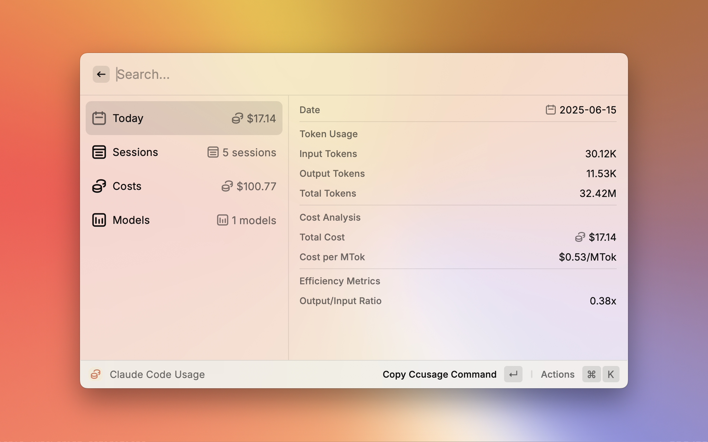

# Claude Usage (ccusage)

  
  
  A Raycast extension that provides real-time monitoring of Claude Code usage statistics using the [ccusage](https://github.com/ryoppippi/ccusage) CLI tool.
  
  
  

## Features

Monitor your Claude Code usage with comprehensive real-time statistics:

- **Today Usage**: Track input/output tokens and costs for today with visual intensity indicators
- **This Week and This Month**: View weekly and monthly totals with comparisons to the previous period
- **Session History**: View recent usage sessions with model-specific breakdown and icons
- **Cost Analysis**: Detailed cost tracking with monthly projections and spending insights
- **Model Statistics**: Usage analytics by Claude model (Fable, Opus, Sonnet, Haiku) with tier grouping
- **Usage Limits**: OAuth-backed 5-hour, 7-day, and per-model Claude usage limits when Claude Code is authenticated with Claude OAuth
- **Menu Bar Integration**: Quick access to usage stats directly from your system menu bar
- **Pie Chart Icon**: Menu bar icon that fills clockwise with a pie chart showing 5-hour usage utilization
- **AI Extension Support**: Comprehensive integration with Raycast AI Extensions for Claude models
- **Default View Preference**: Choose which section to display first when opening the extension
- **Section Preferences**: Show only the sections you need and skip reports that have no visible consumers
- **Custom npx Path**: Support for custom npx installations and non-standard Node.js setups

## Screenshots

### Main Usage View

## Requirements

This extension requires the [ccusage](https://github.com/ryoppippi/ccusage) CLI tool to function properly. The extension automatically installs and runs ccusage using **npx** (Node Package Execute).

### System Requirements

- **Node.js** with npm/npx installed
- **Claude Code** usage history (the extension reads local ccusage data)
- **Internet connection** for downloading ccusage when first run

### Usage Limits Requirement

The Usage Limits feature is only available when Claude Code is authenticated with Claude OAuth.

- Claude OAuth setup: Usage Limits is shown and can fetch limit data
- API-key-only setup: Usage Limits is hidden because Anthropic's OAuth usage endpoint is not available

## Setup

1. Install the extension from the Raycast Store
2. Open the extension - it will automatically download ccusage using npx
3. The extension will immediately start displaying your Claude Code usage data

### Configuration (Optional)

- **Default View**: Set which section appears first (Today, This Week, This Month, Sessions, Costs, Models, or Usage Limits). If it is hidden, the first visible section is selected.
- **Show Sections**: Each section has a checkbox under the **Claude Usage** command. Hidden sections do not load or refresh. Sessions, Costs, and Models share one session report, so disabling Sessions alone still allows Costs and Models to use it. Turning all sections off makes this command run no usage reports or usage-limit requests.
- **Custom npx Path**: If npx is installed in a non-standard location, specify the full path to npx

Use **Actions → Open Command Preferences** when the extension is open. These section settings apply to the main command; the menu bar has its own settings.

## Important Notes

- **Unofficial Extension**: This extension is not an official product of Anthropic or the ccusage developers
- **Data Privacy**: All usage data is processed locally using the ccusage CLI tool
- **Performance**: Required summaries share one scan; session details load independently. Completed summaries appear while session details are still loading. All views share compact cached reports across launches. Fresh cache entries avoid another scan; only missing or expired sections refresh. Model totals still include the full session history. Automatic refresh uses the configured refresh interval.

## Support

If you encounter any issues or have suggestions, please [create an issue](<https://github.com/raycast/extensions/issues/new?title=%5BClaude+Usage+(ccusage)%5D+...&template=extension_bug_report.yml&labels=extension,bug&extension-url=https://www.raycast.com/nyatinte/ccusage&body=%0A%3C!--%0APlease+update+the+title+above+to+consisely+describe+the+issue%0A--%3E%0A%0A%23%23%23+Extension%0A%0Ahttps://raycast.com/%23%7Bextension_path(extension)%7D%0A%0A%23%23%23+Description%0A%0A%3C!--%0APlease+provide+a+clear+and+concise+description+of+what+the+bug+is.+Include+screenshots+if+needed.+Please+test+using+the+latest+version+of+the+extension,+Raycast+and+API.%0A--%3E%0A%0A%23%23%23+Steps+To+Reproduce%0A%0A%3C!--%0AYour+bug+will+get+fixed+much+faster+if+the+extension+author+can+easily+reproduce+it.+Issues+without+reproduction+steps+may+be+immediately+closed+as+not+actionable.%0A--%3E%0A%0A1.+In+this+environment...%0A2.+With+this+config...%0A3.+Run+'...'%0A4.+See+error...%0A%0A%23%23%23+Current+Behavior%0A%0A%23%23%23+Expected+Behavior%0A%0A>) in the repository.

## Credits

The Raycast layout of this extension was inspired by the [System Monitor](https://www.raycast.com/hossammourad/raycast-system-monitor) extension.

Special thanks to [@ryoppippi](https://github.com/ryoppippi) for creating the [ccusage](https://github.com/ryoppippi/ccusage) tool that makes this extension possible.

## License

MIT
