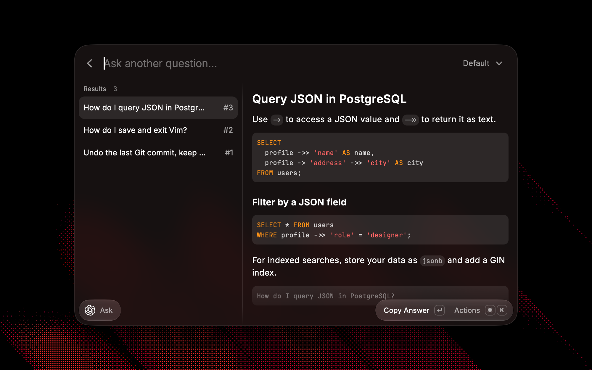
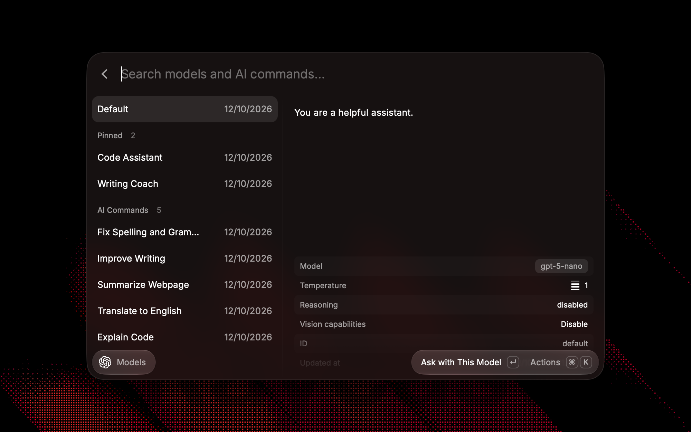
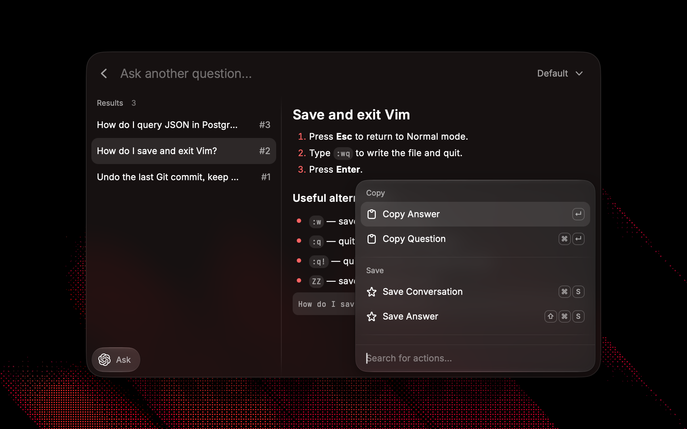
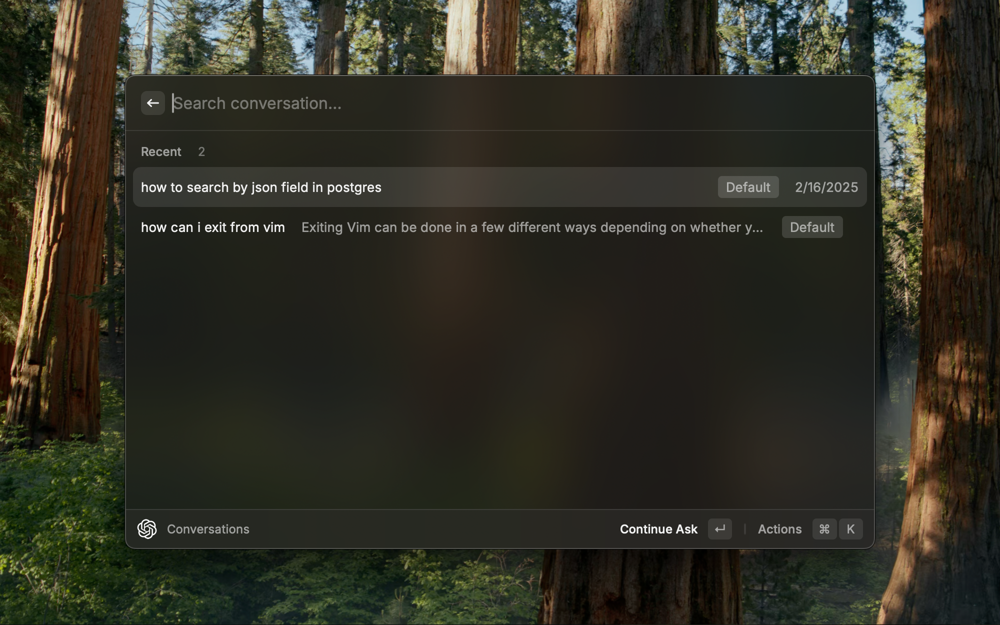
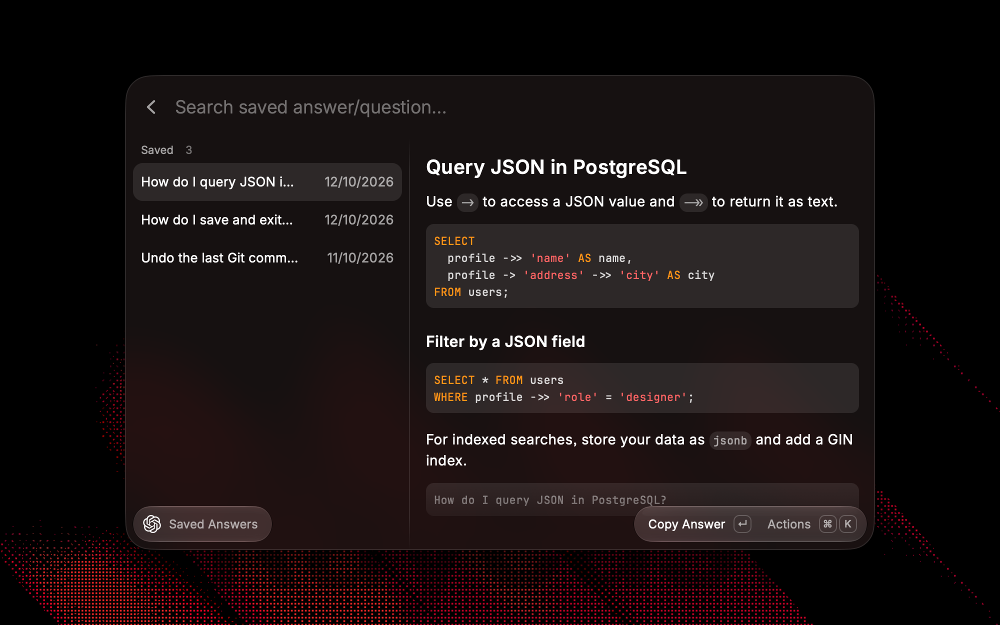
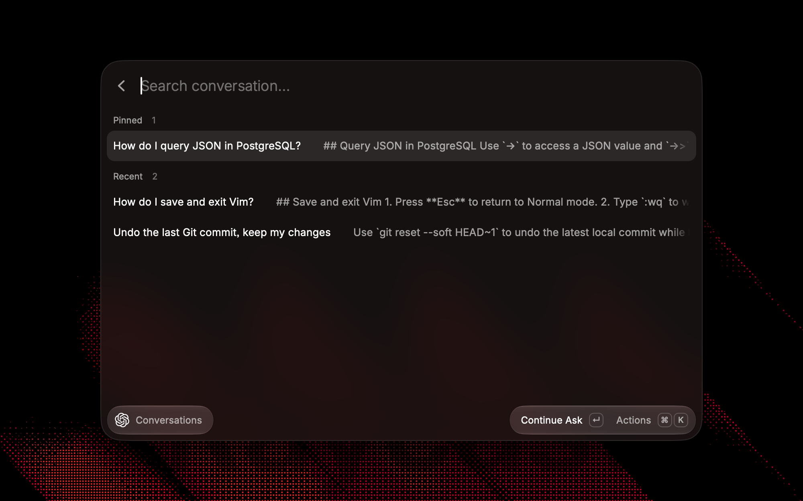
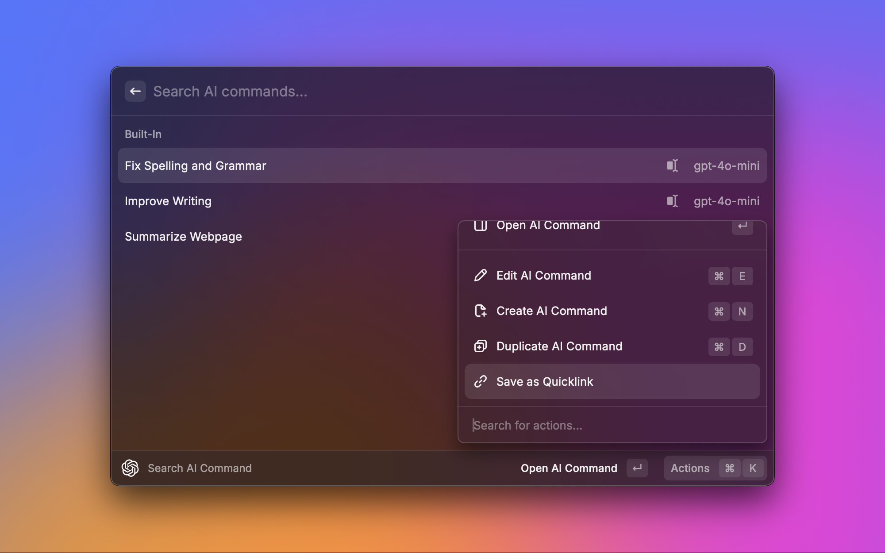
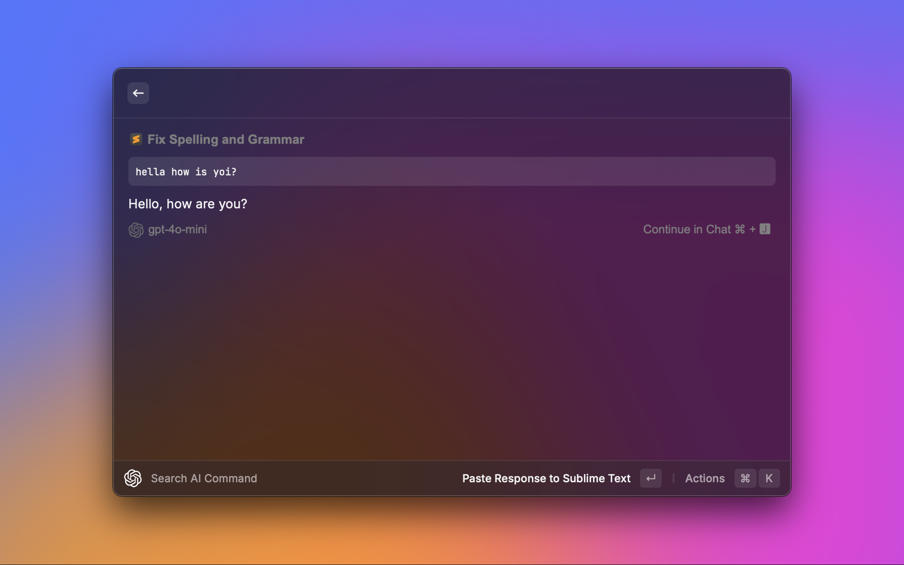

<h1 align="center">ChatGPT</h1>

<h3 align="center">
Interact with OpenAI's ChatGPT right from your command bar
</h3>

# Features

### Ask from your command bar

Ask a question from Raycast and get an answer without leaving your current app.

### Customize your models

Create presets and AI commands with your own prompts and settings.

### Continue conversations

Return to previous conversations and continue where you left off.

### Save answers

Save useful answers for later.

### Search history

Find earlier questions and answers in your history.

### Use AI commands and create your own

Process text taken from anywhere (selected text, clipboard text, opened web page) and
insert the result into the frontmost application or copy it to the clipboard.

> Windows 11+ is supported. For vision commands, selected images are read from the active File Explorer window or from the clipboard (both platforms).

# Models

**Ask Question** and Full Text Input list the models available to your chosen connection, along with saved presets. New configurations start with GPT-6 Luna. The picker reads model IDs from the OpenAI API or Codex app-server, so new models appear without an extension update. A model may still reject a request if it does not support chat or image input.

Use **Models** to edit presets and AI commands. Commands can have independent settings or inherit a preset; overrides replace the corresponding preset setting. Existing commands and saved conversations remain available. Create a command from a preset using **Create AI Command from This Model**.

# Authentication

Add an OpenAI API key in Raycast preferences or use **Sign in with ChatGPT** in the extension. API-key requests use the Responses API and API billing. ChatGPT sign-in uses Codex app-server. Both connections support image input: the API sends image data, while Codex receives local image paths. Choose **Preferred Connection** in extension preferences when both are configured. The API key is preferred by default; if the preferred connection is unavailable, the other is used. Sign out of ChatGPT from the action menu.

On first ChatGPT sign-in, the extension downloads the Codex runtime for your platform from the official npm registry and checks its SHA-256 hash. The API-key connection does not need Codex.

# Preferences

Preferences can be customized through `Raycast Settings > Extensions > ChatGPT`.

| Properties               | Label                  | Value                               | Required | Default | Description                                                                                                      |
| ------------------------ | ---------------------- | ----------------------------------- | -------- | ------- | ---------------------------------------------------------------------------------------------------------------- |
| `connectionMode`         | Preferred Connection   | `apiKey`, `chatgpt`                  | `true`   | `apiKey` | Prefer API billing or your ChatGPT account; use the other connection if the preferred one is unavailable          |
| `apiKey`                 | API Key                | `string`                            | `false`  | `empty` | Your API key; optional when signed in with ChatGPT                                                               |
| `useStream`              | Stream Completion      | `boolean`                           | `true`   | `true`  | Stream the completions of the generated answer                                                                   |
| `isAutoSaveConversation` | Auto-save Conversation | `boolean`                           | `true`   | `true`  | Auto-save every conversation that you had with the model                                                         |
| `isHistoryPaused`        | Pause History          | `boolean`                           | `false`  | `false` | Pause the history of the conversation                                                                            |
| `isAutoLoadText`         | Auto-load Text         | `boolean`                           | `false`  | `false` | Load selected text from your frontmost application to the `question bar` or `full text input form` automatically |
| `isAutoFullInput`        | Use Full Text Input    | `boolean`                           | `false`  | `false` | Switch to `full text input form` from `question bar` automatically whenever you want to ask or type a question   |
| `isAutoTTS`              | Text-to-Speech         | `boolean`                           | `false`  | `false` | Enable auto text-to-speech everytime you get a generated answer                                                  |
| `useApiEndpoint`         | Use API Endpoint       | `boolean`                           | `false`  | `false` | Change the OpenAI's default API endpoint to custom endpoint                                                      |
| `apiEndpoint`            | API Endpoint           | `string`                            | `false`  | `empty` | Custom API endpoint                                                                                              |
| `useVisionModel`         | Change Vision Model    | `boolean`                           | `false`  | `false` | Use the configured vision model for image commands                                                               |
| `visionModelName`        | Vision Model Name      | `string`                            | `false`  | `empty` | Model ID to use when Change Vision Model is enabled                                                              |
| `useProxy`               | Use Proxy              | `boolean`                           | `false`  | `false` | Proxy API requests, the Codex runtime download, and the Codex connection                                         |
| `proxyProtocol`          | Proxy Protocol         | `http`, `https`, `socks4`, `socks5` | `false`  | `http`  | Proxy protocol option                                                                                            |
| `proxyHost`              | Proxy Host             | `string`                            | `false`  | `empty` | Proxy host value                                                                                                 |
| `proxyPort`              | Proxy Port             | `string`                            | `false`  | `empty` | Proxy port value                                                                                                 |
| `proxyUsername`          | Proxy Username         | `string`                            | `false`  | `empty` | Proxy username value                                                                                             |
| `proxyPassword`          | Proxy Password         | `string`                            | `false`  | `empty` | Proxy password value                                                                                             |
| `useAzure`               | Use Azure OpenAI       | `boolean`                           | `false`  | `false` | Use Azure OpenAI for API-key requests                                                                            |
| `azureEndpoint`          | Azure Endpoint         | `string`                            | `false`  | `empty` | Azure OpenAI resource endpoint                                                                                   |
| `azureDeployment`        | Azure Deployment       | `string`                            | `false`  | `empty` | Azure OpenAI resource deployment                                                                                 |

### How to use Azure OpenAI

1. Copy and paste your Azure OpenAI's `KEY` value to the `API key` field
2. Copy and paste your Azure OpenAI `Endpoint` value to the `Azure Endpoint` field. Then, Tick the `Use Azure OpenAI` checkbox

3. Copy and paste your Azure OpenAI `Model deployment name` value to the `Azure Deployment` field
4. Set `Preferred Connection` to `Prefer OpenAI API Key` to use your Azure connection when also signed in with ChatGPT.

# Support

Donate to support the development of this extension. Thank you!

---

Made with ♥ from Indonesia

