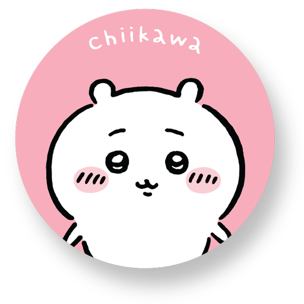

     
     
    
    <h3>Chiikawa Characters</h3>
    
Search and browse Chiikawa characters offline

     
     

Raycast extension for searching and browsing [Chiikawa](https://www.chiikawaofficial.com/home/) character profiles offline. Character data and "open official page" actions use the [official character pages](https://www.chiikawaofficial.com/characters).

## Commands

- `Search Chiikawa Characters`  
  Fuzzy search and browse by English name, Japanese name, romanized name, and lore keywords with category, sorting, and list/grid controls.
- `Compare Chiikawa Characters`  
  Pick any two characters and compare traits, relationships, and fun facts side by side.
- `Random Chiikawa Character`  
  Smart randomizer with category filter and optional "exclude recently seen" behavior, opening directly in detail view on launch.

## Compare Characters

- Select a left and right character from dropdowns
- Open a side-by-side detail view with:
  - shared personality traits
  - unique traits for each character
  - relationships and fun facts comparison
- Quick actions to:
  - open each character's full profile
  - [open each official character page](https://www.chiikawaofficial.com/characters)
  - copy the full comparison as Markdown

## Smart Randomizer

- Filter random picks by category:
  - All Categories
  - Main Trio
  - Friends
  - Yoroi-san
- Toggle recent-history behavior:
  - `Exclude Recently Seen` (default)
  - `Include Recently Seen`
- Recent history is persisted locally (last 4 opened random picks)
- Built-in actions:
  - Open character detail
  - Pick another character (`Cmd + R`)
  - Toggle recent exclusion (`Cmd + E`)

## Included Data

- 11 core characters across:
  - Main Trio
  - Friends
  - Yoroi-san
- Profiles include:
  - EN + JP names
  - personality traits
  - description
  - relationships
  - fun facts

## Detail Actions

Each character's detail view includes a custom animated SVG illustration. Characters blink, wave, wiggle their ears, or move their accessories. Momonga swishes a fluffy tail, Kurimanju lifts a cup, Furuhonya's crab headband wiggles, and the Yoroi-san characters wave and nod. The artwork works offline in Raycast 2 using SVG animation, following the approach in [SVG Showcase for Raycast](https://github.com/luarmr/svg-showcase-for-raycast). List and grid thumbnails keep their original portraits.

Use **Show Original Portrait** in the action menu, or turn off **Show animated characters** in the extension preferences to use the original PNG portraits. This also provides a still-image option for reduced motion or older Raycast versions. Missing SVGs fall back to the original portraits. If neither image is available, the profile still shows its text and actions. Copy as Markdown keeps a portable text profile without image data or local URLs.

- Copy Japanese name (`Cmd + C`)
- Copy bio (`Cmd + Shift + C`)
- [Open official page](https://www.chiikawaofficial.com/characters) (`Cmd + O`)
- Copy profile as markdown (`Cmd + M`)
- Jump to random character (`Cmd + R`)
- Switch between animated characters and original portraits (`Cmd + Shift + A`)

## Development Checks

Run `npm ci`, `npm test`, `npm run lint`, `npx tsc --noEmit`, and `npm run build`.
Tests inspect the detail component's markdown and actions with a mocked Raycast API, including all bundled illustrations, animation preferences and toggling, missing images, and optional catchphrases. Native Raycast rendering should be checked separately.

The custom illustrations are bundled in `assets/animated`. Edit their source in `scripts/generate-character-art.mjs`, then run `node scripts/generate-character-art.mjs` to regenerate all 11 SVGs. The generator is only needed during development.
