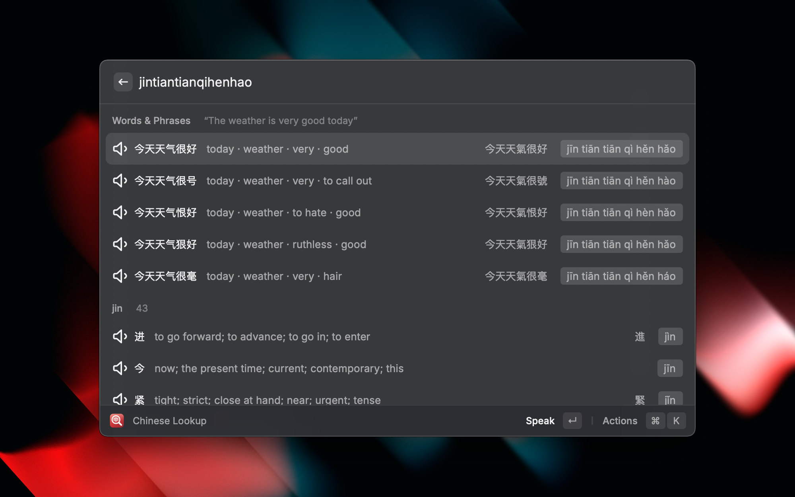
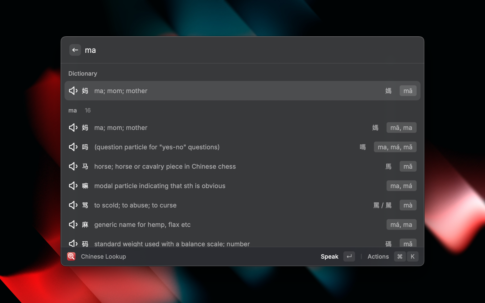
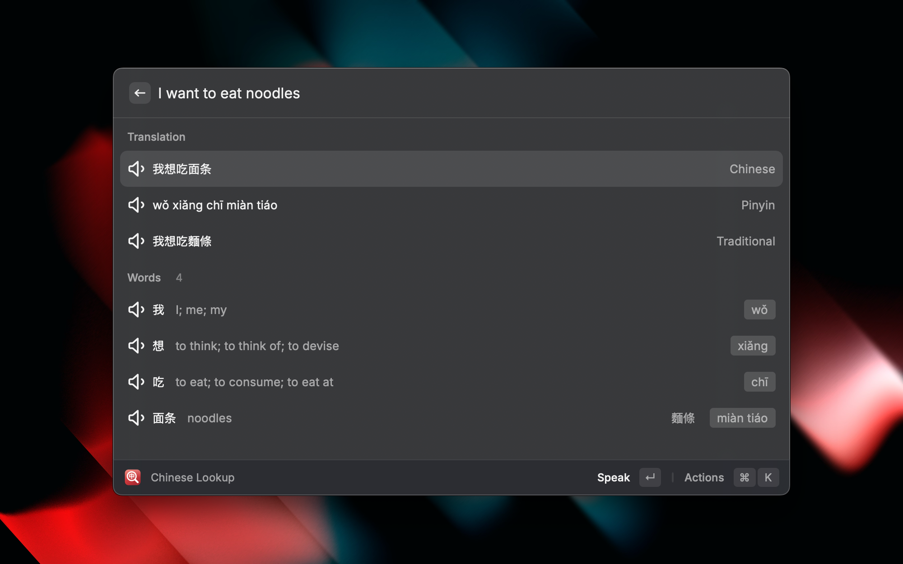
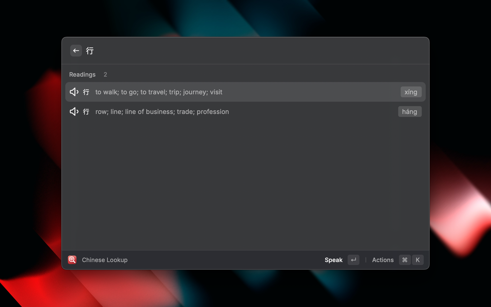
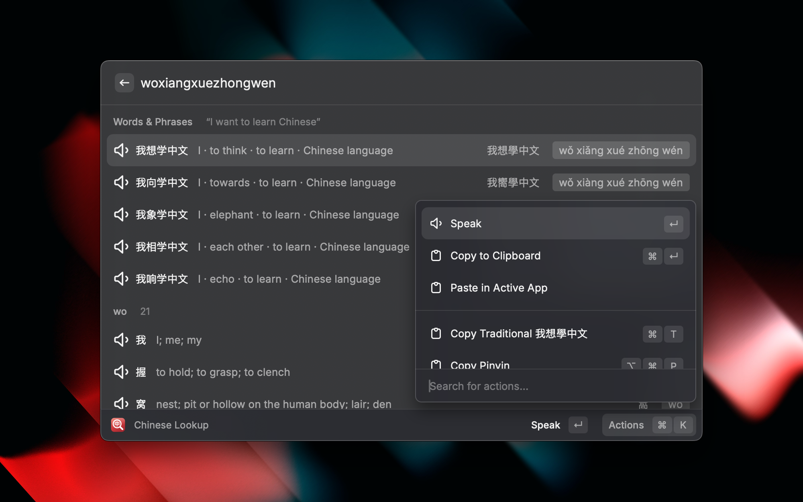

<p align="center">
  
</p>

<h1 align="center">Chinese Lookup</h1>

<p align="center">
  <b>One Raycast search box for everything Chinese.</b><br>
  Type pinyin, English or Chinese and get characters, words, meanings, translations and pronunciation.
</p>

<p align="center">
  
</p>

Learning Chinese usually means juggling a pinyin keyboard, a dictionary and a translator. Chinese Lookup puts all three behind one hotkey. Type `woxiangxuezhongwen` and it writes 我想学中文 and tells you it means "I want to learn Chinese". Type `beautiful` and it gives you 美丽 and 漂亮. Paste a sentence from your textbook and it gives you the pinyin, the translation and every word's meaning. Press ↵ to hear any of it read aloud.

The dictionary is built in and works offline: 8,000+ characters and 70,000+ words, ranked by how often they're actually used.

## Features

### Pinyin → Chinese

Type pinyin the way you'd say it. Chinese Lookup splits run-together syllables into the most likely words and phrases, just like a Chinese keyboard, and tells you what each one means.

- Tones are optional: `nihao`, `ni3hao3` and `nǐhǎo` all work. Type `v` for ü (`lv4` for lǜ, as in 绿).
- Phrases that aren't single dictionary words get a word-by-word meaning: 我想学中文 → "I · to think · to learn · Chinese language".
- Google Translate's translation of the selected phrase appears in the section header ("I want to learn Chinese"), and follows your selection as you arrow through the alternatives.
- Results appear as you type, even mid-syllable.

<p align="center"></p>

### Every character for a sound

Type a single syllable to see every character pronounced that way, most common first, with its tones, meaning and traditional form. Add a tone number or mark (`ma3`, `mǎ`) to narrow it down.

<p align="center"></p>

### English → Chinese

Type an English word to find the Chinese words that mean it, straight from the dictionary. Type a sentence and it's translated into Chinese, with the pinyin and the meaning of every word in the translation, so you learn the parts and not just the whole.

<p align="center"></p>

<p align="center"></p>

### Chinese → English

Paste Chinese, simplified or traditional, from anywhere: a textbook PDF, a website, a chat. You get:

- the English translation
- the pinyin, with each character read correctly in context (了 as *le* or *liǎo*, 行 as *xíng* or *háng*)
- the traditional form (or simplified, if you pasted traditional)
- every word on its own, with its pinyin and meaning

<p align="center"></p>

### Every reading of a character

Many characters have more than one pronunciation, each with its own meaning. Type one character to see them all.

<p align="center"></p>

### Hear it

Double-click any result or press ↵ to hear it read aloud by macOS's built-in Mandarin voice. Press again to hear it slower.

### Actions

| Shortcut | Action |
| --- | --- |
| ↵ or double-click | Speak (again for slower) |
| ⌘ ↵ | Copy |
| ⌘ K | All actions: Paste, Copy Chinese, Copy Traditional, Copy Pinyin |
| ⌘ T | Copy Traditional |
| ⌥ ⌘ P | Copy Pinyin |

<p align="center"></p>

## How it works

Everything except translation runs locally, inside Raycast, in a few milliseconds per keystroke.

- **Pinyin parsing.** Input is normalized (tone marks and numbers become syllable + tone, `v` and `u:` become ü) and split into syllables, preferring longer syllables and backtracking when that leaves letters that can't be pinyin. The last syllable may be unfinished, so results show up while you're still typing.
- **Writing phrases.** Each way of writing the syllables as dictionary words and single characters is scored with a unigram language model: the product of word frequencies, with a penalty per piece so whole words beat strings of single characters. A beam search keeps the best few paths at each position. Single characters blend two frequency sources: [wordfreq](https://github.com/rspeer/wordfreq), which reflects how people write today, and Hanyu Pinlu, which counts how often each *reading* of a character occurs. Sentence-final particles get a nudge at the end of a phrase, so `nihaoma` is 你好吗 and not 你号码.
- **Reading Chinese.** Pasted text is split into words with the same model, then read with [pinyin-pro](https://github.com/zh-lx/pinyin-pro), which picks each character's reading from context. [cjk-conv](https://github.com/bluelovers/ws-cjk-conv) converts between simplified and traditional.
- **English.** The input is checked against the vocabulary of the dictionary's English definitions to tell English (`man`, `you`) from pinyin. Words that are both show both. Dictionary matches are found by scanning definitions on demand rather than through a prebuilt index, which keeps memory well under Raycast's limit for extensions.
- **Translation** uses Google Translate. Requests wait for a pause in typing, are cached, and are only made for sentences, pasted Chinese and the selected pinyin phrase.
- **Speech** uses macOS's `say` with the built-in Tingting voice, or any other installed Mandarin voice.

## Privacy

Translations come from Google Translate, so sentences you type, Chinese you paste and the selected pinyin phrase are sent to Google. Dictionary lookups and speech never leave your Mac. Chinese Lookup has no analytics and stores nothing.

## Install

**Raycast Store:** coming soon.

**From source:**

```bash
git clone https://github.com/dropoutsanta/chinese-lookup.git
cd chinese-lookup
npm install
npm run dev
```

`npm run dev` opens the command in Raycast in development mode and keeps it installed after you stop it. Requires Node 22 or later.

## Rebuilding the dictionary

The data in `assets/data` is generated by two scripts. Each script's header explains where to download its sources.

```bash
node scripts/build-pinyin-index.mjs <path-to-extracted-Unihan>
node scripts/build-word-index.mjs <wordfreq-zh.json> <cedict_ts.u8>
```

## Data sources

- **Characters** (`assets/data/pinyin-index.json`): readings, frequencies, definitions and traditional forms from the [Unicode Unihan Database](https://www.unicode.org/charts/unihan.html), © Unicode, Inc., [Unicode License v3](https://www.unicode.org/license.txt).
- **Words** (`assets/data/word-index.json`): words, readings, definitions and traditional forms from [CC-CEDICT](https://cc-cedict.org/wiki/), and word frequencies from [wordfreq](https://github.com/rspeer/wordfreq) by Robyn Speer, both [CC BY-SA 4.0](https://creativecommons.org/licenses/by-sa/4.0/). This file is shared under the same license.

## Credits

Chinese Lookup began as a fork of [Chinese Character](https://www.raycast.com/koinzhang/chinese-character) by koinzhang, a set of simplified/traditional and pinyin conversion commands. It has since been rewritten from scratch, but thanks for the starting point.

## License

[MIT](LICENSE) © Nick Tomic. The dictionary data is licensed as described under [Data sources](#data-sources).
