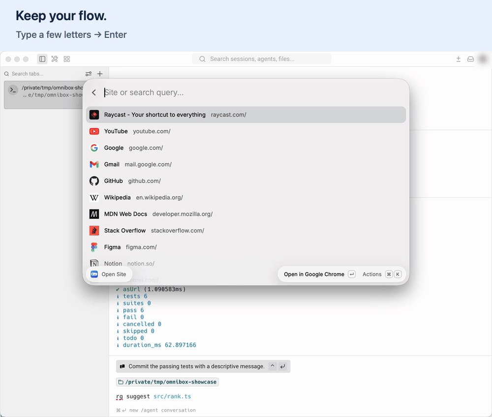
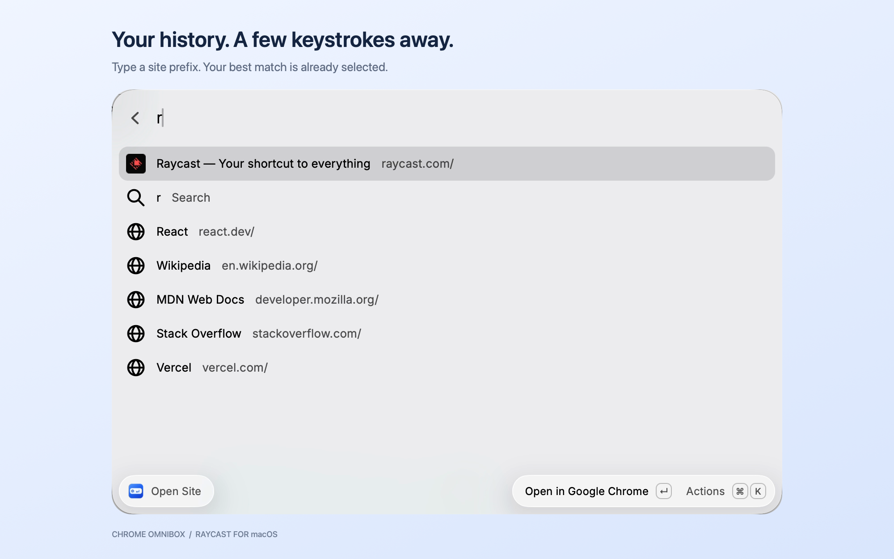
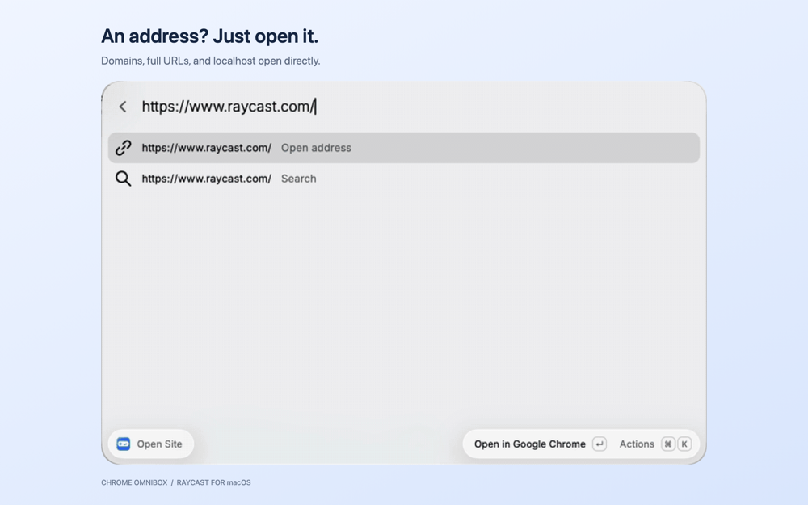
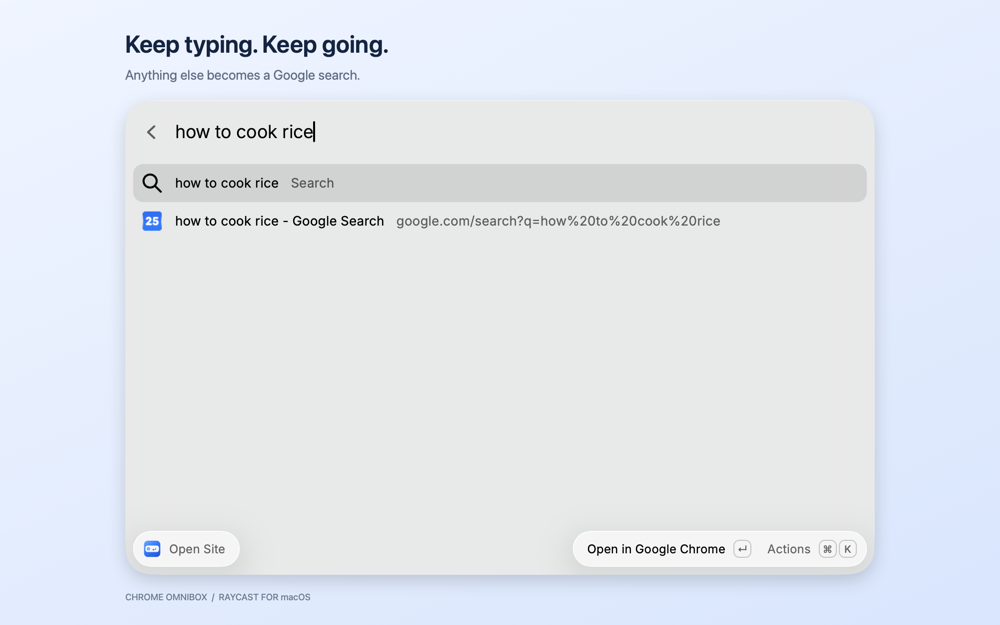

<h1></h1>

Your browser's address bar, one hotkey away — in [Raycast](https://www.raycast.com).

[](https://github.com/allnightlong/raycast-chrome-omnibox/actions/workflows/ci.yml)

[](LICENSE)

Press a hotkey, type a site or address, and press **Enter**. History matches open in your browser; anything else becomes a Google search. No aliases or quicklinks to maintain.

[](media/workflow.gif)

Recorded with a separate Chrome demo profile and sample history.

- **Smart ranking:** site prefixes first, then word and substring matches, weighted by frequency and recency.
- **Automatic setup:** uses the most recently updated history among supported browsers and profiles.
- **Local history:** history and favicons stay on your machine. Opening sites and Google searches uses your browser.

## Setup

In **Raycast Settings → Shortcuts**, find **Chrome Omnibox → Open Site** and assign a global hotkey. Older versions use **Settings → Extensions**.

Try **⌃⌥⌘L** on macOS (shown above) or **Ctrl+Alt+Space** on Windows. Choose a shortcut that does not conflict with your apps or Raycast's launcher. See [Raycast's hotkey guide](https://manual.raycast.com/command-aliases-and-hotkeys).

## Screenshots

**Find a site from your history**



**Open an address directly**



**Search the web**



## Supported browsers

| | Windows | macOS |
| --- | :---: | :---: |
| Google Chrome (Stable, Beta, Dev, Canary), Chromium | ✓ | ✓ |
| Microsoft Edge, Brave, Vivaldi, Yandex Browser | ✓ | ✓ |
| Opera, Opera GX, Comet, Helium, Cốc Cốc | ✓ | ✓ |
| Arc, Dia, ChatGPT Atlas, Iridium | | ✓ |
| 360 Speed (X), QQ Browser, Sogou Explorer | ✓ | |

Missing yours? Open an issue with the browser name and its `chrome://version` → *Profile Path*.

## Development

```bash
npm install
npm run dev
npm test
npm run lint
npm run build
```

With a WSL toolchain, use `npm run dev:win` for Windows Raycast.

**Submit:** `npm run publish` opens or updates a PR in [raycast/extensions](https://github.com/raycast/extensions). The manual *Publish to Raycast Store* workflow also works with the `RAYCAST_PUBLISH_TOKEN` repo secret (classic PAT, `repo` scope).

[MIT license](LICENSE)
