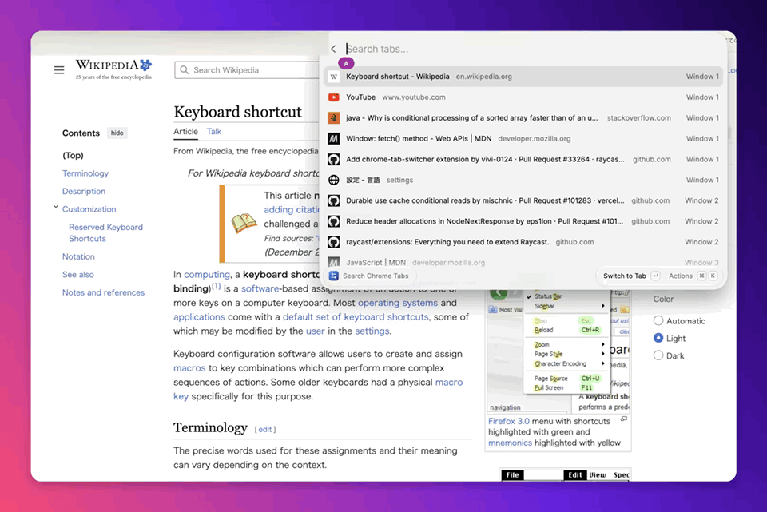

# Chrome Tab Switcher

A fast Raycast extension to search and switch Google Chrome tabs across all open windows.

## Features

- **Cross-Window Tab Search**: Quickly find any open Chrome tab across multiple windows.
- **Instant Switch**: Hit `↵` (Enter) to bring the tab and its window directly into focus.
- **Fast & Lightweight**: Built using macOS JavaScript for Automation (JXA) with optimized batch queries.
- **Search Filtering**: Filter by title or URL with space-separated keywords.

## How to Use

1. Run the `Search Chrome Tabs` command in Raycast (assigning a hotkey is recommended).
2. Type to filter open tabs by title or URL.
3. Use `↑` / `↓` to choose a tab, then press `↵` (Enter) to switch to it.

## Permissions

On first run, macOS will prompt you to allow Raycast to control Google Chrome.
If you accidentally denied permission:
1. Open **System Settings -> Privacy & Security -> Automation**.
2. Enable **Google Chrome** under **Raycast**.
