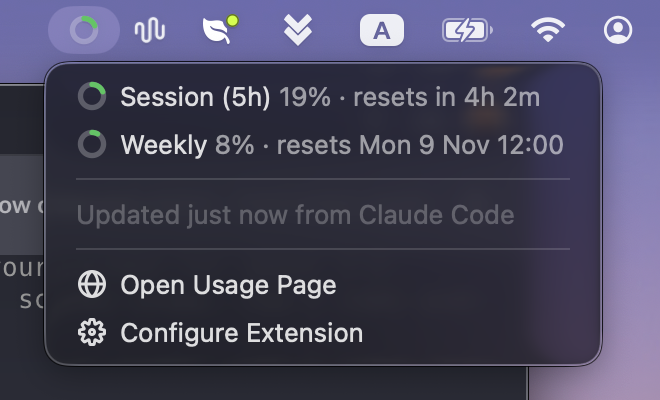

# Claude Session Usage

Shows your **Claude subscription usage** as a small ring in the macOS menu bar:

- the **5-hour session limit** (default)
- the **weekly (7-day) limit**, or both as concentric rings

The ring is green, turns orange when 30% or less is left, and red when 10% or less is left.

The numbers are the ones Claude Code shows with `/usage`. They are not estimates from local logs.

## Requirements

- [Claude Code](https://claude.com/claude-code) signed in with a **Pro or Max** subscription. Claude Code only reports usage limits for these plans.

## Setup

1. Run **Connect Claude Code** and press ↵.
2. Send any message in Claude Code.
3. Run **Menu Bar Ring** once to put the ring in the menu bar.

## Commands

| Command | |
|---|---|
| **Connect Claude Code** | Sets up Claude Code to send its usage numbers to the extension. Shows the connection status, and disconnects again. |
| **Check Usage** | Your usage and reset times in a Raycast window. Actions: Open Usage Page, Refresh Usage (⌘R), Copy Usage Summary (⌘⇧C). |
| **Menu Bar Ring** | The ring in the menu bar. Click it for exact percentages, reset countdowns and when the numbers were last updated. |
| **Toggle Usage Ring** | Shows or hides the ring in the menu bar. |

## How it works

After every reply, Claude Code passes your current 5-hour and weekly usage to its **status line** command. **Connect Claude Code** installs a small script as that command:

- `~/.claude/usage-ring-statusline.sh` saves only the `rate_limits` numbers to `~/.claude/usage-ring.json`, using macOS's built-in `plutil`. Paths, prompts and session details are never written.
- If you already had a status line, the script passes everything on to it, so it keeps working.
- `~/.claude/settings.json` is backed up to `settings.json.usage-ring.bak` first. Disconnecting restores your previous status line exactly.

The extension then only reads that file. It never reads your Claude login, never calls Anthropic, and can't be rate-limited.

**Good to know**

- The numbers update while you use Claude Code. In between, you see the last update, and a window shows 0% once its reset time has passed.
- Usage from claude.ai or the Claude apps counts toward the same limits. It shows up the next time Claude Code replies.

## Preferences

| Preference | Default | |
|---|---|---|
| Ring Shows | Session (5h) | `Session`, `Weekly`, or `Both` (outer = weekly, inner = 5h) |
| Show percentage | off | Shows `8%` next to the ring (`8% · 6%` in Both mode) |
| Orange Threshold | 70 | Ring turns orange from this usage (30% or less left) |
| Red Threshold | 90 | Ring turns red from this usage (10% or less left) |

## Troubleshooting

- **"Waiting for Claude Code"**: send a message in Claude Code. Usage arrives with the first reply of a session. If it never arrives, check that Claude Code is signed in with a Pro or Max plan.
- **Ring shows `!`**: run **Connect Claude Code**.
- **The ring disappeared**: macOS hides menu bar items when the menu bar is full. Free up space or use a menu bar manager.

Not affiliated with Anthropic.
