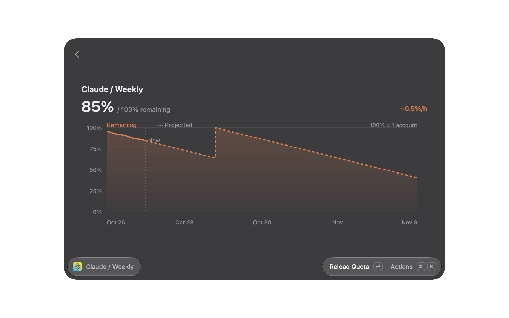
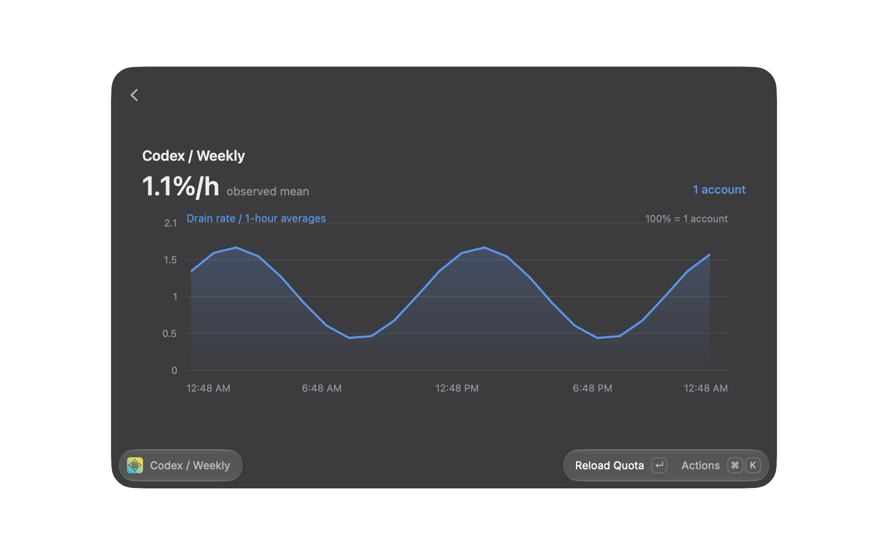
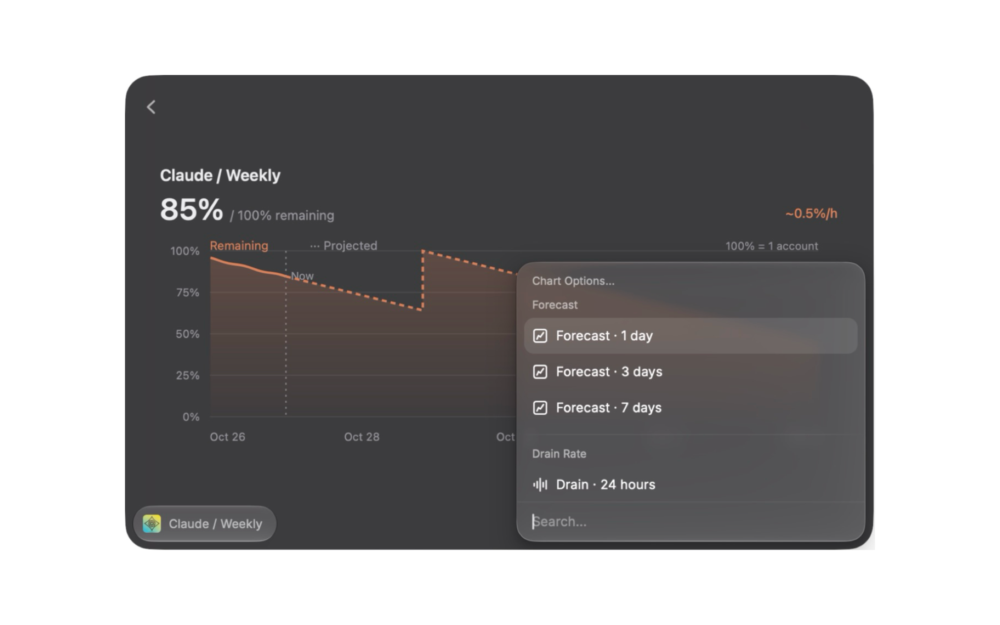

# CLIProxyAPI

A small Raycast front end for [CLIProxyAPI](https://github.com/router-for-me/CLIProxyAPI). It covers a subset of the official Management Center: auth files, quota and rate-limit resets.

## Setup

1. In your CLIProxyAPI config, set `remote-management.secret-key`. CLIProxyAPI hashes it on startup, so keep a copy of the plaintext.
2. Open the extension preferences and enter:
   - **Server URL**: defaults to `http://localhost:8317`
   - **Management Key**: the plaintext secret key

## Install

```sh
npm install
npm run install-raycast
```

This builds the production version straight into Raycast. It stays installed without the dev server running. Run `npm run install-raycast` again after changing the code. Use `npm run dev` only while developing.

## What it shows

Every auth file grouped by provider, with:

- status, cooldowns and request counts
- live quota windows and their reset times (Codex and Claude)
- bundled logos for Codex, Claude, Antigravity, Meta and xAI accounts
- available Codex reset credits and Claude reset grants

Switch views from the search bar dropdown or the Switch View action, or cycle through them with ⌘D:

- **Details**: the account list with a detail pane showing quota bars and status.
- **Limits**: one line per account with every limit inline as a progress ring, so you can compare all accounts at once.
- **Overview**: one entry per provider. Each limit shows the summed quota left across accounts, with one bar segment per account.
- **Forecast**: a full-width remaining-quota chart with a 1, 3 or 7-day projection.
- **Drain Rate**: a full-width chart of hourly consumption over the last 24 hours, seven days or 28 days.

## Shortcuts

| Action | Shortcut |
| --- | --- |
| Refresh Account | ↵ |
| Refresh All Accounts | ⌘R |
| Reload Quota | ⌘⇧R |
| Next View | ⌘D |
| Open Management Center | ⌘O |
| Use Rate-Limit Reset (asks first) | ⌘⇧U |
| Clear Cooldown (asks first) | ⌘⇧K |
| Enable/Disable Account | ⌘⇧E |

"Use Rate-Limit Reset" spends one of the account's upstream reset credits or grants, and you can't get it back. "Clear Cooldown" only clears CLIProxyAPI's local routing cooldown and leaves upstream limits alone.

## Screenshots

The six Store screenshots in `metadata` show Details, Limits, Overview, Forecast, Drain Rate and Chart Options using sample accounts and history. Antigravity, Meta and xAI logos appear in the account views; quota charts currently support Codex and Claude.

## Usage history and forecasts

The extension records fresh quota observations whenever it loads quotas. The Record Quota History command also runs in the background about every 15 minutes while Raycast is running. Disable Collect Usage History in extension preferences to stop background sampling. Foreground refreshes still record observations. Raycast scheduling is approximate; sleep, closed Raycast and failed requests leave gaps.

History stays in local JSON files under the extension's support directory, separated by a hash of the server URL and management key. Observations contain opaque account identifiers, provider names, quota percentages, reset times and timestamps. They contain no emails, filenames, management keys or account tokens. Files older than 28 days are pruned on subsequent samples for that connection. Changing connection settings starts a separate history.

Hourly averages are derived from the stored observations, so they survive restarts without accumulating errors from averaging averages. For each account and quota window, the extension divides the decrease in remaining percentage points by observed time, splitting intervals across clock hours in proportion to their duration. Refills, changed reset windows, unknown reset times and gaps over 90 minutes are excluded. Each plotted hourly provider total needs at least 15 minutes of observations for every included account; otherwise the line has a gap. A flat measured interval is zero usage; missing history is not.

Forecasts use each account's time-weighted observed drain over the past seven days, not request or token counts. Each account needs at least one observed hour across three or more valid intervals before projection starts. The forecast applies that constant rate independently to each account, stops at zero, and assumes a full refill at its reported reset time. Known weekly and five-hour windows repeat on that schedule; other windows use only their next reported reset. Unknown reset times are projected without refills. No reset credits or grants are spent by the collector or forecast. Partial refreshes pause the projection.

This is a usage estimate, not a guarantee. Changes in workload, provider quota policies and rolling-window recovery can differ from a constant drain and full-refill model. One account's capacity is 100 percentage points, so three accounts have 300% capacity. A rate of 3%/h means three percentage points of one account's capacity per hour across those accounts.

Charts start in a learning state because the Management API does not provide the subscription quota history needed to backfill them. Request/token usage telemetry is a different measurement.

Charts use a full-width Detail view without a Grid card or selection outline. Press ⌘⇧P to open Chart Options, which combines graph, time range, provider and quota window in one searchable menu. Account views are available separately in Actions. Account Views sits at the bottom and includes icons. The canvas omits the duplicate time-range label, information footer and shortcut text. Raycast's Detail view has no main search input or top-right dropdown.

Chart shortcuts:

| Action | Shortcut |
| --- | --- |
| Open Forecast from account views / toggle Forecast and Drain Rate | ⌘T |
| Next provider | ⌘J |
| Next quota window | ⌘L |
| Toggle 24 hours / seven days in Drain Rate | ⌘H |
| Reload quotas and history from a chart | ⌘R |
| Open Chart Options | ⌘⇧P |
| Cycle all views | ⌘D |

The following dark-theme chart screenshots use sample history. Real history starts collecting after installation.






