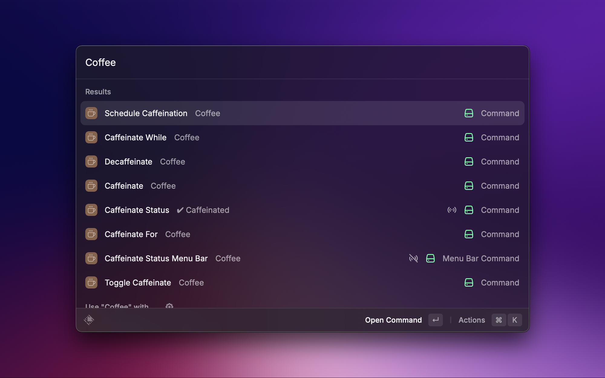
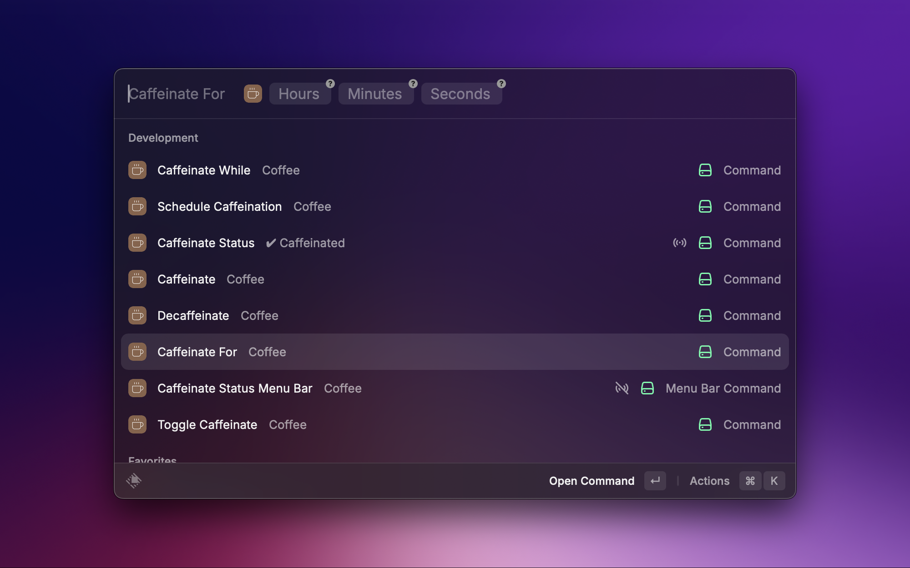
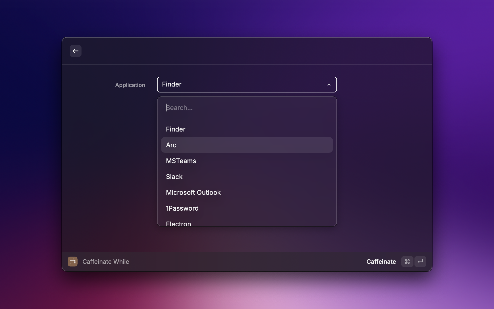
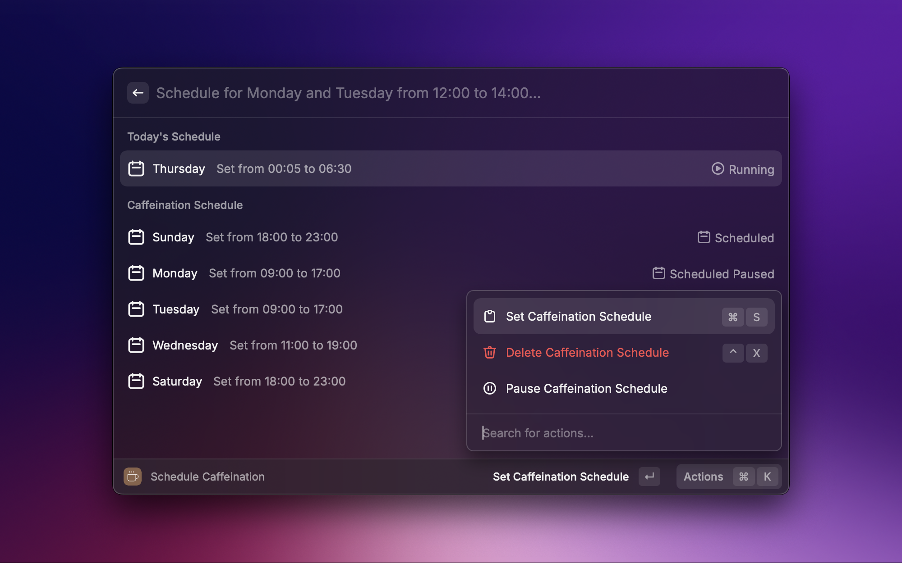

  
  <h1 align="center">Coffee Extension</h1>

**Coffee** is a Raycast extension designed to manage the caffeination of your computer. Whether you want to keep your computer awake for a specific period, while a particular app is running, or on a schedule, Coffee has you covered.

## Installation 🛠️

To install the Coffee extension, follow these steps:

1. Open Raycast.
2. Search for "Store" and navigate to the Raycast Store.
3. Search for "Coffee" and click "Install."

## Usage 🚀

Once installed, simply trigger the Raycast command palette and search for the desired caffeination command.

  

## Features ✨

### 1. **Caffeinate/Decaffeinate**

Keep your computer awake indefinitely or stop Coffee’s own caffeination. Other applications’ sleep prevention remains untouched.

### 2. **Toggle Caffeination**

Start or stop Coffee’s own caffeination.

### 3. **Caffeinate For**

Caffeinate your computer for a specified amount of time. Hours, minutes, and seconds must be non-negative whole numbers with a total greater than zero. Invalid durations leave an existing session running.

  

### 4. **Caffeinate While**

Keep your computer awake as long as a specific app is running.

  

### 5. **Schedule Caffeination**

Set up a custom caffeination schedule using natural language.  
Examples:

> ⏳ Schedule for everyday except Tuesday from 13:00 to 20:00  
> ⏳ Schedule for Monday and Thursday from 09:00 to 14:00  
> ⏳ Schedule from 10:00 to 16:30 (adds schedule for all days)  
> ⏳ Saturday and Sunday from 20:00 to 23:30

Supported Actions:

- Add a Schedule
- Pause/Resume Schedule
- Delete a Schedule

> 📋 **Note:** If you pause a schedule, you must manually resume it for it to work the next week or any future instances.

  

### 6. **Caffeination Status**

Get the current state of caffeination.

### 7. **Caffeinate Status Menu Bar**

Get the status of current caffeination in your menu bar.

On macOS, Coffee distinguishes its own session from **External caffeination** started by another application or a terminal. The menu's **External caffeination** row shows how many external processes are running (or **None**), and external activity keeps the icon visible when **Hide the icon** is enabled. **Stop Coffee Caffeination** is only available while Coffee's own session is running, and only a Coffee-managed session selects a Coffee action or shows its countdown. Starting, replacing, toggling, or stopping Coffee leaves external processes running.

The menu keeps the same rows while it refreshes, so it opens with the last known state and updates in place once the current process scan completes.

Coffee saves its process ID and creation time, so it can recognize a surviving session after Raycast restarts. A session started by an earlier version of Coffee has no ownership record. If exactly one process matches how earlier versions launched `caffeinate` and it was already running before this version first ran, the menu offers **Stop Likely Coffee Session…** in place of the external row. A terminal or another app could have launched `caffeinate` the same way, so Coffee asks for confirmation before stopping it, and never adopts it or stops it on its own; Decaffeinate leaves it running. If no Coffee-managed session is running, stopping it follows the same schedule rules as Decaffeinate: a running schedule blocks the stop, or is paused when **Decaffeinate pauses running schedules** is enabled. Anything else is treated as external and must expire or be stopped through its original caller.

On Windows, Coffee tracks its own keep-awake worker. External sleep prevention is not monitored. A session surviving an update remains controllable, but its description may be omitted until the next session if it was saved by an older version.

### 8. **Auto-Caffeinate on Launch**

Optionally have Coffee start caffeinating your computer (indefinitely) automatically whenever Raycast launches. Enable the **Start caffeination when Raycast starts** toggle under the **Launch** section in the extension's preferences.

> **Requirements:** Either the _Caffeinate Status_ command (15 s background interval) or the _Caffeinate Status Menu Bar_ command (1 m background interval) must be enabled in Raycast — the auto-start feature piggybacks on these background ticks.

**How session detection works:** Coffee tracks the Raycast process PID. A new PID means Raycast actually relaunched, so Coffee starts automatically if it has no surviving session. External caffeination does not suppress an enabled launch session. Putting the computer to sleep and waking it does **not** trigger a re-caffeination, because the PID stays the same — your manual decaffeination is honoured until you truly restart Raycast.

## Development

Run `npm run check` for the test suite, TypeScript checking, and source/test linting. `npm run lint` additionally runs Raycast's extension validation. The Windows native bridge also requires a Windows-target Rust compilation check; release packaging from macOS requires `cargo-xwin` and the Windows build dependencies.
