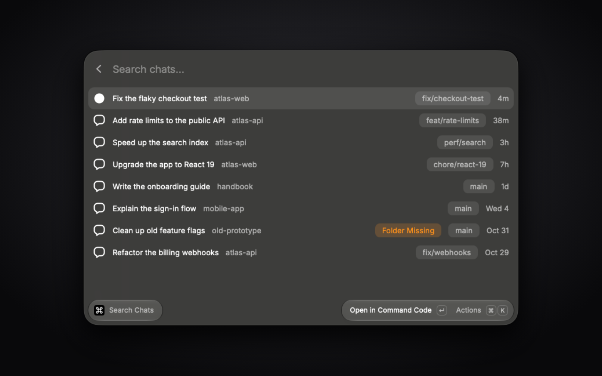
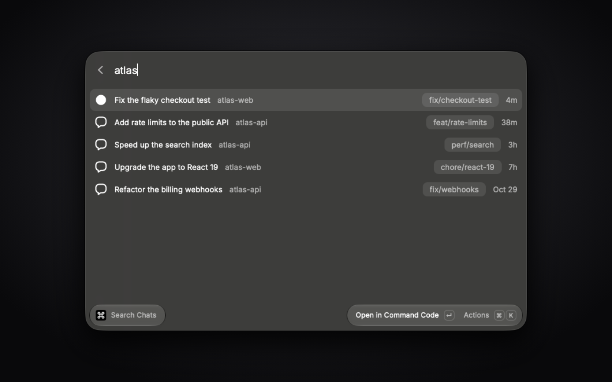
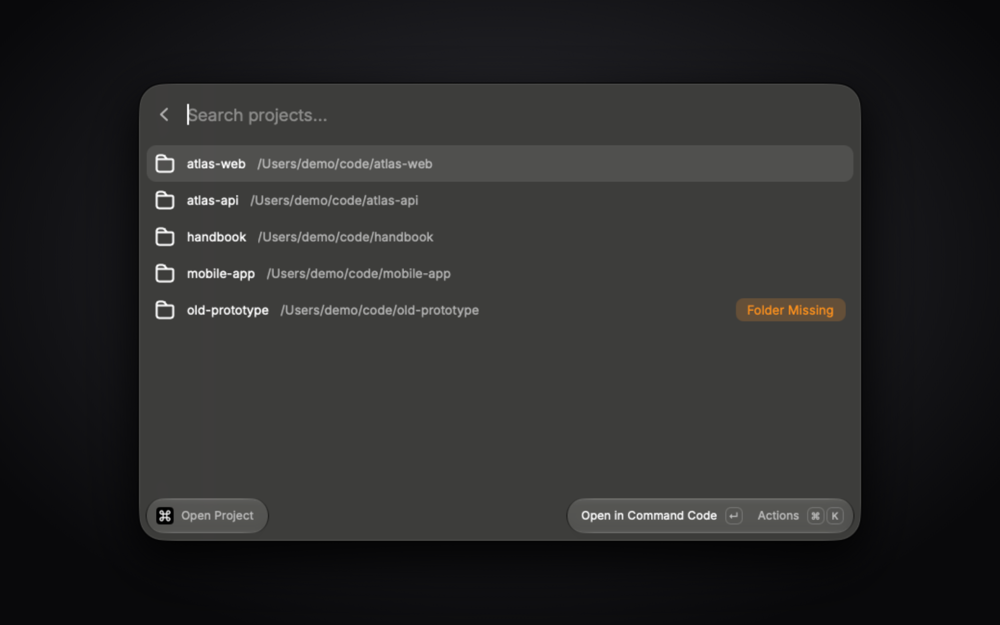

# Command Code for Raycast

Search your Command Code chats and open projects in the desktop app.

## Commands

### Search Chats

Find a chat by title, project or branch, then open it in Command Code.

### Open Project

Open one of your projects in Command Code. If a project's folder is gone, it
shows a Folder Missing tag and you can still copy its path.

## Requirements

Requires Command Code 0.1.61 or newer. Older versions clear a chat's saved
branch and worktree when you open it from Raycast.

[Download the Command Code desktop app](https://commandcode.ai/download) and
open it once before using these commands. The extension only reads your
local chat list and never changes it. Opening a folder the app has not seen
before asks you to trust it first.
