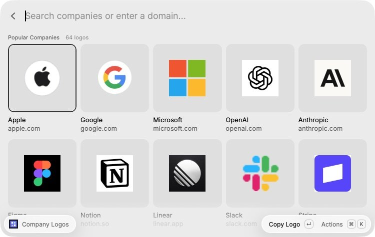

# Company Logos

Find a company logo in Raycast. Copy the image, then paste it into a document, slide, canvas, or chat.

## Use

- Search 64 popular companies by name, domain, or product alias.
- Enter another domain or full website URL to fetch its favicon.
- **Enter:** copy the PNG image.
- **⌘Enter:** paste into the previously active app.
- **⌘⇧C:** copy the image URL.
- **⌘O:** open the company website.

Images come from Google's favicon endpoint: `https://www.google.com/s2/favicons?domain=stripe.com&sz=256`. No API key needed. Requests ask for 256 px, but actual resolution depends on the website. These are website icons, not full wordmarks or vector brand assets. Unknown sites may return a generic icon or an error.

Downloaded images are converted to PNG with macOS `sips`, then cached for seven days. Copy and paste use Raycast's file clipboard API; the target app must accept image/file pastes. Preview and download requests send company domains to Google. URL paths and query strings are discarded.

## Source and images

Source code is available under the [MIT license](LICENSE). **Individual company logo files are fetched at runtime and are not included in this repository or its releases.** The catalog contains company names, domains, and search keywords. Company logos appear in the README and Store screenshots only. The bundled extension icon is original geometric artwork.
