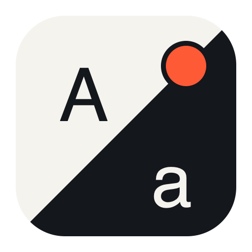

# Contrast Picker

A [Raycast](https://raycast.com) extension that checks the contrast of two colors and suggests an accessible fix.
Pick both colors from anywhere on screen with the native macOS eyedropper. No copy and paste.

## Commands

| Command                   | What it does                                                                                               |
| ------------------------- | ---------------------------------------------------------------------------------------------------------- |
| **Pick & Check Contrast** | Opens the eyedropper for the text color, then for the background, then shows the result. Give it a hotkey. |
| **Check Contrast**        | Opens with typed colors, or with your last two copied colors. Shows a form when a color is missing.        |

## Result view

- WCAG 2.2 ratio with AA / AAA badges for normal and large text
- APCA Lc, polarity and the minimum font size for your font weight
- A preview of the original pair and the suggested fix at your font size and weight
- Fixes that keep the hue and only change OKLCH lightness: change the text color, the background, or both
- A short explanation of the rules that apply to your text size

## Keyboard shortcuts

| Shortcut            | Action                                          |
| ------------------- | ----------------------------------------------- |
| `↵`                 | Copy the suggested fix in your preferred format |
| `⌘1` `⌘2` `⌘3` `⌘4` | Copy the fix as HEX, OKLCH, RGB, Tailwind       |
| `⌘⇧U`               | Use the fix (check it again as the new pair)    |
| `⌘F` / `⌘B` / `⌘⇧P` | Pick text color / background / both again       |
| `⌘T`                | Swap colors                                     |
| `⌘=` / `⌘⇧W`        | Font size / font weight                         |
| `⌘E`                | Edit colors                                     |
| `⌘L`                | Copy another fix                                |
| `⌘⇧C`               | Copy a plain-text report                        |

## Accepted color formats

`#a2d26b`, `a2d26b`, `#abc`, `#00000080`, `rgb(162 210 107)`, `hsl(88 52% 62%)`, `oklch(0.8 0.13 128)`, `rebeccapurple`,
Tailwind classes such as `text-slate-500`, `bg-sky-400/50` or `hover:bg-white`.
You can also paste `#767676 on #ffffff` in one field. Transparent text is blended over the background.
A transparent background is shown over white.

## Preferences

- **Primary Fix Target**: WCAG AA (default), WCAG AAA or APCA
- **Primary Copy Format**: HEX (default), OKLCH, RGB or Tailwind
- **Prefill from clipboard**: on by default. Needs Raycast Clipboard History for the second-to-last entry.

## Development

```bash
npm install
npm run dev        # ray develop: builds the Swift eyedropper and opens the extension in Raycast
npm test           # unit tests for color math, WCAG, APCA and fixes
npm run lint       # Raycast lint (manifest, icon, ESLint, Prettier)
npm run build      # production build
```

Requires macOS 12+ and Xcode (for the Swift eyedropper).

## Credits

- APCA contrast and font lookup from [apca-w3](https://github.com/Myndex/apca-w3) (APCA 0.0.98G-4g, font table 0.1.7 G)
- Color conversion by [Color.js](https://colorjs.io)
- Tailwind palette from [Tailwind CSS](https://tailwindcss.com) v4
