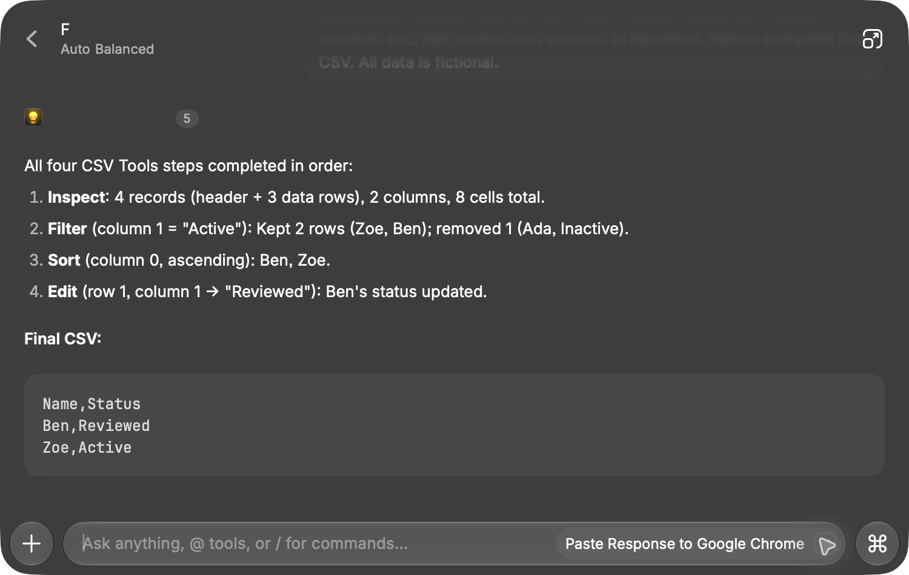

# CSV Tools for Raycast

Inspect, filter, sort, and edit explicitly supplied CSV text using [CSV File Tools](https://csvfile.tools).

## Connection and data flow

This extension connects Raycast AI directly to `https://csvfile.tools/api/csv/mcp` using Raycast’s native HTTP MCP configuration. There is no copied CSV engine or extra server. Supplied CSV text is sent to that endpoint for processing. Review the service’s published privacy policy before supplying data. Endpoint availability and host acceptance must be verified before release.

## Tools

- `inspect_csv`: record, column and cell counts; up to 20 preview records.
- `filter_csv_rows`: exact literal equality in a zero-based column.
- `sort_csv_rows`: stable code-unit string order, ascending or descending.
- `edit_csv_cells`: up to 1,000 explicit edits to existing cells; row indices include the header.

CSV input/output is limited to 256 KiB UTF-8, 50,000 cells and 200 columns. Delimiters are comma, tab, semicolon or pipe. Headers default to preserved for sorting/filtering. Values remain strings, formulas are never evaluated, and no file paths or URLs are fetched. Complete CSV results are returned rather than silently truncated.

## Example

Ask CSV Tools to inspect this text with a comma delimiter, then filter column 1 for `paid`, preserving the header:

```csv
name,status
Ada,paid
Ben,pending
```

Expected filtered CSV: `name,status\nAda,paid` (the server may serialize a trailing newline).

## Raycast example



## Requirements

Use Raycast with AI tools enabled. This extension connects to the public CSV MCP endpoint and requires no CSV API key. The extension exposes no filesystem commands; supply CSV text explicitly in the conversation.

## Development

Install dependencies with `npm ci`, then run `npm run build`. This extension contains native MCP configuration rather than a copied CSV engine or separate server.
