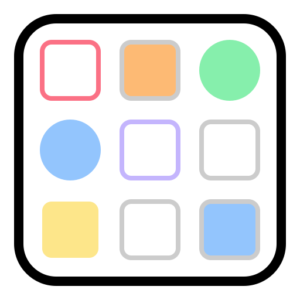
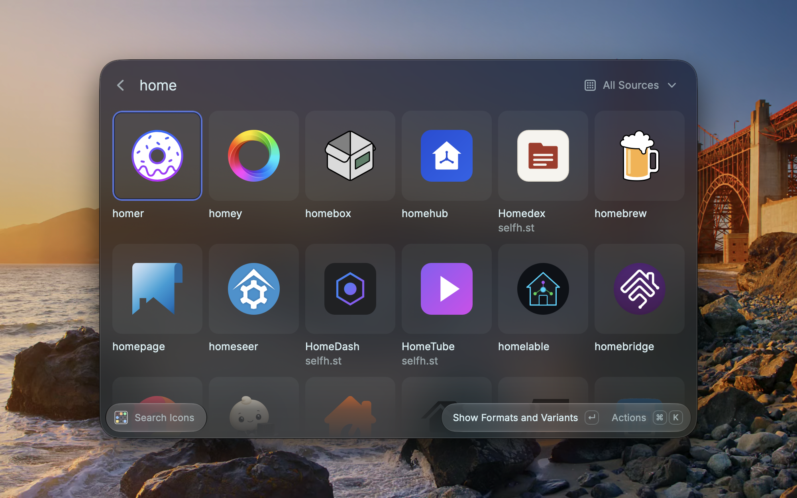
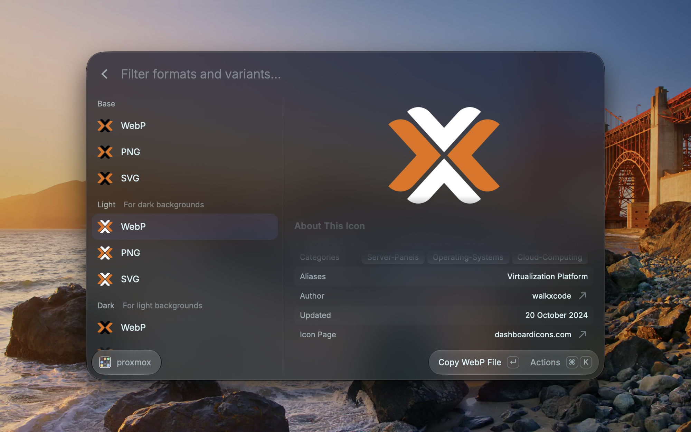
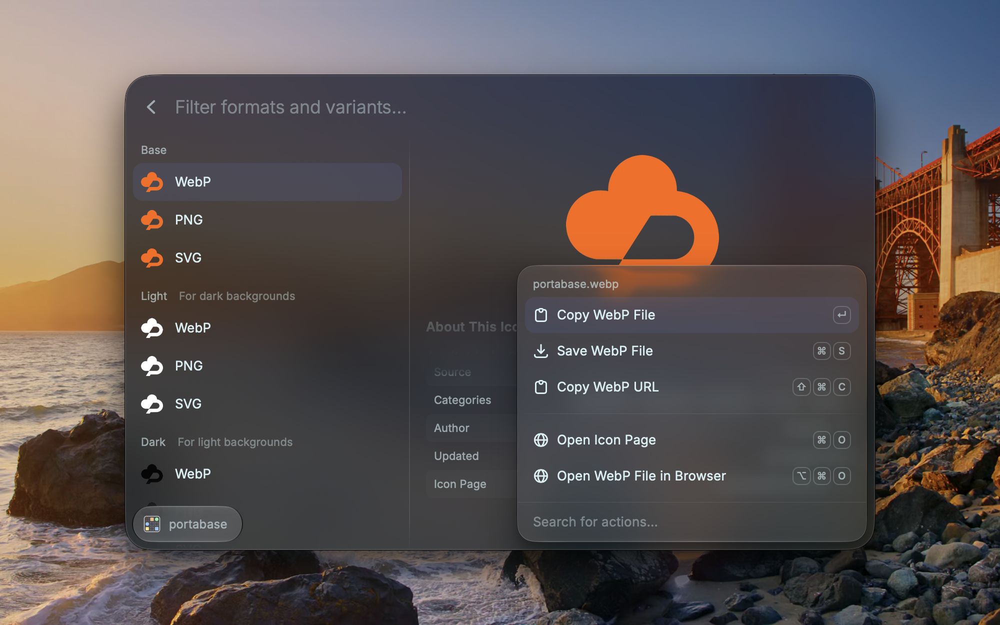
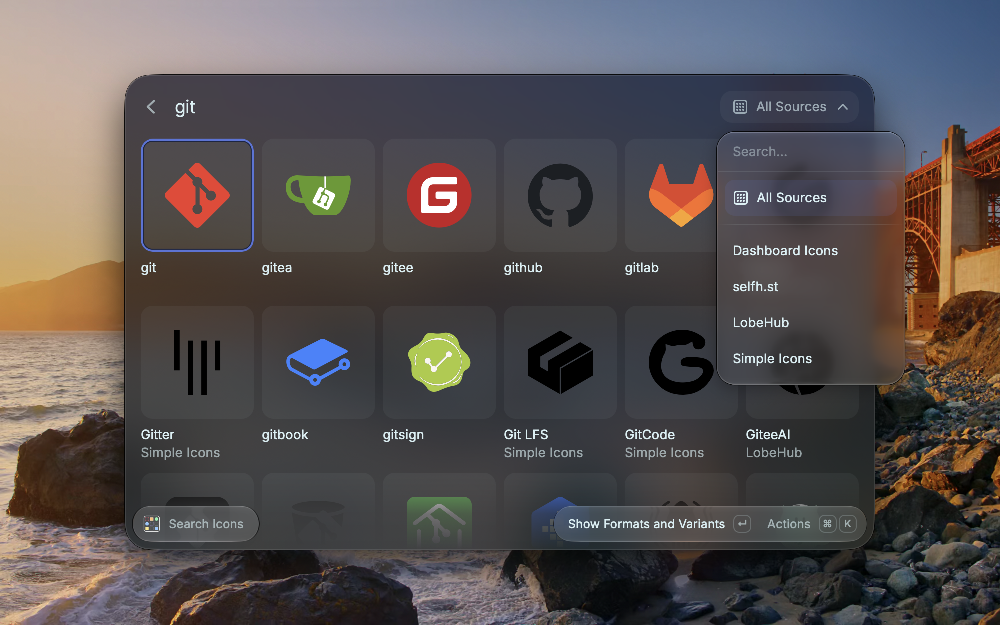

<p align="center">
  
</p>

<h1 align="center">Dashboard Icons for Raycast</h1>

<p align="center">
  Search <a href="https://dashboardicons.com">dashboardicons.com</a> from Raycast and copy or save icons for your homelab dashboard, app directory, or docs.
</p>

> [!NOTE]
> This is an independent, unofficial extension. It is not made by, affiliated with, or endorsed by Homarr Labs or the Dashboard Icons project. The extension icon is the Dashboard Icons logo, used under the Apache License 2.0 to identify the service. All rights to the Dashboard Icons name and logo remain with their owners. See [NOTICE](NOTICE).

## Screenshots

<p align="center">
  
</p>

<table>
  <tr>
    <td width="33%" align="center">
      <a href="metadata/dashboard-icons-2-variants.png"></a><br>
      <sub>Every variant and format with preview</sub>
    </td>
    <td width="33%" align="center">
      <a href="metadata/dashboard-icons-3-actions.png"></a><br>
      <sub>Copy, save, or open in the browser</sub>
    </td>
    <td width="33%" align="center">
      <a href="metadata/dashboard-icons-4-sources.png"></a><br>
      <sub>Filter by icon source</sub>
    </td>
  </tr>
</table>

## Features

- Search the Dashboard Icons catalog, and optionally selfh.st, LobeHub, and Simple Icons.
- See every variant (Base, Light, Dark, wordmarks, and custom variants) in every available format (WebP, PNG, SVG), each with a preview.
- Copy an icon file to the clipboard (WebP by default), save it to a folder, or copy its URL or SVG code.
- Shows license and attribution for icons from external catalogs.

The extension uses the public endpoint of the official Dashboard Icons MCP server (`https://dashboardicons.com/api/mcp/public`), so results, formats, and variants match the website. It needs no account, no API key, and no Raycast Pro. According to the [Dashboard Icons privacy policy](https://dashboardicons.com/privacy), the public endpoint collects no analytics.

## Install from the Raycast Store

1. Open the [Dashboard Icons page in the Raycast Store](https://www.raycast.com/macx/dashboard-icons) and click **Install Extension**.
   Alternatively, open the **Store** command in Raycast, search for "Dashboard Icons", and press `⌘↵`.
2. Run **Search Icons** from Raycast's root search.

Tip: Give the command an alias such as `icons` in Raycast Settings → Extensions. Then type `icons`, press `Tab`, enter an app name, and press `Enter`.

## Usage

1. Open **Search Icons**, press `Tab`, and type an app name such as `ntfy`.
2. Press `Enter` on an icon to see all variants and formats.
3. Press `Enter` again to copy the selected file, or press `⌘K` for more actions.

| Action | Shortcut |
| --- | --- |
| Copy file | `Enter` |
| Save file to the download folder | `⌘S` |
| Copy URL | `⌘⇧C` |
| Copy SVG code (SVG only) | `⌘⌥S` |
| Open icon page | `⌘O` |
| Copy base icon directly from search | `⌘⇧Enter` |

Light variants are meant for dark backgrounds, and Dark variants for light backgrounds.

The server allows 30 searches or icon lookups per minute per internet connection. To stay well below that, the extension searches only after a short typing pause (400 ms) and from two characters on, fetches "Did You Mean" suggestions only for queries of four or more characters, caches results, and sends at most 25 requests per minute. If you still hit the limit, wait a minute and try again.

### Preferences

- **Default Format**: format listed first and used by the quick copy action (WebP by default).
- **Download Folder**: where Save puts files (your Downloads folder by default). Existing files are never overwritten.

## Development

Requirements: [Raycast](https://raycast.com) and Node.js 22.22.2 or later.

```bash
git clone https://github.com/macx/raycast-dashboard-icons.git
cd raycast-dashboard-icons
npm install
npm run dev
```

`npm run dev` adds the extension to Raycast in development mode with hot reloading. Stop it with `⌃C`; the extension stays in Raycast.

| Command | Purpose |
| --- | --- |
| `npm run dev` | Develop in Raycast |
| `npm test` | Unit tests (offline, against an in-memory MCP server) |
| `npm run test:live` | Contract tests against the real Dashboard Icons MCP server |
| `npm run lint` | Raycast lint (manifest, icons, ESLint, Prettier) |
| `npm run build` | Distribution build, also generates `raycast-env.d.ts` |
| `npm run typecheck` | TypeScript check (run `npm run build` once first) |

### Working with Claude Code

The repository ships a Claude Code setup: [CLAUDE.md](CLAUDE.md) explains the project, and `.mcp.json` connects Claude to the public Dashboard Icons MCP server for research.

| Skill | Who | What it does |
| --- | --- | --- |
| `/validate` | Everyone | Runs all checks (lint, build, typecheck, unit and live tests) and reviews the Raycast Store checklist |
| `/icon-research` | Everyone | Looks up real icon data (formats, variants, authors, licenses) through the MCP server |
| `/screenshots` | Everyone | Explains how to take Store screenshots with Raycast 2 and files them into `metadata/` |
| `/pull-contributions` | Maintainer | Brings changes others made to the Store copy in `raycast/extensions` into this repository through a pull request |
| `/release` | Maintainer only | Verifies ownership, runs all checks, and publishes to the Raycast Store after confirmation |

| Agent | What it does |
| --- | --- |
| `store-validator` | Reviews manifest, assets, screenshots, changelog and UI texts against the Store guidelines |
| `e2e-tester` | Tests against the real MCP server and CDN files, checks the production bundle, and lists manual checks in Raycast |
| `security-reviewer` | Reviews handling of untrusted server data, file writes, URLs and dependencies |

`/release` only works for admins of this repository on a clean, up-to-date `main`; for everyone else it stops and suggests a pull request.

## Contributing

Issues and pull requests are welcome **in this repository**, which is the source of truth. The Store version is built from a copy in [raycast/extensions](https://github.com/raycast/extensions); changes made there are merged back here before each release.

1. Fork the repository and create a branch.
2. Make your change and add or update tests.
3. Run `npm run lint`, `npm run build`, and `npm test`.
4. Open a pull request against `main`. CI runs the same checks and must pass; `main` accepts changes only through pull requests.

Releases to the Raycast Store are published by the maintainer with `npm run publish`, which opens a pull request in [raycast/extensions](https://github.com/raycast/extensions).

## Releasing

Versions follow [Semantic Versioning](https://semver.org): patch (`1.0.1`) for bug fixes, minor (`1.1.0`) for new features, major (`2.0.0`) for changes that break existing behavior. The version lives in `package.json` and is the title of each `CHANGELOG.md` entry, which the Store shows as the version history.

A release is a pull request to [raycast/extensions](https://github.com/raycast/extensions) that Raycast reviews and merges; after the merge the update is published to the Store automatically. With Claude Code, the maintainer runs `/release`, which walks through these steps:

1. **Pull Store-side contributions** (skip before the first release): `/pull-contributions`, or `npm run pull-contributions` on a branch, then merge the result through a pull request.
2. **Bump the version and update the changelog** on a branch, merged through a pull request:

   ```bash
   npm version patch --no-git-tag-version   # or minor / major
   ```

   ```markdown
   ## [1.0.1] - {PR_MERGE_DATE}

   - What changed, in plain words
   ```

   Raycast replaces `{PR_MERGE_DATE}` with the merge date.
3. **Update screenshots if the UI changed.** Run `npm run dev`, open the command, and use Raycast's built-in **Capture Window** command (assign a hotkey in Raycast Settings → Extensions) with **Save to Metadata**. Screenshots go to `metadata/`: PNG, 2000 × 1250 px, at most six, one theme and background, no personal data.
4. **Release** from an up-to-date, clean `main`:

   ```bash
   npm run release
   ```

   This runs all checks (`npm run check`: lint, build, typecheck, unit and live tests) and then `npm run publish`, which asks you to sign in with GitHub and opens or updates the pull request in `raycast/extensions`.
5. **Follow the review.** Fixes during the review go into the same version: merge them here, then run `npm run publish` again to update the same pull request.
6. **After Raycast merges**, tag the published commit and create a GitHub release with the changelog entry:

   ```bash
   git tag -a v1.0.1 -m "v1.0.1" && git push origin v1.0.1
   gh release create v1.0.1 --title "v1.0.1" --notes "<changelog entry>"
   ```

## License

The extension code is licensed under the [MIT License](LICENSE). The Dashboard Icons logo and all icons shown by the extension belong to their respective owners; see [NOTICE](NOTICE).
