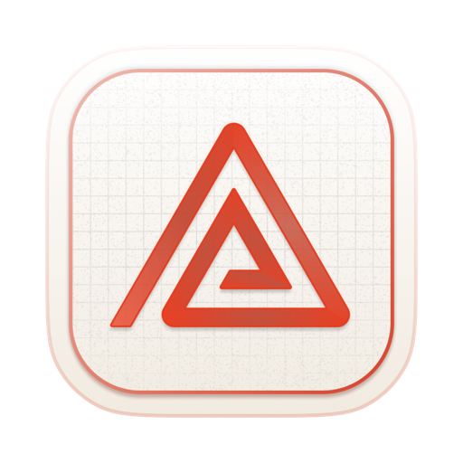
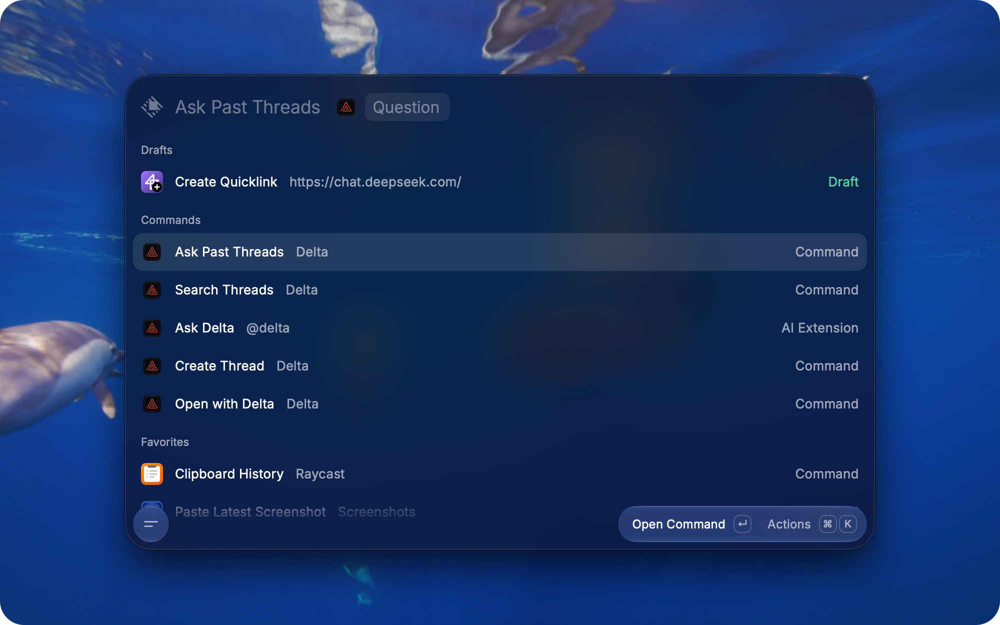

  <picture>
    <source media="(prefers-color-scheme: dark)" srcset="assets/icon@dark.png">
    
  </picture>

<h1 align="center">Delta for Raycast</h1>

  Search, ask and start <a href="https://delta.dev">delta.dev</a> threads

  
  

Tested on Delta 0.25

### Requirements

Install [Delta](https://delta.dev/download) and sign in

---

### Commands

| Command | What it does |
| --- | --- |
| Search Threads | Find a thread, open it, share it, or ask about it |
| Create Thread | Start a thread with a draft prompt |
| Open with Delta | Open the Finder selection in Delta |
| Ask Past Threads | Ask from root search, best as a [fallback command](https://manual.raycast.com/fallback-commands) |

Ask `@delta` in Raycast AI about your threads

---

### Development

Сontribute!!!

    npm i
    npm run dev

---

Not affiliated with Zed Industries
