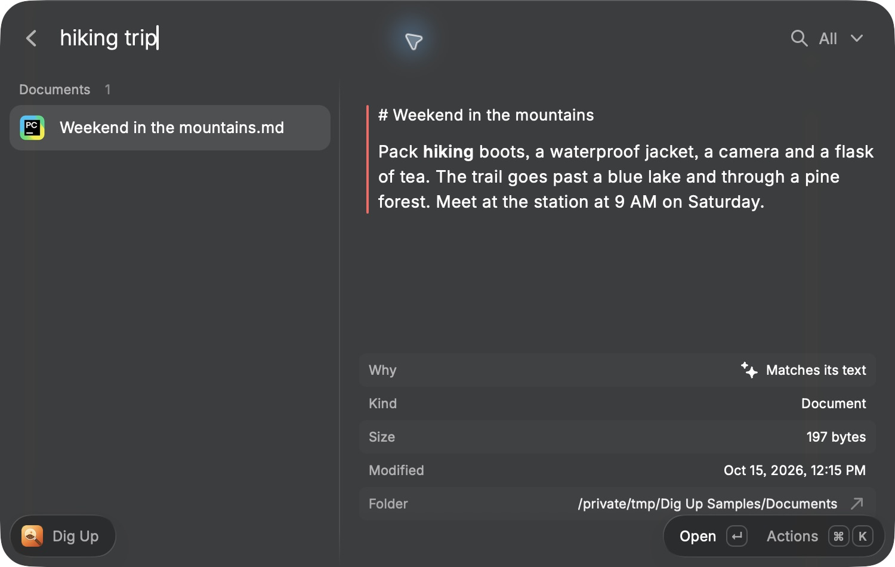
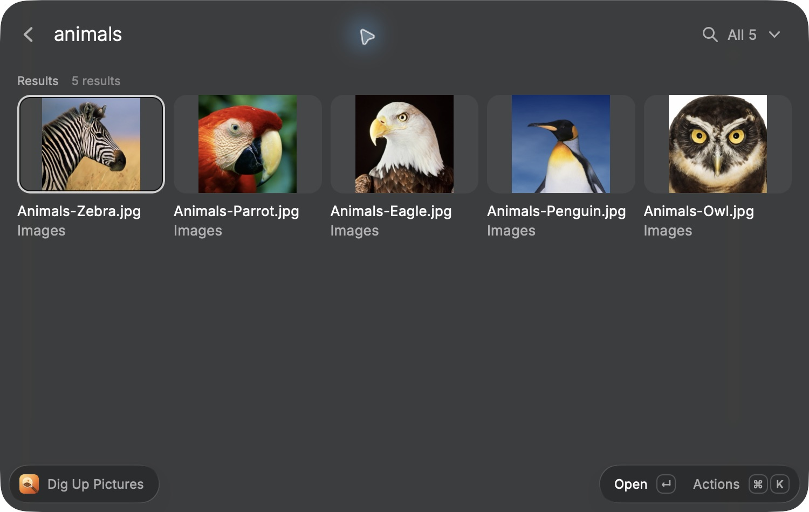

# Dig Up

Search your files by what's in them, from Raycast. Describe a screenshot, a photo, a page of a PDF, a moment in a
recording or a video, or a piece of code in your own words, and Dig Up finds it.

Everything runs on your Mac with Google DeepMind's EmbeddingGemma 2. Dig Up is a Raycast port of
[DigUp](https://github.com/ARahim3/DigUp) by Abdur Rahim, with DigUp's search, indexing rules and wording.

## Requirements

An Apple Silicon Mac (M1 or later), macOS 14 or later, and Raycast are required. Intel Macs and Windows are not supported. Allow about 1 GB for the model and search engine, plus space for your file index. The first indexing pass can take several minutes; search stays available while it runs.

## What you can find

- **Screenshots and photos**: “that payment error”, “the zebra”, “whiteboard from Tuesday”. Text in screenshots is
  read too, so an error code or an invoice number finds its screenshot.
- **PDFs and documents**: “the clause about pets in the lease”, “flight receipt”. A PDF result points at the page that
  matched.
- **Moments inside audio and video**: “where they talk about sleep”, “the part with the drums”. A result says where:
  `0:06` for a frame, `♪ 0:25` for a video's sound.
- **Code**, by what it does: start with `code:`, as in `code: retry a request with backoff`. A result opens in your
  editor at the line.

It also works across languages: an English query finds a note in Bengali or Arabic, and the other way round.

## First run

1. Open **Dig Up** and choose the setup action. It names the missing component, such as **Download Search Engine**. Dig Up downloads, once:
   - the model, EmbeddingGemma 2 (two Q8_0 files from Hugging Face, **865 MB** together), and
   - llama.cpp's `llama-server` (build b11624, from GitHub).

   The download resumes if it's cut off and is checked before use. If DigUp is installed, or the two model files are
   in your Hugging Face cache, Dig Up reuses them. It still downloads the search engine if it is missing. You can also point the **Model Folder**
   preference at a folder that holds `embeddinggemma-2-Q8_0.gguf` and `mmproj-embeddinggemma-2-Q8_0.gguf`, and the
   **llama-server** preference at your own build (b11452 or newer).

2. Open **Dig Up Folders** and add the folders to search (Desktop, Documents, Downloads, … are suggested). The folders
   you pick say what adding them costs, such as `Adds about 4 min of indexing, and 2 min more for long files`: long
   PDFs and documents get their first pages first and the rest afterwards. Each folder you search shows how much of it
   is indexed and what still waits, such as `1,204 of 1,300 indexed` and `8 waiting · 3 couldn't be read`; until its
   first pass finds files, it shows how long that pass takes, such as `≈ 4 min`.
3. Run **Dig Up Status** once to put Dig Up in the menu bar. Raycast runs a menu-bar command only after it's been
   opened once; from then on it checks every minute, which shows how indexing goes and starts indexing again after a
   restart.
4. Search right away: file names match at once, and results by meaning fill in as indexing goes, newest files first.

Meaning search compares files within your library. With very small libraries, broad descriptions can return no matches; try a specific detail or a word from the file name.

## Open Dig Up with ⇧⌘Space

Raycast extensions can't set a hotkey themselves. In Raycast's settings, open **Extensions → Dig Up**, select the
**Dig Up** command and record a hotkey. DigUp uses **⇧⌘Space**; if the DigUp app itself is installed and holds that
shortcut, pick another for one of them.

## Give Raycast Full Disk Access

Dig Up reads your files through Raycast, so macOS asks on Raycast's behalf. To search Desktop, Documents, Downloads,
iCloud Drive or external drives without a prompt for each, give **Raycast** Full Disk Access in **System Settings →
Privacy & Security → Full Disk Access**, then quit and reopen Raycast. **Dig Up Folders → Check Access** tells you
when a folder can't be read; such a folder shows `No access`. A folder on a drive that isn't plugged in shows
`Not connected` instead: Dig Up skips it and keeps its files for when it's back.

## Commands

| Command                              | What it does                                                                                                                                                                                                                                                                                                                                                                                                              |
| ------------------------------------ | ------------------------------------------------------------------------------------------------------------------------------------------------------------------------------------------------------------------------------------------------------------------------------------------------------------------------------------------------------------------------------------------------------------------------- |
| **Dig Up**                           | The search. Keyword matches show as you type and results by meaning replace them a moment later. Results refresh as indexing progresses, grouped by kind (Screenshots, Images, Documents, Video, Audio, Code). Results that match much less well fold away under “N weaker matches”. The detail pane (⌘D) shows the page with your words marked, the frame at the moment, the passage, or the lines of code that matched. |
| **Dig Up Pictures**                  | The same search as a picture grid with a kind filter that counts each kind's results (⌘1 to ⌘7).                                                                                                                                                                                                                                                                                                                          |
| **Dig Up Folders**                   | The folders to search, folders to skip inside them, code folders, skipped file types, first-pass estimates, access checks, and Pause / Resume.                                                                                                                                                                                                                                                                            |
| **Dig Up Status**                    | A menu-bar item: indexing progress, what's being read, what's indexed, Pause / Resume, Index Now (⌥: Rebuild Index). Run it once to put it in the menu bar; it then checks every minute, which also restarts indexing after a reboot.                                                                                                                                                                                     |
| **Dig Up: Index Now**                | Look for new and changed files now.                                                                                                                                                                                                                                                                                                                                                                                       |
| **Dig Up: Pause or Resume Indexing** | Pause indexing until you resume it. Search keeps working.                                                                                                                                                                                                                                                                                                                                                                 |
| **Dig Up: Rebuild Index**            | Embed every file again. Search by name keeps working meanwhile.                                                                                                                                                                                                                                                                                                                                                           |

### Keys in Dig Up

| Key | Action                                                                                                                                                                     |
| --- | -------------------------------------------------------------------------------------------------------------------------------------------------------------------------- |
| ↩   | Open, where it matched: **Open at p. 3** (the PDF app gets words from that page in its search), **Open at 0:06** (in QuickTime Player or IINA), **Open in Zed at line 12** |
| ⌘↩  | Show in Finder                                                                                                                                                             |
| ⌘R  | Refresh results                                                                                                                                                          |
| ⌘Y  | Quick Look                                                                                                                                                                 |
| ⌘⇧C | Copy the file, to paste into a folder, a mail or a chat                                                                                                                    |
| ⌘⇧O | Open With                                                                                                                                                                  |
| ⌘O  | The same search in Dig Up Pictures                                                                                                                                         |
| ⌘D  | Show or hide the detail pane (remembered)                                                                                                                                  |
| ⌘⇧W | Show or hide the weaker matches                                                                                                                                            |
| ⌘P  | The kind filter                                                                                                                                                            |

## Code search

Add code folders in **Dig Up Folders** (it suggests the ones with git repositories). Code gets an index of its own and
never shows up in other searches; type `code:` in Dig Up, or pick **Code** in the kind filter. Code search reads
source files, notebooks and a repo's own docs, and skips what git ignores, vendored and generated code, data files,
and anything that looks like a key or a password.

A code result opens at the line in the **Code Editor** preference: Zed, Cursor, Visual Studio Code, Windsurf,
VSCodium, Sublime Text, the JetBrains IDEs, Xcode, BBEdit or TextMate. The default is the first of those installed.

## Preferences

| Preference            | Default                |                                                                                                                                                                               |
| --------------------- | ---------------------- | ----------------------------------------------------------------------------------------------------------------------------------------------------------------------------- |
| Code Editor           | First installed editor | Where code results open, at the line.                                                                                                                                         |
| Recordings and Videos | The file's default app | QuickTime Player and IINA can start at the moment that matched. macOS asks once whether Raycast may control QuickTime Player; without that, the recording opens at the start. |
| Indexing              | Index on battery power | Off: a folder's first pass waits for a charger. New files always go in right away. Low Power Mode and a hot Mac hold the first pass either way.                               |
| Index Hours           | Any time               | Only index between these hours, such as `22-7`. Search works all day. Outside them, the status says when indexing starts again: `indexing from 10:00 PM`.                     |
| llama-server          | Downloaded             | Your own `llama-server`, build b11452 or newer.                                                                                                                               |
| Model Folder          | Found or downloaded    | A folder with the two model files.                                                                                                                                            |

## Privacy

Everything is indexed and searched on this Mac. Dig Up goes online only for the one-time downloads above (the model
from Hugging Face, llama.cpp from GitHub), which send nothing about your files. There's no account and no telemetry.

Dig Up only reads files: it never changes, moves or uploads them. It reads only the folders you choose, skips hidden
folders, app bundles, caches and files that live only in iCloud, and never downloads them.

Under the hood, a small background process (the engine) does the indexing and searching. Raycast's commands talk to it
over a Unix socket that only your user can open, and the model runs in `llama-server` on `127.0.0.1`. The engine
stops when Raycast quits; the next command or menu-bar check starts it again. The index, the model and the logs live
in the extension's support folder (`~/Library/Application Support/com.raycast.macos/extensions/…`).

## Differences from DigUp

Raycast draws the window, so a few things work differently:

- Quick Look opens the whole file, not the matched page or moment; the detail pane shows the page or frame instead.
- ⌘C in Raycast's search field copies text, so copying the file is ⌘⇧C.
- Results can't be dragged out: copy the file, or show it in Finder.
- Recordings don't play inside the window: **Open at 0:06** starts them at the moment in QuickTime Player or IINA.

## Development

Run `npm ci`, then `npm run build:helper` on an Apple Silicon Mac with Xcode Command Line Tools, and `npm run build`. `npm run dev` builds both the helper and engine before opening the extension in Raycast. Run `npm run typecheck` and `npm test` for checks.

The small native helper in `assets/digup-helper` is built from the included `helper/*.swift` files with `scripts/build-helper.sh`. Store builds use this bundled helper and rebuild the JavaScript engine from source; they do not require Swift or Xcode. See [native helper build notes](docs/NATIVE-HELPER.md). The AI model and llama.cpp are downloaded from pinned upstream releases with SHA-256 checks, rather than bundled.

## Credits

- [DigUp](https://github.com/ARahim3/DigUp) by Abdur Rahim (MIT): the design, search, indexing rules and wording this
  extension ports.
- [EmbeddingGemma 2](https://huggingface.co/google) by Google DeepMind (Apache 2.0): the model.
- [llama.cpp](https://github.com/ggml-org/llama.cpp) (MIT): runs the model.
