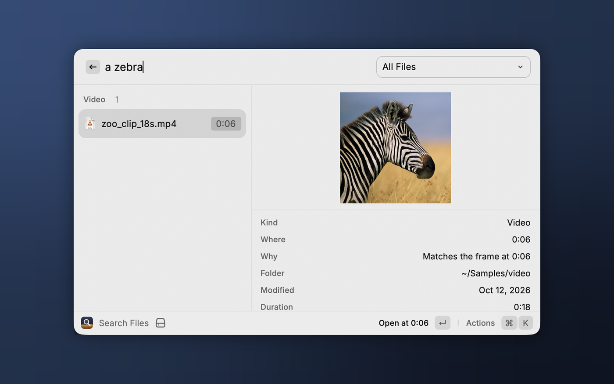
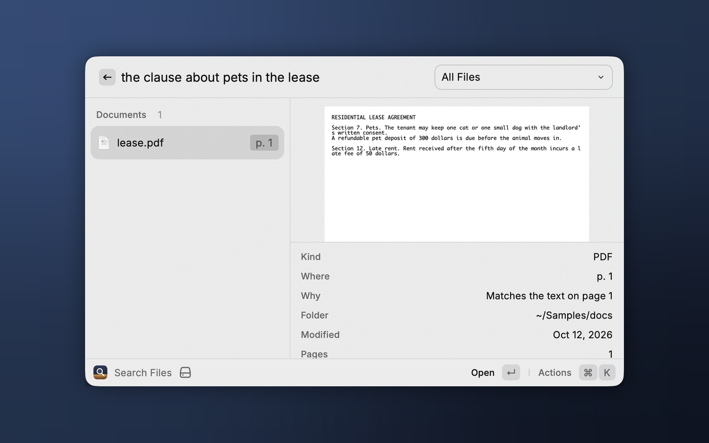
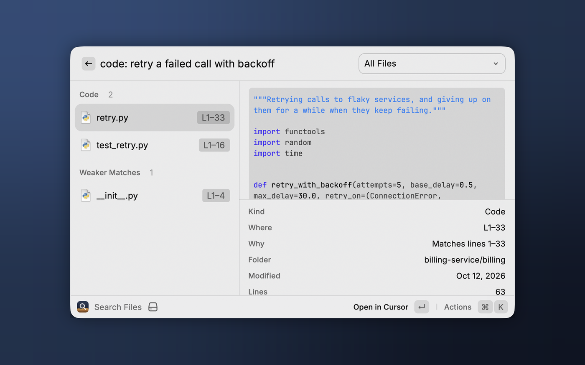
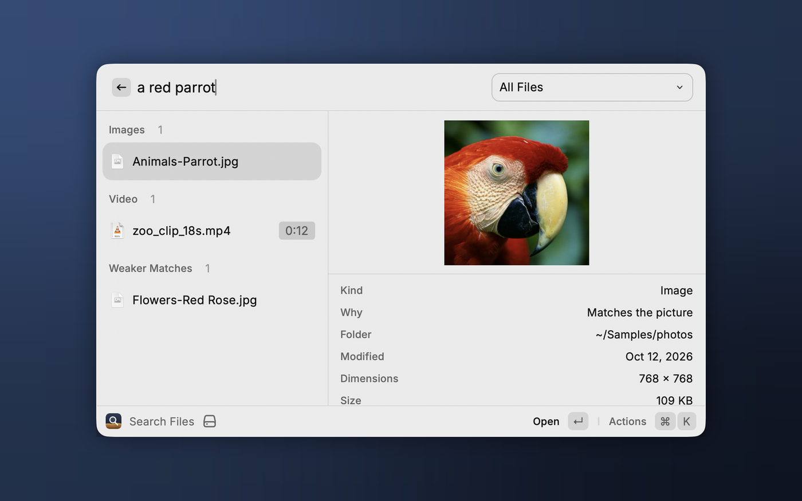

# DigUp Search for Raycast

Search the files on your Mac by what's in them, from Raycast. Describe what you're looking for and get the picture,
the PDF page, the moment in a recording or a video, or the code that matches.



This extension is a front end for [DigUp](https://github.com/ARahim3/DigUp), a free and open-source Mac app that
indexes your folders with Google DeepMind's EmbeddingGemma 2, entirely on your Mac. DigUp builds and keeps the
index; this extension searches it.

> An unofficial, community-made extension. It is not affiliated with DigUp's author.

## Requirements

- An Apple Silicon Mac with macOS 14 or later
- [DigUp](https://github.com/ARahim3/DigUp/releases/latest) 0.6.1 or newer, opened once, with at least one folder
  indexed (`brew install --cask arahim3/tap/digup`)
- Raycast

DigUp doesn't need to be running while you search.

## Install from source

You need Node.js 22.22.2 or newer.

```bash
git clone https://github.com/roy-jiang/digup-raycast && cd digup-raycast
npm install && npm run dev
```

Once "Search Files" shows up in Raycast you can stop `npm run dev` with ⌃C: the extension stays installed. To
update, `git pull` and run the same two commands again.

## Use

Open **Search Files** and describe what you're looking for:

- "a dog on the beach" finds the photo; "payment declined error" the screenshot
- "the clause about pets in the lease" finds the PDF page
- "where they talk about sleep" finds the minute of a podcast
- "zebra in a video" finds the clip, at the moment the zebra shows up
- "code: retry a failed call with backoff" finds the function, if code search is on in DigUp

Exact words count too: invoice numbers, error codes and names are matched as written. While you type you see word
matches; when you pause, matches by meaning replace them.

If DigUp adds or updates files while the command is open, the next search after typing stops uses the updated index.

Pick a file type from the dropdown to narrow the search. The Code item is there when code search is on in DigUp.

| | |
|---|---|
|  |  |
|  | |

| Action | Key | What it does |
|---|---|---|
| Open | ↩ | Videos and recordings open in QuickTime Player at the moment that matched. PDFs open in your default PDF app; when that is Preview and the match is past the first page, Preview's search is filled with a word from that page. Code opens in your editor at the line. Everything else opens normally. |
| Show in Finder | ⌘↩ | Reveals the file |
| Toggle Quick Look | ⌘Y | Previews the file |
| Open With… | ⌘⇧O | Picks another app |
| Copy File | ⌘⇧C | Copies the file itself, to paste anywhere |
| Copy Path | ⌘⌃C | Copies where the file is |

⌘P opens the file-type dropdown, and ⌘K lists every action.

### Which app plays videos and recordings

QuickTime Player, unless you choose another in Raycast Settings → Extensions → DigUp Search → **Open Videos and
Recordings In**. The choice holds for every video and recording among the results, whatever app opens the file
elsewhere on your Mac: an MP3 that Finder gives to Music opens in QuickTime Player from here.

- **QuickTime Player** starts at the moment that matched. It is told the moment by script, as DigUp itself does it:
  the first time, macOS asks whether Raycast may control QuickTime Player. A file it can't play (MKV, WebM, FLAC…)
  opens in its default app instead.
- **VLC** and **IINA** start at the moment too. VLC is started with the moment as an argument; one that is already
  running is told by script, because arguments only reach an app as it starts, and for that macOS asks once whether
  Raycast may control VLC.
- **Any other app** gets the file and starts at its beginning: the result shows the moment, so you can go there
  yourself. If the app can't take the file, its default app opens it.

Code opens in the editor chosen in DigUp's Settings → Code (Zed, VS Code, Cursor, Xcode, Sublime Text, JetBrains
IDEs and a few more), or the first of them that's installed.

## How it works

When you open the command, the extension starts DigUp's own helper,
`DigUp.app/Contents/Helpers/digup search-service`, and talks to it over standard input and output. The helper reads
DigUp's index and loads the text part of the model (about 450 MB of memory while the command is open). It quits when
you close the command. Nothing leaves your Mac.

The extension reads DigUp's settings (which folders, where the index is) and never changes them or the index.

## Limits

- Quick Look opens the file, not the page or the moment: Raycast can only hand it a path.
- Choosing folders, pausing indexing and downloading the model happen in DigUp.
- macOS only, like DigUp for now.

## Troubleshooting

| You see | Do this |
|---|---|
| Install DigUp to Get Started | Install DigUp, open it once and choose folders |
| Update DigUp to Continue | Update to 0.6.1 or newer |
| Reinstall DigUp to Continue | DigUp is there but its search helper isn't: download DigUp again and replace the app |
| Open DigUp to Choose Folders | Open DigUp and let it index at least one folder |
| Allow Raycast to Read Your Folders | System Settings → Privacy & Security → Files and Folders → turn the folder on for Raycast |
| "Meaning Search Is Off" | Open DigUp and let the model finish downloading; word matches still work |
| DigUp Stopped Responding | Choose Retry. If it happens again, Copy Error Log and report it |
| Results are missing | Check the folder is indexed in DigUp, and that Raycast may read it (see above) |

## Development

```bash
npm test          # unit tests
npm run lint      # Raycast's checks, ESLint and Prettier
npm run build     # a distribution build, with type checking
npm run smoke     # the real helper against your own DigUp index; prints counts, never file names
```

In development mode (`npm run dev`) the extension reads `~/.config/digup-raycast/dev-settings.json`, if it exists,
to search another index instead of DigUp's own, for example a small folder indexed just for testing:

```json
{ "indexDir": "~/Samples-index", "roots": ["~/Samples"], "codeRoots": ["~/Samples/code"] }
```

DigUp's helper builds such an index:
`/Applications/DigUp.app/Contents/Helpers/digup index ~/Samples --index ~/Samples-index` (add `--code` for the code
folder). The Store build ignores the file; `npm run smoke` reads it too.

The helper's protocol is described at the top of DigUp's
[`SearchService.swift`](https://github.com/ARahim3/DigUp/blob/main/Sources/digup/SearchService.swift).

## License

MIT. Parts of this extension are adapted from DigUp, which is by Abdur Rahim and MIT licensed: see
[THIRD_PARTY_NOTICES.md](THIRD_PARTY_NOTICES.md). EmbeddingGemma is a Google model. Raycast is a trademark of
Raycast Technologies.
