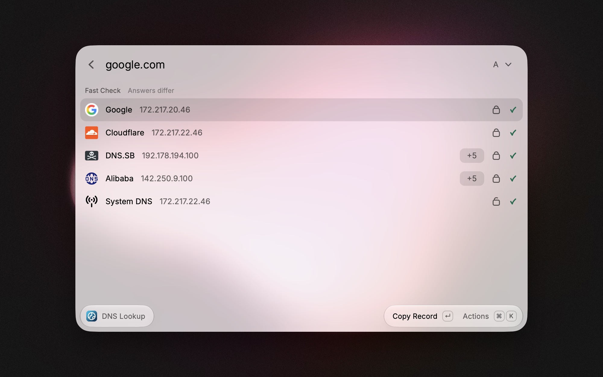
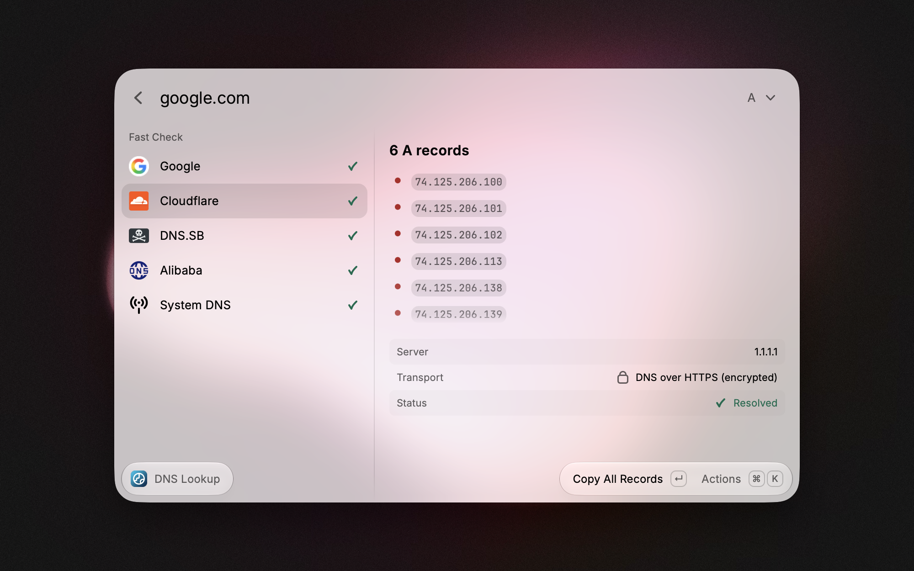
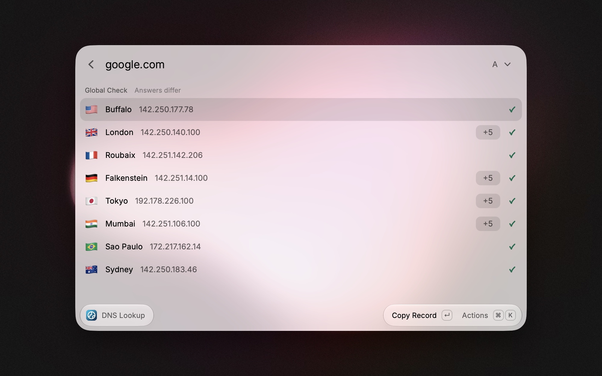
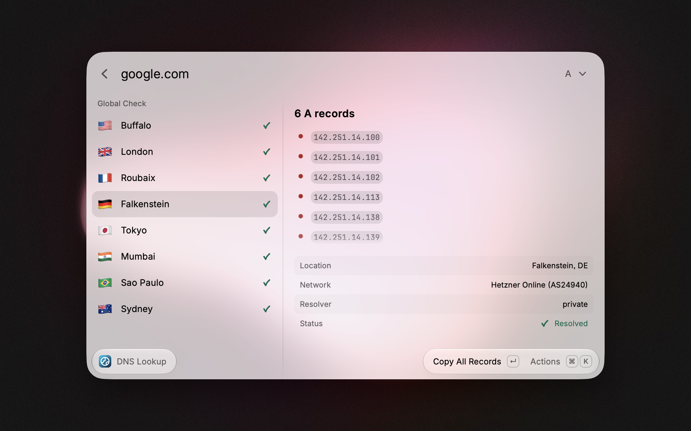

  
  <h1>DNS Lookup for Raycast</h1>
  
<em>Check DNS propagation instantly using the world's fastest resolvers and physical probes.</em>

---

DNS Lookup for Raycast is a powerful, zero-config tool designed for developers and sysadmins. It offers two modes: a **Fast Check** for immediate debugging via DoH (DNS over HTTPS) or classic DNS (UDP port 53), and a **Global Check** to verify worldwide propagation using physical probes via the Globalping network.

## 🚀 Features

### ⚡️ Fast Check (Instant)
Query the 4 major DNS providers simultaneously, plus the resolver configured on your machine. Perfect for checking if your changes are live.
* 🇺🇸 **Google Public DNS** (8.8.8.8)
* ☁️ **Cloudflare** (1.1.1.1)
* 🇩🇪 **DNS.SB** (Europe)
* 🇨🇳 **Alibaba DNS** (Asia)
* 💻 **System DNS** (your local or corporate resolver, always queried over classic DNS)

Each result shows the transport that answered it: 🔒 for DoH, 🔓 for classic DNS. By default, the extension uses DoH and automatically falls back to classic DNS (UDP port 53) when HTTPS lookups are blocked, for example behind a firewall that only allows port 53.

> Some networks intercept port 53 and answer every classic DNS query themselves. In that case, classic DNS (🔓) results come from that network resolver rather than from the provider shown on the row.

### 🌍 Global Check (Propagation)
Verify your DNS propagation across the globe using real physical probes (not just proxies).
* **Surgical Precision:** Queries 8 probes strategically distributed across **North America, Europe, Asia, South America, and Oceania**.
* **Real-world data:** Shows the country flag, and the ISP/network name (e.g., Comcast, Orange, AWS) in the detail panel.
* **Zero-Config:** Works out-of-the-box without an API key (uses the free tier limits).

### 🛠 Supported Records
* **Standard:** A, AAAA, CNAME, MX, NS, TXT.
* **Advanced:** SOA (formatted for readability) and SRV.

## ⚙️ Configuration (Optional)

The extension works perfectly without any configuration. Two optional preferences are available in the Raycast extension preferences:

| Preference | Description |
| --- | --- |
| **Fast Check Transport** | `Auto (DoH, Fallback to UDP 53)` (default), `DNS over HTTPS Only` or `Classic DNS Only (UDP 53)`. Pick the UDP option when your network forbids encrypted DNS. |
| **Globalping API Key** | Bypass the anonymous rate limits and use purchased Globalping credits if needed. |

To get a Globalping API Key:

1.  Create an account on [Globalping](https://globalping.io/).
2.  Generate an API Token.
3.  Enter it in the Raycast extension preferences.

## 📸 Screenshots

*Fast Check: the 4 public resolvers and your system DNS, with the transport used (🔒 DoH, 🔓 classic DNS) and whether their answers agree.*

*Detail panel (`Cmd + D`): every record, with the server, transport and status.*

*Global Check: worldwide propagation from 8 Globalping probes.*

*Probe details: location, network, resolver and every record.*

## 💡 How to use

1.  **Enter a domain** (e.g., `google.com`) in the command argument, or in the search bar and press `Enter`.
2.  **Fast Check** runs automatically when the domain is passed as an argument.
3.  **Select a Record Type** (A, MX, TXT...) via the dropdown: the current check runs again with it.
4.  **Press `Cmd + Shift + Enter`** (`Ctrl + Shift + Enter` on Windows) to switch to **Global Check**.
5.  **Press `Enter`** on a result to copy its records.
6.  **Press `Cmd + D`** (`Ctrl + D` on Windows) to show the detail panel with every record and the resolver or probe information.

The section header tells you whether all resolvers or probes return the same answer (`All identical` or `Answers differ`), which is what you want to see once a change has propagated. Domains using geo-routing (CDNs, large websites) legitimately return different answers.

## 🛡 Privacy

This extension communicates directly with:
* `dns.google` / `8.8.8.8`
* `cloudflare-dns.com` / `1.1.1.1`
* `doh.dns.sb` / `185.222.222.222`
* `dns.alidns.com` / `223.5.5.5`
* the DNS resolver configured on your system
* `api.globalping.io`

Provider logos are loaded through Raycast's favicon service. No data is sent to any other third-party server or analytics.

---
Have feedback or need help? Feel free to reach out at hi@vltn.sh.

_This extension uses the awesome services of [Globalping](https://globalping.io) and standard DoH providers. I am not affiliated with, partnered with, or compensated by any of these companies — I simply use their free services to make sysadmins' lives easier._
