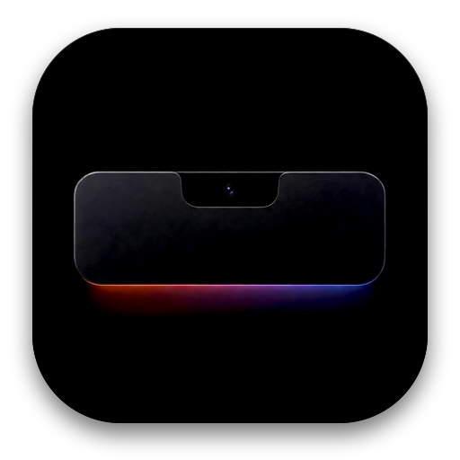

# Dynamic Island for Mac 🏝️

Transform your MacBook camera notch into an interactive, fluid **Dynamic Island** with media playback controls, a focus timer, live audio volume mixer, calendar, and real-time system metrics.

Built strictly according to [Raycast Extension Guidelines](https://developers.raycast.com/) with an ultra-lightweight, native Swift engine (<0.1% idle CPU).



---

## ✨ Features

- **Hardware-Accurate Notch Integration**:
  - Automatically queries `NSScreen.safeAreaInsets` to seamlessly anchor to the physical camera notch (Liquid Retina XDR on MacBook Pro 14"/16" and MacBook Air).
  - Automatically switches to a sleek floating pill on external monitors or non-notched Macs.
- 🎵 **Now Playing & Media Controller**:
  - Displays currently playing track, artist, album, live playback position scrubber, and equalizer animation.
  - Interactive playback controls: Play/Pause, Next Track, Previous Track.
- 🎚️ **Volume Mixer**:
  - Independent per-application volume sliders and audio route controls directly from the notch.
- ⏱️ **Focus Timer**:
  - Integrated Pomodoro timer directly inside the notch with visual progress and countdown.
- 📅 **Calendar**:
  - Day-by-day navigation and schedule preview directly under the notch.
- 📊 **System Monitor**:
  - Real-time CPU, RAM, Battery, Network, and Disk usage metrics with clean card layout and customizable badges.
- ⚡ **Zero Idle Overhead**:
  - Built natively in Swift with AppKit and SwiftUI.
  - Communicates directly with Raycast via Distributed Notifications IPC (`com.raycast.island.*`).

---

## 🚀 Raycast Commands

| Command | Mode | Description |
| :--- | :--- | :--- |
| **Toggle Dynamic Island** | `no-view` | Quickly expand, collapse, or launch the Dynamic Island overlay. |
| **Dynamic Island Settings** | `view` | Configure widgets, notch behavior, and island options directly in Raycast. |
| **Media Controller** | `view` | Control music playback and inspect current track metadata. |
| **Volume Mixer** | `view` | Adjust master and per-application audio volumes. |
| **System Monitor** | `view` | Real-time system health metrics (CPU, RAM, Battery, etc.). |
| **Focus Timer** | `view` | Start, pause, and configure Pomodoro focus intervals with live countdown on the notch. |

---

## 🛠️ Configuration & Preferences

### Raycast Preferences
Go to **Raycast Preferences → Extensions → Dynamic Island**:

- **Display Mode**: Choose how the island anchors (`Auto-detect MacBook Notch`, `Always Notch`, or `Floating Pill`).
- **Hover to Expand**: Automatically expand the island when your mouse cursor hovers over the notch.

### Dynamic Island Settings
Open the **Dynamic Island Settings** command in Raycast to manage widget visibility and system monitors interactively:

- **Widget Visibility**: Toggle Now Playing, Volume Mixer, System Stats, Focus Timer, and Calendar widgets on the island menu.
- **System Metric Cards**: Customize which hardware metrics (CPU, GPU, Memory, Battery, Network, and Disk) appear on the notch.
- **Daemon Controls**: Stop or start the native background engine.

---

## 🔧 Building & Developing

```bash
# Start development server with live reload
npm run dev

# Run linter
npm run lint

# Build extension bundle
npm run build
```

---

## 📄 License

MIT License.
