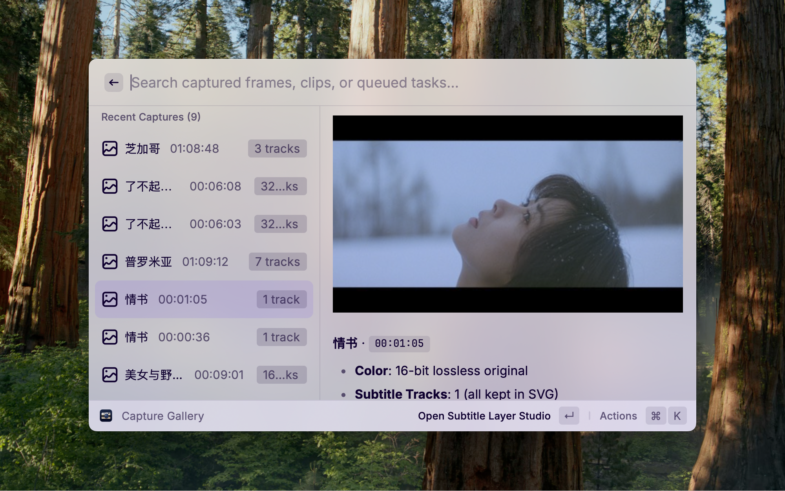
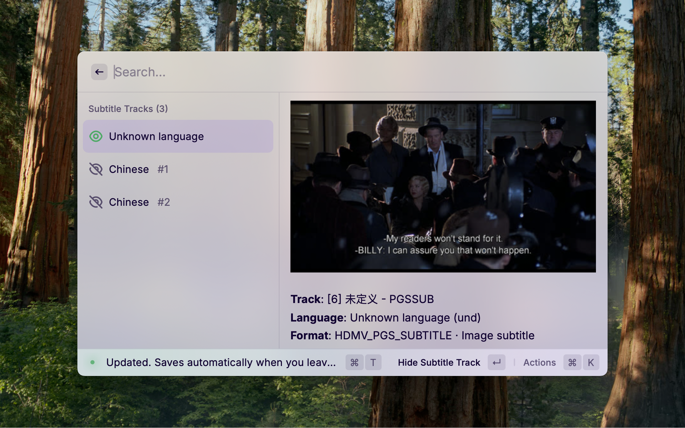

# FrameCraft

[简体中文](README.zh-CN.md)

A Raycast extension for Jellyfin / Emby. It captures stills at the source's original quality, exports video clips that keep every subtitle track, and lets you manage subtitle layers and make bilingual subtitles right inside Raycast.


## Background

When you watch Jellyfin / Emby on macOS, the popular players all fall short on screenshots and subtitle management:

- **Infuse, VidHub and similar players**: no screenshot feature, and no way to manage multiple subtitle tracks.
- **IINA**: screenshots of HDR sources look poor, often with shifted or washed-out colors.
- **Capturing the player window**: you only get what is on screen — scaled to the window, HDR converted to SDR, subtitles burned in at screen size, and sometimes the playback controls on top.

FrameCraft reads where your player is paused from within Raycast, downloads only a small part of the source around that point, and uses FFmpeg to capture that frame at original quality. It also adds multi-track subtitle management and clip export.



## How to Use

Pause your player, open Raycast and run Capture Frame. Once the task has started, carry on watching.

## Features

- **Original-quality captures**: 16-bit PNG at the source's original resolution, with HDR (PQ/HLG) preserved. It picks the frame that is on screen while paused and checks its timestamp before and after encoding.
- **Subtitle Layer Studio**: every subtitle track is saved as its own layer in an SVG, and you can manage them in Raycast:
  - Show or hide any subtitle track
  - Stack two languages for simple bilingual subtitles
  - Nudge subtitles up or down, or turn image subtitles into editable text (OCR)
  - Saves automatically when you leave the studio — no manual export
- **Clip export**: mark a start point, then export from there to the current position. The video stream is copied without re-encoding, and every audio and subtitle track is kept (MKV).
- **Works on huge files**: a 57 GB Blu-ray M2TS capture takes about a minute; a 38 GB MKV about 30 seconds.
- **Blu-ray ISO / BDMV (experimental)**: reads the disc's playlists and maps the position to the right clip.
- **Background queue**: captures run in background processes, so Raycast never freezes and several captures can run at once.

Each capture exports three files:

| File | Contents |
| :--- | :--- |
| `*_clean.png` | The frame without subtitles, 16-bit, original resolution |
| `*_subbed.png` | The same frame with your chosen subtitles burned in |
| `*_layered.svg` | The frame plus every subtitle track, one layer per track, for further editing in design tools |




## How It Works

Ideally FrameCraft would just ask the player for the decoded picture, but no mainstream Mac player allows that: Infuse, VidHub and similar clients have no scripting or export interface, and the decoded picture lives only in their own memory — nothing usable is in their caches. So FrameCraft takes the long way round and rebuilds the frame itself:

1. **Read the position**: read the paused position the player reports to Jellyfin / Emby. For IINA and QuickTime, ask the player directly.
2. **Locate the data**: use the file's own index (MKV Cues, MPEG-TS timestamps, Blu-ray playlists) to work out which part of the file holds that moment.
3. **Download the video**: download the video around that point with parallel HTTP Range requests. Compressed video can only be decoded starting from a keyframe, so a single frame can't be requested on its own.
4. **Capture and verify**: decode locally with FFmpeg, pick the frame that is on screen, and check its timestamp again after encoding.
5. **Rebuild the subtitles**: extract each subtitle track at that moment, composite it at the source's resolution and color space, and write it into the SVG layers.

Approaches that didn't work:

- **Screen capture**: gives you the pixels on your display, not the original pixels.
- **Reading the player's cache**: players keep the picture in memory only; nothing can be read from disk.
- **Reading macOS Now Playing info, Jellyfin live updates, the time shown in the UI, URL schemes**: none of them are accurate.
- **Letting FFmpeg read the remote file directly**: sparse subtitle tracks plus many small seeks over a slow network made a single capture take minutes, or time out.

Without access to the media server itself, this is the simplest direct approach.

## Player Compatibility

FrameCraft captures the position the player reports. Whether that is the frame you see on screen depends on the player. Results from frame-by-frame comparison with screen captures:

| Player | Result | Notes |
| :--- | :--- | :--- |
| **VidHub** | Excellent | mpv engine. Same frame as the screen on MKV, TS and Blu-ray ISO |
| **IINA** | Accurate | mpv engine; reads the player's own position (one-time setup, see below) |
| **Infuse** | Off | In-house engine; off by about −24 to +11 frames (≈ ±1 s), no fixed pattern |
| **Swiftly** | Off | VLC engine; also noticeably off |
| **Other Jellyfin clients** | Untested | Depends on whether the client reports the frame time or its playback clock |
| **Emby clients** | Experimental | Same API as Jellyfin, but not tested yet |

Why the offset: mpv-based players report the time of the frame on screen when paused. Infuse and VLC-based clients report their playback clock, which can stop anywhere between two frames and adds audio and display latency. This can't be corrected from outside the player. **For frame-accurate captures, use VidHub.**

## Requirements

- macOS
- [Raycast](https://www.raycast.com/)
- [FFmpeg](https://ffmpeg.org/) (install with Homebrew: `brew install ffmpeg`)
- Only for Blu-ray ISO / BDMV sources:
  - Xcode Command Line Tools: `xcode-select --install`
  - `brew install libbluray libudfread curl pkg-config`

## Installation and Setup

### Install

From source:

```bash
git clone https://github.com/stardryjun/FrameCraft.git
cd FrameCraft
npm install
npm run dev
```

After `npm run dev`, FrameCraft appears in Raycast. You can then press `Ctrl + C` to leave development mode; the extension stays in Raycast.

### Connect Jellyfin / Emby

Open FrameCraft's preferences in Raycast (press `⌘ ,` on any FrameCraft command) and fill in:

- **Server URL**: the address you open in a browser. Include any sub-path such as `/jellyfin`.
- **API Key**: create one on the API Keys page of the server dashboard (Jellyfin: Dashboard → API Keys). Not your login password.
- **User Name Filter** (optional): set it if several people stream at the same time.

Then play something, pause, and run **Capture Frame**. The player must report its progress to that server; playing a file directly over SMB / WebDAV creates no playback session on the server.

### Connect IINA

1. Open IINA → Settings → Advanced and enable advanced settings.
2. Under "Additional mpv options", add `input-ipc-server` with the value `/tmp/framecraft-iina.sock` (no leading `--`).
3. Quit IINA completely and reopen your video.

This socket can control IINA and is only reachable from your Mac. Remove the option to turn it off.

## Usage

| Command | What it does |
| :--- | :--- |
| **Capture Frame** | Capture the paused frame; the task goes to the background queue. Optional argument: `clean` (no subtitles), `dual` (Chinese + English); for discs, `playlist=<number>` picks the playlist. |
| **Capture Gallery** | Task progress, results and failed tasks. Select a capture and press ↵ to open the Subtitle Layer Studio. |
| **Mark Clip Start** | Mark the current position as the clip start. |
| **Export Clip** | Export from the start mark to the current position. Without a mark, exports the 15 seconds before the current position. |
| **Copy Stream URL** | Copy the path or URL being read. It may contain your API key — don't share it publicly. |

### Preferences

| Preference | Default | Notes |
| :--- | :--- | :--- |
| Save Location | `~/Pictures/FrameCraft` | Where captures and clips are saved |
| Default Subtitles | Primary track | Which subtitles appear in `_subbed.png`. The SVG always keeps every track |
| FFmpeg Path | Auto | Looks in Homebrew's install locations |
| Network | Direct | Ignores the system proxy when reading video |
| Clipboard | On | Copies the image when a capture finishes |

## Limitations

- The server must support HTTP Range requests (return 206). A remote capture reads at most 512 MiB in 512 requests; beyond that it fails instead of downloading the whole file.
- Blu-ray support is capture-only and experimental. Encrypted discs and DVD ISOs are not supported. If a disc has more than three candidate playlists, specify one with `playlist=<number>`.
- HDR (PQ) subtitles are composited in linear light with a 203-nit reference white. Subtitle color conversion for HLG sources is not implemented yet.
- Long-running subtitles and complex ASS styling are not fully verified.

## Privacy

- FrameCraft only connects to the media server you configure.
- Your API key is stored by Raycast and redacted from error messages.
- Captures, history and caches stay on your Mac; caches expire after 10 minutes.

## Development

```bash
npm install
npm run dev      # build the background worker and start Raycast development mode
npm run build    # production build
npm run lint     # lint
```

- `assets/worker.cjs` is the background worker bundle, generated from `src/worker/` by `npm run build-worker`. Rebuild it after changing code it uses.
- `assets/disc-reader.c` is compiled automatically the first time a disc is captured.

## License

[MIT](LICENSE)
