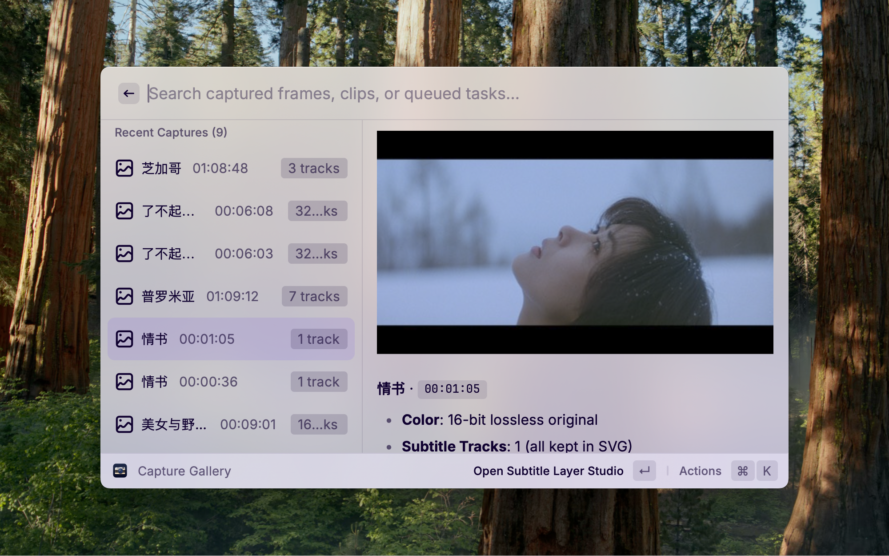
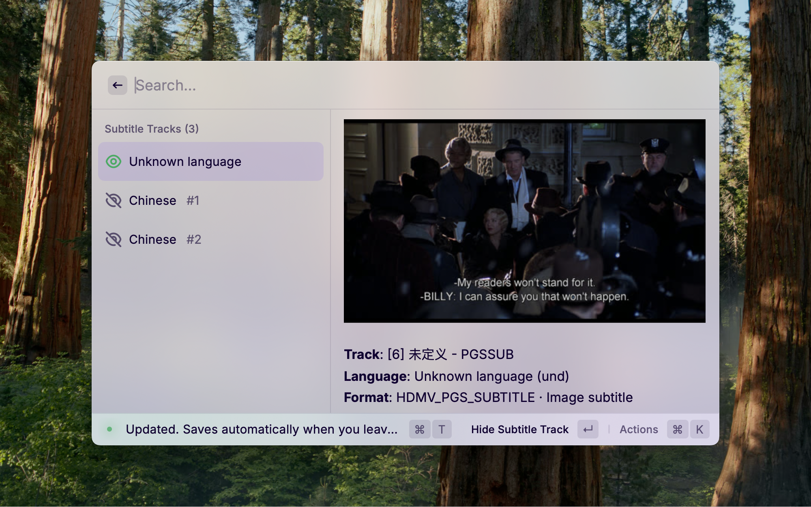

# FrameCraft

适用于 Jellyfin / Emby 的 Raycast 扩展。它能截取原画质截图，导出保留全部字幕轨的视频片段，还能在 Raycast 里管理字幕图层、制作双语字幕。


[English](README.md)

## 背景

在 macOS 上用 Jellyfin / Emby 看片时，主流播放器在截图和字幕管理上都有明显缺失：

- **Infuse、VidHub 等播放器**：没有截图功能，也无法管理多条字幕轨。
- **IINA**：截取 HDR 片源时效果较差，容易偏色或发灰。
- **截播放器窗口**：只能得到屏幕上看到的样子，分辨率缩放到窗口大小，HDR 被转成 SDR，字幕按屏幕尺寸烧在画面里，还可能带着播放控制栏。

FrameCraft 在 Raycast 里读取播放器当前暂停的位置，只下载片源在这个位置附近的一小段数据，再用 FFmpeg 截出原画质的这一帧，同时补上了多字幕管理和视频片段导出的功能。



## 使用方式
暂停播放器，呼出 Raycast ，截取画面，显示任务开始后继续观影即可

## 功能

- **原画质截图**：输出片源原始分辨率、16 位色深的 PNG，HDR（PQ/HLG）原样保留。选取的是暂停时屏幕上显示的那一帧，编码前后都会核对时间戳。
- **字幕工作台**：每条字幕轨都保存为 SVG 里的一个独立图层，在 Raycast 里就能管理：
  - 随时显示或隐藏任意字幕轨
  - 叠加两种语言，制作简单的双语字幕
  - 微调字幕上下位置，或把图片字幕识别成可编辑文字
  - 离开工作台时自动保存，不用手动导出
- **视频片段导出**：先标记起点，再导出起点到当前位置的片段。直接复制视频流，不重新编码，保留全部音轨和字幕轨（MKV）。
- **超大文件也能截**：57 GB 的蓝光原盘 M2TS 约 1 分钟出图，38 GB 的 MKV 约 30 秒。
- **蓝光 ISO / BDMV（实验性）**：读取光盘的播放列表，自动对应到正确的片段。
- **后台队列**：截图在后台进程里执行，Raycast 不会卡住，也可以同时处理多张。

每次截图导出三个文件：

| 文件 | 内容 |
| :--- | :--- |
| `*_clean.png` | 无字幕原图，16 位，原始分辨率 |
| `*_subbed.png` | 同一帧，烧入你选择的字幕 |
| `*_layered.svg` | 原图加上每条字幕轨，每轨一个图层，可以在设计软件里继续调整 |




## 实现原理

最理想的做法是直接向播放器要解码好的画面，但主流的 Mac 播放器都做不到：Infuse、VidHub 等客户端没有脚本接口，也没有导出接口；解码后的画面只在它们自己的内存里，缓存里也没有能用的内容。所以 FrameCraft 只能绕一圈，自己把这一帧重建出来：

1. **读取位置**：读取播放器上报给 Jellyfin / Emby 的暂停位置。IINA 和 QuickTime 则直接向播放器查询。
2. **定位数据**：用文件自带的索引（MKV 的 Cues、MPEG-TS 的时间戳、蓝光的播放列表），算出这个时间点在文件的哪一段。
3. **下载视频**：用多路并行的 HTTP Range 请求下载数据附近的视频文件，由于原盘视频压缩需要前一个关键帧来计算中间内容，不能只申请该帧内容。
4. **截图并核对**：在本机用 FFmpeg 解码，选出屏幕上显示的那一帧，编码后再核对一次时间戳。
5. **重建字幕**：逐条提取这个时间点的字幕，按片源的分辨率和色彩空间合成，并写入 SVG 图层。

失败的尝试：

- 截屏：截图是电脑屏幕像素，不是原始像素。
- **读取播放器缓存**：播放器只把画面放在内存里，硬盘上无法读取。
- 读取**系统「正在播放」信息、Jellyfin 实时推送、界面上显示的时间、URL Scheme**：均非准确信息。
- **让 FFmpeg 直接读取远程文件**：字幕轨数据稀疏，再加上网络慢时大量零碎的跳转读取，一次截图要好几分钟，甚至超时。

这是在没有云端服务器权限的情况下最简单直接的办法。

## 播放器兼容性

FrameCraft 截的是播放器上报的那个位置。这一帧是不是你在屏幕上看到的那一帧，取决于播放器。以下是和屏幕截图逐帧比对的结果：

| 播放器 | 实测表现 | 说明 |
| :--- | :--- | :--- |
| **VidHub** | 极佳 | mpv 内核。MKV、TS、蓝光 ISO 实测都和屏幕是同一帧 |
| **IINA** | 准确 | mpv 内核，直接读取播放器自己的位置（需要做一次设置，见下文） |
| **Infuse** | 有偏差 | 自研内核，偏差约 −24 到 +11 帧（约 ±1 秒），没有固定规律 |
| **Swiftly** | 有偏差 | VLC 内核，同样有明显偏差 |
| **其他 Jellyfin 客户端** | 未测试 | 取决于客户端上报的是画面时间还是播放时钟 |
| **Emby 客户端** | 实验性 | 接口和 Jellyfin 相同，但还没有测试 |

为什么会有偏差：mpv 内核的播放器暂停时，上报的是屏幕上那一帧的时间；Infuse 和 VLC 内核的客户端上报的是播放时钟，可能停在两帧之间的任意位置，还会叠加音频和画面显示的延迟。这些偏差在播放器外部无法修正。**需要逐帧准确时，推荐用 VidHub。**

## 环境要求

- macOS
- [Raycast](https://www.raycast.com/)
- [FFmpeg](https://ffmpeg.org/)（用 Homebrew 安装：`brew install ffmpeg`）
- 仅在截取蓝光 ISO / BDMV 时需要：
  - Xcode 命令行工具：`xcode-select --install`
  - `brew install libbluray libudfread curl pkg-config`

## 安装与配置

### 安装

从源码安装：

```bash
git clone https://github.com/stardryjun/FrameCraft.git
cd FrameCraft
npm install
npm run dev
```

运行 `npm run dev` 后，FrameCraft 会出现在 Raycast 里。之后可以按 `Ctrl + C` 退出开发模式，插件会继续留在 Raycast 中。

### 连接 Jellyfin / Emby

在 Raycast 里打开 FrameCraft 的设置（在任意 FrameCraft 命令上按 `⌘ ,`），填写：

- **Server URL（服务器地址）**：平时在浏览器里打开的地址。如果有子路径（比如 `/jellyfin`），要一并填上。
- **API Key（API 密钥）**：在服务器管理后台的 API 密钥页面创建（Jellyfin：控制台 → API 密钥）。不是登录密码。
- **User Name Filter（只检测这个用户，可选）**：多人同时播放时填写。

然后在播放器里播放并暂停，运行 **Capture Frame**。播放器必须向这台服务器上报播放进度；直接通过 SMB / WebDAV 播放文件，服务器上不会有播放会话。

### 连接 IINA

1. 打开 IINA → 设置 → 高级，启用高级设置。
2. 在「额外 mpv 选项」里添加一行：名称 `input-ipc-server`，值 `/tmp/framecraft-iina.sock`（名称前不加 `--`）。
3. 完全退出 IINA，再重新打开视频。

这个接口可以控制 IINA，只有本机能访问。删掉这一项就会关闭它。

## 使用

| 命令 | 作用 |
| :--- | :--- |
| **Capture Frame** | 截取当前暂停的画面，任务进入后台队列。可选参数：`clean`（不带字幕）、`dual`（中英双语）；光盘可以用 `playlist=编号` 指定播放列表。 |
| **Capture Gallery** | 查看任务进度、成片和失败任务。选中一张截图按 ↵，进入字幕工作台。 |
| **Mark Clip Start** | 把当前位置记为片段起点。 |
| **Export Clip** | 导出起点到当前位置的片段。没有标记起点时，导出当前位置之前的 15 秒。 |
| **Copy Stream URL** | 复制正在读取的视频路径或地址。地址里可能带有 API 密钥，不要公开分享。 |

### 设置项

| 设置 | 默认值 | 说明 |
| :--- | :--- | :--- |
| Save Location（保存位置） | `~/Pictures/FrameCraft` | 截图和片段的保存位置 |
| Default Subtitles（默认字幕） | 主字幕轨 | 决定 `_subbed.png` 里显示哪几条字幕。SVG 始终保留所有字幕轨 |
| FFmpeg Path（FFmpeg 路径） | 自动 | 自动在 Homebrew 的安装位置查找 |
| Network（网络） | 直连 | 读取视频时不使用系统代理 |
| Clipboard（剪贴板） | 开启 | 截图完成后自动复制图片 |

## 限制

- 服务器必须支持 HTTP Range 请求（返回 206）。每次远程截图最多读取 512 MiB、发出 512 次请求，超过时直接报错，不会改为下载整个文件。
- 蓝光目前只支持截图，而且是实验性功能。不支持加密光盘和 DVD ISO。光盘的候选播放列表超过 3 个时，需要用 `playlist=编号` 指定。
- HDR（PQ）字幕在线性光下合成，参考白为 203 nits。HLG 片源的字幕颜色转换尚未实现。
- 长时间持续显示的字幕和复杂的 ASS 样式还没有充分验证。

## 隐私

- FrameCraft 只连接你在设置里填写的媒体服务器。
- API 密钥由 Raycast 保存，错误信息里会自动隐去。
- 截图、历史记录和缓存都只保存在你的 Mac 上，缓存 10 分钟后过期。

## 开发

```bash
npm install
npm run dev      # 构建后台进程并启动 Raycast 开发模式
npm run build    # 生产构建
npm run lint     # 代码检查
```

- `assets/worker.cjs` 是后台进程的打包文件，由 `npm run build-worker` 从 `src/worker/` 生成。修改了它用到的代码后，要重新构建。
- `assets/disc-reader.c` 在第一次截取光盘时自动编译。

## 许可证

[MIT](LICENSE)
