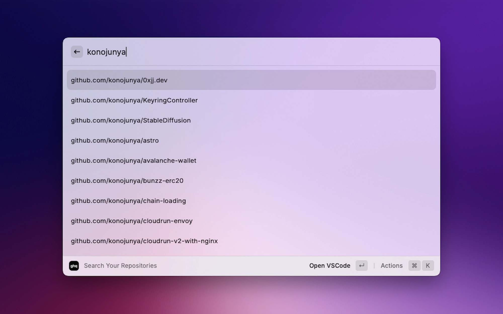

# ghq Extension for Raycast



Raycast Extension for [ghq](https://github.com/x-motemen/ghq) `list` and `get`.

ghq extension is currently no plans to implement `create`, `rm`, and `root` because there are few situations where you want to use Raycast to perform these functions.

## Feature Support

| Command      | Support            |
| :----------- | :----------------- |
| `ghq list`   | ✅                 |
| `ghq get`    | ✅                 |
| `ghq create` | No support planned |
| `ghq rm`     | No support planned |
| `ghq root`   | No support planned |

## Preferences

All preferences properties list that can be customize through `Raycast Settings > Extensions > ghq`

|   Properties    |      Label      |  Value   | Required |   Default   |                         Description                         |
| :-------------: | :-------------: | :------: | :------: | :---------: | :---------------------------------------------------------: |
| `GHQ_ROOT_PATH` | `ghq root path` | `string` |  `true`  | `~/ghq/src` | Your ghq root path. use `ghq root` command to get the path. |

The **Get Repository** command also has an optional `GHQ_PATH` preference for the ghq executable path, such as `/opt/homebrew/bin/ghq` or `~/.local/bin/ghq`. If empty, the command searches `PATH` and the standard Apple Silicon and Intel Homebrew locations.

## Get a Repository

Install [ghq](https://github.com/x-motemen/ghq) and Git before using **Get Repository**. For Homebrew users, run `brew install ghq`.

1. Open **Get Repository** in Raycast.
2. Enter a repository URL, SSH URL, or shorthand such as `konojunya/ghq-raycast` or `github.com/konojunya/ghq-raycast`.
3. Optionally select **Clone using SSH** (`-p`), **Create a shallow clone** (`--shallow`), or **Update if already cloned** (`--update`).
4. Submit the form. Progress and errors appear in a toast. Once complete, use its **Search Repositories** action to open the repository search.

Repositories are cloned into the configured `GHQ_ROOT_PATH`, which is also used by **Search Your Repositories**. Existing clones are left as they are unless **Update if already cloned** is selected.

Private repositories require Git credentials or SSH keys to be set up beforehand. The command does not prompt for terminal credentials; authentication failures appear in the error toast.

## Development

Use Node.js 22.22.2 or newer, as required by the Raycast API.

```sh
npm ci
npm test
npm run lint
npm run build
npm run dev
```

The tests cover command arguments, path handling, and error reporting. When ghq is installed, they also clone and update a temporary local Git repository without accessing a remote host. Set `GHQ_TEST_BINARY` to test a custom ghq installation.

### Quick Get

Pass a repository URL in the **Get Repository** command argument and press Enter to start cloning immediately with the default options. Launch the command without an argument to use the options form.

You can also add **Get Repository** in Raycast’s **Manage Fallback Commands** settings. It receives the root search text and starts cloning when selected. The selected root-search result determines what Enter runs; URLs may also match Raycast’s built-in browser action.
