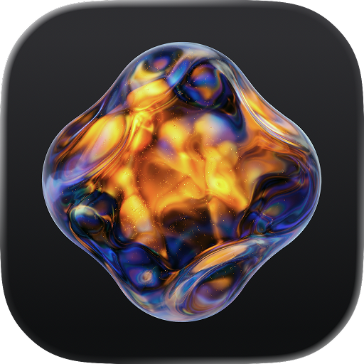

<div align="center">
    <br/>
    <br/>
    
    <h3>Glaze</h3>
    <p>Browse projects, stores, and installed apps</p>
    <br/>
    <br/>
</div>

Glaze is a Raycast extension that browses your Glaze projects, launches installed apps, explores public and team stores, and prepares app ideas or changes with Raycast AI so you can review them and press Send in Glaze.

## Highlights

- Find current and legacy projects, including relocated roots, then open, edit, or move them to Trash
- Launch, inspect, reveal, and uninstall apps installed from a Glaze store
- Search the public store without signing in, and sign in to browse the team stores you can access
- Filter by category and sort by Popular, Newest, or Recently Updated, with an Installed mark when the selected Glaze app already has that store app
- Hand a new app or a change to an existing project to Glaze from Raycast AI
- Choose Glaze or Glaze Internal for projects, installed apps, links, and the store session

## Requirements

- Raycast on macOS
- [Glaze](https://www.glaze.app) installed in `/Applications` or `~/Applications` to open projects, launch Glaze, and install apps
- A Glaze account with team access for **Browse Team Store**. The public store is available without signing in
- Raycast AI access for **Ask Glaze** and `@glaze`. The four browsing commands work on their own

## Usage

1. Run **My Projects**, **Installed Apps**, **Browse Public Store**, or **Browse Team Store**.
2. Search the list. Store commands can also filter by category.
3. Press Return to open the primary action, or open the Action Panel for the rest.

From a project you can:

- Open the app
- Edit with Glaze's agent
- View details
- Open sources in an installed editor
- Reveal the project in Finder
- Copy the app path
- Move the project and its app bundle to Trash

From an installed app you can launch it, view details, open its store page, reveal it in Finder, copy its path, or uninstall it. Deleting a project and uninstalling an app ask for confirmation, then move the files to Trash. Restore them in Finder if needed.

Store results show an **Installed** checkmark when the selected Glaze app already has that app. Choose **View and Install in Glaze** to open the store page and finish installation there. Press **⌘R** to refresh projects, installed apps, or store results.

## Ask Glaze

Select Glaze from the `@` menu in AI Chat or Quick AI, or open **Ask Glaze**:

- `@glaze build a small countdown timer with start, pause, and reset`
- `@glaze add a dark mode to my Timer app`
- `@glaze list my projects`
- `@glaze open my Timer project`

A new-app request opens a new composer with your wording. A change to an existing project opens that project's agent. Only the phrase that names the destination is removed: “Add dark mode to my Timer app” becomes “Add dark mode”. App names used in requirements, comparisons, or quoted UI text stay in the request. An ambiguous or missing project should be clarified before anything opens.

**Press Send in Glaze to start building or applying changes.** These actions prefill the composer. Opening a project without changes opens its agent with no prompt. There is no separate New Project command.

Requests are limited to 64 KB. Raycast AI supplies the tool arguments, so review the prefilled request before pressing Send. After a new-app or edit handoff, the extension closes the launcher and keeps Quick AI ready for the next time you open Raycast.

## Team Store

**Browse Team Store** opens Raycast's Glaze connection screen when a session is needed. Finish sign-in in the browser and return to Raycast. Use the same account as Glaze so your team memberships are available. Google is the default. Choose Apple under the command's **Sign-In Method** preference when that is how the Glaze account signs in.

One available team opens directly. With several teams, pick one, then use **Actions → Switch Team** to change later. The selected team's name appears in the command subtitle and the view title.

The extension keeps its own session in Raycast's secure token storage, separately for each target app. It leaves the desktop app's login unchanged. Private store results stay in memory for the current session. **Disconnect Store Account** removes the saved session and returns to root search.

## Target App

In **Raycast Settings → Extensions → Glaze → Target App**, choose:

- **Auto (prefer Internal)**: use Glaze Internal when it is installed, and Glaze otherwise
- **Glaze**: use the regular Glaze app
- **Glaze Internal**: use Internal

The choice controls project discovery, installed apps, links, and the extension's store session. An explicit Glaze or Glaze Internal selection stays on that app.

## Commands

| Command             | Purpose                                                                       | Typical Use                                       |
| ------------------- | ----------------------------------------------------------------------------- | ------------------------------------------------- |
| My Projects         | Browse and open projects in the selected Glaze app                            | Open an app, edit it with the agent, or delete it |
| Installed Apps      | Browse apps installed with the selected Glaze app                             | Launch, reveal, or uninstall a store app          |
| Browse Public Store | Explore public Glaze apps by category                                         | Search and install without signing in             |
| Browse Team Store   | Sign in with Glaze and browse the Raycast or other team stores you can access | Find an internal app and open it in Glaze         |

## Keyboard Shortcuts

| Action              | Shortcut |
| ------------------- | -------- |
| Edit with Agent     | `⌘E`     |
| Refresh             | `⌘R`     |
| Reveal in Finder    | `⌘⇧F`    |
| Copy App Path       | `⌘⇧C`    |
| Delete or Uninstall | `⌃X`     |

## Troubleshooting

- **Glaze not found:** install the selected app in `/Applications` or `~/Applications`, or change Target App, then reopen the command.
- **Missing projects or apps:** check Target App and press **⌘R**. Relocated project roots come from Glaze's settings. If a folder cannot be read, check its permissions in Finder.
- **Sign-in not completed:** retry the connection or change Sign-In Method. Signing in on the Glaze website alone leaves this extension disconnected.
- **No team stores:** check the account and team invitation. Disconnect and sign in with another account if needed.
- **Store unavailable:** check the connection and refresh. An access error hides previously loaded private results.

## Development

From this extension's directory, with Node.js 22.22 or later:

```sh
npm ci
npm run dev
```

For Raycast Internal, use `npm run dev:internal`. Leave the development command running for live updates. Restart it and begin a fresh Ask Glaze conversation after changing the manifest, AI instructions, or tool schemas.

```sh
npm test
npm run typecheck
npm run lint
npm run build
npm run evals
```

The AI evals mock tool results, so they do not create or edit real apps. They require a signed-in Raycast account with AI access. Unit tests cover discovery, target selection, malformed metadata, and prompt encoding. The build checks all four commands and four AI tools.

Team sign-in uses Supabase PKCE with Raycast's HTTPS callback. The deployed Glaze auth redirect allowlist must permit the Raycast callback, including its state query parameter. Verify the Google and Apple flows in Raycast before publishing. Unit tests cannot confirm that the provider configuration is correct.
