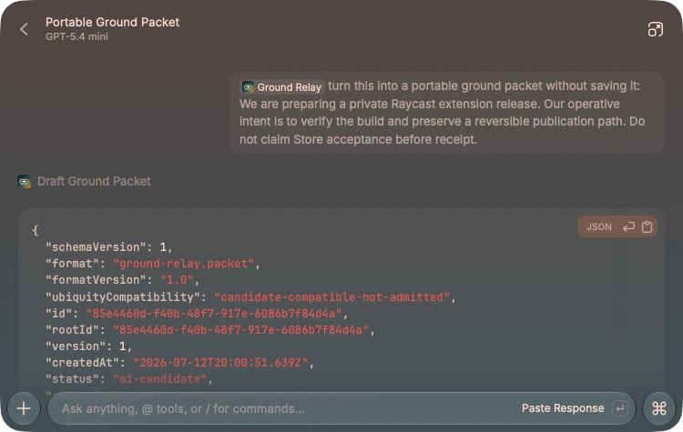
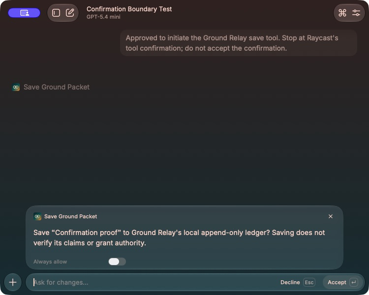

# Ground Relay for Raycast

Ground Relay carries the ground your work stands on—situation, operative intent, explicit refusals, constraints, authority, evidence, uncertainty, next movement, and correction history—across AI tools and human handoffs.

It is an ecosystem utility first. It does not require Ubiquity, hide context in a hosted memory service, or claim that generated text is verified. Its open packet format preserves an optional, provenance-aware path into deeper Ubiquity workflows later.

## What ships

- **Create Ground Packet** — captures selected text first, then clipboard content, then manual entry; saves a local packet.
- **Browse Ground Packets** — searches packets, appends corrections, and copies portable Markdown or JSON.
- **Draft Ground Packet** — AI tool that creates a non-persistent candidate.
- **Find Context Gap** — AI tool that returns one material missing question without scoring the carrier.
- **Save Ground Packet** — AI tool that writes locally only after explicit Raycast confirmation.
- **Correction lineage** — a correction appends a new version linked to the record it supersedes.





## Portability contract

Every JSON export declares:

```json
{
  "format": "ground-relay.packet",
  "formatVersion": "1.0",
  "ubiquityCompatibility": "candidate-compatible-not-admitted",
  "authorityStatus": "advisory-no-authority-grant"
}
```

Compatibility is intentionally narrow. A packet may later be inspected by a Ubiquity importer, but it is not onboarding, admission, doctrine, verification, or an authority grant.

Markdown and JSON remain usable with Raycast AI, MCP clients, AI Skills, ChatGPT, Claude, Codex, or human collaborators.

The open contract is defined by [`schemas/ground-relay.packet.schema.json`](schemas/ground-relay.packet.schema.json). The bounded future mapping is documented in [`docs/ubiquity-portability.md`](docs/ubiquity-portability.md).

## Install locally

Requirements: Raycast, Node.js 22.22.2 or newer, and npm.

```bash
npm install
npm run dev
```

The public Store manifest is configured for the verified Raycast author `breyden_taylor` with `access` set to `public`. The separately published private organization copy remains under `prmptd`.

## Input syntax

Evidence uses one item per line:

```text
claim || source reference || observed-at
```

Only source-linked evidence is marked receipt-bearing. Uncertainty uses:

```text
[solid] directly supported statement
[inferential] reasoned from supported evidence
[unknown] unresolved statement
```

## Privacy and authority

- Packets stay in Raycast's extension-local support directory unless copied elsewhere.
- The extension does not silently read files, chats, accounts, or browser history.
- Selected text or clipboard content is captured only when the user opens or reloads the create command.
- AI drafts remain advisory and unverified.
- AI persistence uses Raycast's human confirmation boundary.
- No project file, MCP server, skill, `AGENTS.md`, `TELOS.md`, canonical source, or external service is mutated.

## Development

```bash
npm run typecheck
npm test
npm run lint
npm run build
npx ray evals
```

The eval suite covers drafting, gap finding, explicit save, saved-record listing and retrieval, empty-ledger warnings, and instructions embedded in stored data. Mock outputs prevent eval runs from mutating the local ledger.

See [SECURITY.md](SECURITY.md) for the bounded upstream development-dependency advisory.

## Saved records and the paired extension

AI can now list/search saved records and retrieve an exact version by ID. Listings default to the latest version of each lineage; `includeHistory` exposes older versions. `offset` and `limit` paginate results (1–100 per page). Search includes evidence and source references. Tools read only this installation's ledger. Development, private-organization, and public Store installations can have separate storage; these are never silently merged.

Open a saved record and choose **Review in the paired extension**. Raycast launches its **Review Handoff** command using the supported cross-extension API. The form is prefilled for review; opening it does not save or analyze anything. **Copy Structured Handoff** and pasting into **Review Handoff** provide a fallback if the paired extension is unavailable or its owner differs. Set **Paired Extension Owner** to `prmptd` for the private organization copy, or the paired extension's actual Store author/owner. The companion is optional.

The new record retains the source ID, root, version, exact JSON snapshot, and SHA-256 digest in `draft.handoff`. This is a new derived record, not an overwrite or automatic correction of the source. A digest identifies bytes; it does not verify claims, currentness, or authority. Handoffs never silently read the other extension's private storage. Submitting the Lawful Splat creation/review form sends its displayed context to Raycast AI when available; opening the form alone does not.

## Ledger recovery

Unreadable records produce visible warnings instead of masquerading as an empty ledger. Valid records remain available. Corrections stop if unreadable records could obscure the latest version. Writes cannot replace an existing record ID; competing corrections are serialized and stale forms rejected. Deleted versions use system Trash.

A correction lock is never reclaimed merely because it is old. If Raycast crashes while holding a lock, a later correction reports its exact path. Confirm no correction is active and preserve the ledger before removing that lock; never delete the record JSON files as a lock-recovery step.

## External-volume development

On exFAT, macOS creates `._*` sidecars. Tests and ESLint ignore them, but Raycast's metadata validator treats PNG sidecars as images. Make a clean local release staging copy excluding `.git`, `node_modules`, `._*`, `.DS_Store`, and generated outputs; install/link the existing dependencies there, then run validation and publication from that copy. Do not submit sidecars to Git or the Store. CLI evals also require `node_modules/.bin` on PATH (as in `npm exec -- ray evals`); check the per-case scores because this CLI can exit zero after an evaluation error.

## Browsing and recovery

The browser shows the latest version of each packet by default and searches all stored fields. Use **⌘⇧H** to show all versions, **⌘N** to capture a new packet, and **⌘R** to refresh. Ledger warnings open in a separate view; Enter always opens the selected packet.

Existing evidence is edited as one JSON object per line so embedded newlines, literal `||`, IDs, and advisory flags survive a round trip. New plain lines still use the documented `claim || source || date` syntax. Malformed structured evidence is rejected. Handoffs verify and preserve the exact source snapshot bytes.

Trashing a version keeps a small `.retired-<id>.json` version reservation. Restore the original file from Trash to recover it; newer corrections do not reuse its number. Preserve these reservations when backing up or moving the ledger. Older competing latest versions are all shown; inspect and trash the unwanted duplicate before correcting further.

## Local validation build (2026-11-09)

The upgraded development copy is imported from this repository and uses its own Raycast support directory. It does not share or automatically merge the private Store copy’s ledger. The private Store update is currently blocked by the organization command quota; its prior signed bundle was restored and remains separate. See `docs/ux-audit-2026-11-09.md` for the tested release boundary.
