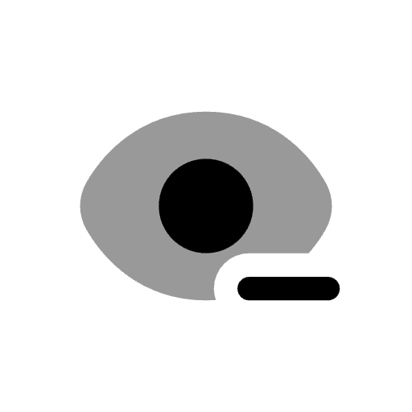

<div align="center">
    <br/>
    <br/>
    
    <h3>Hide Details</h3>
    <p>Redact sensitive details from clipboard images</p>
    <p align="center">
        <a href="https://buymeacoffee.com/0xdhrv"></a>
        <a href="https://github.com/0xdhrv"></a>
        <a href="https://x.com/0xdhrv"></a>
    </p>
    <br/>
    <br/>
</div>

Hide Details is a Raycast extension that detects sensitive text and faces in clipboard images so you can redact them before sharing. Review what it found or copy a redacted image with a single command. All processing happens locally: on macOS with Apple Vision, and on Windows with the built-in Windows OCR and face detection APIs.

## Commands

| Command                        | Description                                                                                   |
| ------------------------------ | --------------------------------------------------------------------------------------------- |
| Redact Clipboard Image         | Scan the clipboard image, review the detected details, and copy the redacted image.           |
| Redact and Copy                | Scan and redact the clipboard image immediately, then copy the result without opening a view. |
| Redact Image File from History | Pick a recently copied image file, then review it or copy a redacted version.                 |

## How to use

1. Copy a screenshot or image to your clipboard.
2. Run **Redact Clipboard Image** in Raycast.
3. Check the redacted image preview and detections, then select **Copy Redacted Image** from any row.
4. Paste the result wherever you need it.

For a quicker workflow, assign a hotkey to **Redact and Copy** in Raycast. Copy an image, press the hotkey, then paste.

If you copy something else while **Redact and Copy** is processing, it preserves the newer clipboard and asks you to run the command again. Copying from the review view is an explicit action and replaces the current clipboard.

## Clipboard history

If the clipboard holds text or another non-image item, both clipboard commands use the newest copied image file in recent Raycast clipboard history instead. The review view marks this result with a **History** tag and says which entry it used. **Redact and Copy** includes the entry in its confirmation. It still keeps anything you copy while it is processing.

Run **Redact Image File from History** to choose a recently copied image file. Copy the file in Finder or Explorer first. The command checks the six latest history entries available to extensions. Select a file to review it, or choose **Redact and Copy** to copy the redacted version right away. Thumbnails show the original, unredacted files. The time under each file is its modification time.

Screenshot images in history are unavailable through Raycast's clipboard API. To redact a screenshot, copy it onto the current clipboard and run **Redact Clipboard Image** or **Redact and Copy**. The history picker and fallback support copied image files only.

Use **Scan Current Clipboard Again** to retry with your saved preferences. Use **Scan Current Clipboard with Accurate OCR** for difficult text. These actions read the image currently on your clipboard and replace the previous preview. The Accurate OCR action applies to that scan without changing your saved Text Recognition preference.

## Review results

The **Redacted Image** row shows the output and the number of distinct masked regions. Detection labels mask the recognized text so it stays hidden while screen sharing. Each detection row shows the image, its numbered category, and the region’s position in pixels from the top-left corner. It offers **Copy Redacted Image** and **Don’t Redact** (`⌘D`) for false positives. **Redact** reverses that choice; **Redact All Detections** restores every mask. Copy is unavailable while the preview updates, and a failed update keeps the previous preview and selection. One OCR line can match more than one category. These appear as separate detections but share one masked region. Excluding one does not remove masks required by another overlapping detection. Exclusions apply only to this scan; every rescan starts with all detected details masked. Detection labels remain hidden even when a region is excluded, but the preview and copied image can reveal that region.

The **OCR** and **Face** percentages describe recognition confidence. They do not measure whether every sensitive detail was found. Turn off **Show OCR Confidence** in extension preferences to hide the OCR percentages. **Custom word match** identifies a literal rule from Always Hide These Words.

A result with no detections can still be copied, but it has no added masks. Check the preview before sharing. If copying fails, the preview remains available so you can retry **Copy Redacted Image**.

Copying saves readable clipboard data in memory for recovery if the image write fails. Unavailable clipboard formats do not block copying the finished image. If a failed write cannot be fully recovered, the error asks you to copy the original again.

## What it detects

- Email addresses and phone numbers.
- Card numbers that pass a Luhn checksum.
- Common secret formats, including Stripe keys, GitHub tokens, AWS access key IDs, Slack tokens, and JWT-shaped strings.
- IPv4-shaped addresses.
- Personal names and words you specify.
- Text matching your custom regex.
- Faces.

Text detections redact the full line recognized by OCR. Automatic detection can miss details, so check the resulting image before sharing it.

Card and phone detection checks numbers separately from neighboring numeric details. This includes cards beside expiry dates, phones beside ticket numbers, adjacent phone numbers, and phones beside IPv4 addresses. Other long numeric identifiers can resemble phone numbers and cause extra lines to be masked.

## Windows

On Windows, Hide Details runs a bundled Windows PowerShell script that uses Windows OCR, Windows face detection, and System.Drawing. It needs Windows 10 or later and a display language with OCR support installed. Some features differ from macOS:

- **Don't Redact**, **Redact**, and **Redact All Detections** are unavailable. You can review and copy the result, but cannot remove individual false-positive masks. Change **What to Hide** or your custom rules, then scan again to change which details are masked.
- Personal names are detected only from **Always Hide These Words**. Windows has no built-in name recognition.
- Windows OCR and face detection don't report confidence, so the review list shows no percentages.
- **Accurate** text recognition scans an image upscaled 2x, which helps with small text.
- **Custom Regex** uses [.NET regular expression syntax](https://learn.microsoft.com/dotnet/standard/base-types/regular-expression-language-quick-reference). Common patterns, including `(?i)`, work the same on both platforms.
- **Smooth Blur** downsamples and smooths each region rather than applying a Gaussian blur.

## Preferences

Text Recognition defaults to **Fast** for clear screenshots. Fast recognition can miss details in small or difficult text; choose **Accurate** for these images. Accurate recognition can take longer on its first run while macOS prepares its models.

| Preference              | Description                                                                                             | Default        |
| ----------------------- | ------------------------------------------------------------------------------------------------------- | -------------- |
| Text Recognition        | Choose Fast or Accurate OCR.                                                                            | Fast           |
| OCR Confidence          | Show OCR confidence percentages in the detection list.                                                  | On             |
| Redaction Style         | Choose Blackout, Pixelate, or Smooth Blur.                                                              | Blackout       |
| Face Redaction          | Blur faces while keeping the selected style for text. Requires Faces in What to Hide.                   | Off            |
| What to Hide            | Choose categories with the checkboxes in **Configure What to Hide** in the review action menu.          | All categories |
| Always Hide These Words | Comma-separated names or strings to detect as names. Keep the `name` category enabled to use this list. | Empty          |
| Custom Regex            | Optional regex applied to each OCR line, independently of the built-in categories.                      | Empty          |
| Padding                 | Extra pixels around each detected region, from `0` to `1000`.                                           | `4`            |

Enable **Blur Faces** under **Face Redaction** to blur faces on macOS and Windows while keeping your selected Redaction Style for text. Keep **Faces** enabled in **Configure What to Hide**. Overlapping text masks are applied after face blur. On macOS, face blur also applies when you exclude or restore detections in the review.

Use Blackout when sensitive content must be unreadable. Blur and pixelation can retain visible information.

Blackout is the default when no style has been saved. An existing Pixelate or Smooth Blur preference stays selected until you change it in **Open Extension Preferences**.

Open **Configure What to Hide** from the review action menu (also available when a scan fails). Check or uncheck the categories, then **Save and Scan Current Clipboard**. The saved selection applies to both commands. **Select All Categories** selects every built-in category; uncheck all categories to use only Custom Regex. Leaving the form without saving keeps the previous selection.

Existing installations start with their previous comma-separated selection, including an empty selection. The previous selection remains available as **Legacy Categories** in extension preferences during migration. After saving the checkbox form, that legacy field is ignored. **Use Legacy Category Settings** removes the checkbox override and scans with the previous preference again. Other preferences are unchanged. Unknown legacy categories or malformed saved selections stop the scan; save a valid checkbox selection to repair them.

Invalid padding stops processing with an error. Padding accepts fractional values as well as whole pixels within the allowed range.

## Custom rules

Use **Always Hide These Words** for names or literal strings. For patterns such as invoice numbers, internal IDs, or file paths, set **Custom Regex** in the extension preferences.

Literal word matching is case-insensitive, ignores whitespace, and matches substrings within an OCR line. Entries shorter than two characters are ignored. Keep **Names and Custom Words** checked in **What to Hide** to enable these rules.

Enter a pattern directly, without JavaScript-style `/` delimiters:

```regex
\bINV-\d{4,6}\b
```

Combine rules with `|`. Use `(?i)` for case-insensitive matching:

```regex
(?i)\bINV-\d{4,6}\b|confidential|client\s+id
```

The pattern uses [Apple's regular expression syntax](https://developer.apple.com/documentation/foundation/nsregularexpression). It runs against each original OCR line, including spaces. For example, `Project\s*Nebula` also matches a space introduced by OCR between those words. A match redacts the entire line and appears as **Custom Regex** in the detection list.

Custom Regex applies independently of **What to Hide**. Uncheck all categories in **Configure What to Hide** to use only your regex. Leave Custom Regex empty to disable it. Matches that contain no characters are ignored. Invalid patterns or patterns that take too long stop redaction with an error, leaving the clipboard unchanged.

## Privacy

Images are processed on your computer without uploads. Clipboard images are read directly into memory. The extension does not write unencrypted originals to disk. To let you reverse exclusions without rereading a changed clipboard, an active review retains an AES-GCM encrypted snapshot in its private temporary directory. Its random key stays in command memory. The immediate command does not create this snapshot.

Each scan owns an output image (which may reveal explicitly excluded detections) in a private temporary directory. The immediate command removes it after copying or a copy failure. The review command removes its output and encrypted snapshot when the scan is replaced or the view closes, and discards the snapshot key. Each successful edit removes the previous output. Output files abandoned by a stopped process are removed after 24 hours on a later run. Live review results are preserved. Temporary files from older versions use a 24-hour cleanup threshold.

The output is a flattened PNG with no editable layers.

## Troubleshooting

| Issue                                       | What to do                                                                                                                                             |
| ------------------------------------------- | ------------------------------------------------------------------------------------------------------------------------------------------------------ |
| Clipboard has no image                      | Copy a screenshot onto the current clipboard or copy an image file in Finder or Explorer. Screenshot images stored only in history are unavailable.    |
| Clipboard changed while scanning            | The scan or automatic copy stopped. Run the command again for the image currently on your clipboard.                                                   |
| Small or difficult text was missed          | Use **Scan Current Clipboard with Accurate OCR** and inspect the new preview. The first Accurate scan can take longer while macOS prepares its models. |
| Unknown category or invalid padding         | Open **Configure What to Hide** to save a valid category selection, or set padding from `0` to `1000` in extension preferences.                        |
| Custom Regex is invalid or takes too long   | Correct or simplify the pattern in extension preferences, then scan again.                                                                             |
| Preview expired or output could not be read | Scan the current clipboard again to create a new result.                                                                                               |

## Development

Windows code lives in `assets/windows/hide-details.ps1` (image I/O, OCR, faces, rendering, clipboard) and `src/detection.ts` (text classification and OCR coordinate conversion). Windows OCR boxes are rotated by the reported text angle around the OCR image's center, then scaled to the original dimensions before masking. `npm test` checks this conversion, the helper protocol, and the TypeScript rules against the Swift rules on the same text. On Windows, run `npm run test:windows` to test the bundled PowerShell script through the TypeScript adapter, including empty and single-item OCR and face results and rendered pixels. These integration tests are skipped on other platforms. Clipboard behavior still needs manual testing on Windows.

Distribution builds and the full native test suite require macOS 14 or newer, Raycast, Node.js 22.22.2 or newer, and Xcode with Swift 6.3 or newer for the Swift build plugins. Windows development uses Windows PowerShell 5.1 and the built-in OCR and face detection APIs.

On Windows, validate with `npm run lint`, `npx ray build -e dev`, and `npm run test:windows`. Distribution builds compile the macOS Swift helper and must run on macOS. Type checking also requires the generated Swift bindings from a macOS build.

Install dependencies and start development from the project directory:

```bash
npm ci
npm run dev
```

Native code lives in the Swift package at `swift/hide-details`. TypeScript calls its `@raycast` functions through `swift:../swift/hide-details` imports, using the same integration as Color Picker. Raycast compiles and packages the native code during development and builds. Generated native assets and build caches are ignored by Git.

To validate and build the extension:

```bash
npm run lint
npm run build
npm run typecheck
npm test
```

Run `npm run publish` to build the extension and start Raycast's publishing flow. No manual native build or checked-in executable is required.

`npm test` builds the extension and its Swift bindings before running the regression suite. The tests cover mask pixels and crop direction, Fast and Accurate OCR, dotted cards with only card detection enabled, cards and phones beside other numbers, masked review labels, face detection, small text, preference validation, scan cleanup, category migration, reversible exclusions, overlapping detections, stale identities, render failures, and preview/copy synchronization. Synthetic pixel tests verify encrypted snapshot round-trips and restoring masks in all three styles. Native clipboard tests use an isolated pasteboard and check PNG/TIFF input, copied output, restoration after rejected writes, and protection against stale copies without replacing your clipboard.

## License

[MIT](./LICENSE)
