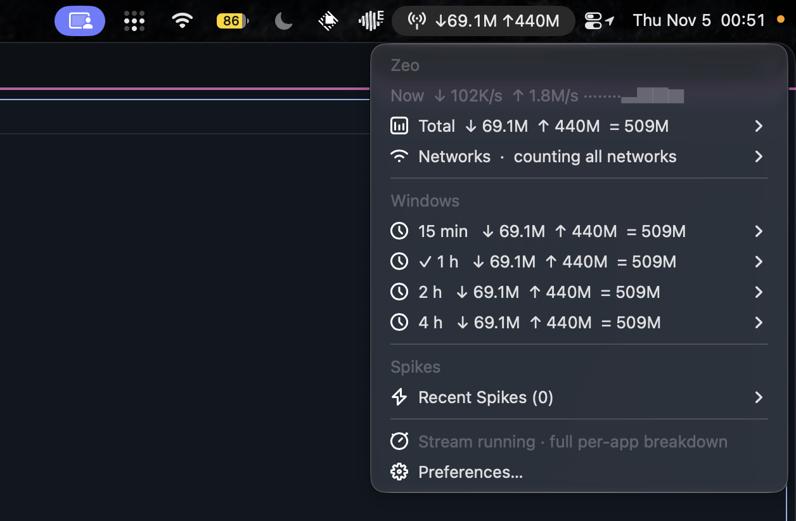
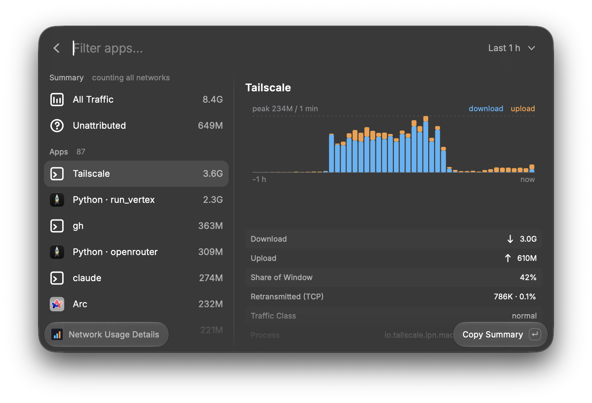
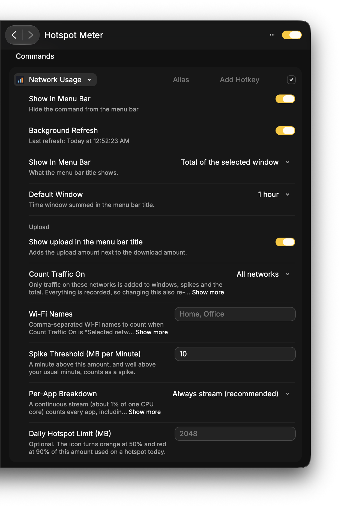

# hotspot meter

a raycast menu bar thing that tells u where ur data went. built because my iphone hotspot kept getting eaten alive and i had zero clue what was doing it.

no sudo, no daemon, no app to install. it's one raycast extension that sits in the menu bar, counts every byte in/out on ur main network, and lets u click down into it like an old-school xbar plugin: window → app → where it's talking to.

## what u get

menu bar title is something like `↓4.7G ↑3.9G` (or just the total since reset, or live speed, ur call). click it:

```
Zeo
Now   ↓ 6.7M/s  ↑ 1.8M/s   ▃▃▃▃▃▃▃▃▇▅▅█
Total ↓ 625M ↑ 284M = 908M          → since <date>, reset / clear all history / undo
Networks · counting all networks     → every network u've been on, tick the ones u wanna count
Windows
  15 min  ↓ 1.3G ↑ 1.5G = 2.8G      → sparkline, biggest spike, top 5 apps, "all n apps…"
  1 h     ...
  2 h     ...
  4 h     ...
Spikes
  Recent Spikes (1)                  → time · size · who did it
Capture Source / Preferences
```



drill into a window and u get the 5 heaviest apps (the menu stays small so it opens instantly; `All N Apps…` jumps to the details window on that window). click an app:

- how much, and what % of the window
- the top remote ips it talked to (apple and tailscale ranges get labeled)
- retransmitted bytes = data u paid for twice (tcp only, quic doesn't report it)
- traffic class (background system stuff vs normal)
- for the usual suspects (`nsurlsessiond`, `cloudd`, `bird`, `photolibraryd`, `softwareupdated`, `backupd`...) a one-liner on what it even is + a button that jumps to the right system settings pane
- helpers get folded into their parent app (all the `Browser Helper`s become just `Arc`)
- anything running under a vpn tunnel shows up as "through vpn tunnel" so it doesn't get counted twice

there's also an `Unattributed` row: interface total minus what we could pin on an app. it's kinda the honest part. see limits below.

## the details window

menu too small? hit `Open Details` in the menu (or search **network usage details** in raycast). it's a regular raycast list: pick a window top right (15 min to 4 h), every app on the left, and on the right a traffic history chart for the selected row plus download/upload, share of the window, retransmits, traffic class and where it's talking to (one row per destination). long bundle ids get a readable name (`io.tailscale.ipn…` is just `Tailscale`, search still finds the raw one). there's a summary row for all traffic, the unattributed bit (with its own chart), and a spikes section that only shows up when there are spikes. actions: copy summary, open the matching system settings pane, reveal in finder. it samples on its own while it's open, so it's live even if background refresh is off.



## only count on certain networks

thing i actually needed: i only care about hotspot data, not home wifi. so there's a `Count Traffic On` setting:

| option | what gets counted |
|---|---|
| all networks | everything (default) |
| personal hotspot only | only when ur on a phone hotspot. auto-detected, nothing to configure |
| selected networks | only networks u tick in the `Networks` menu, plus any wifi names u type into `Wi-Fi Names` (like `Home, Office`) |

stuff to know:

- everything still gets recorded, the filter is applied when u look at it. so flipping the setting re-filters ur whole history instead of wiping it.
- if u type wifi names and none of them match a network yet, nothing is counted (instead of everything) until one does.
- when ur on a network that's not being counted the title gets a `⏸`, and the per-app stream isn't started, so it costs nothing.
- hotspot detection = iphone hotspot gateway (`172.20.10.1`), usb/bluetooth tethering, or macos flagging the link as expensive (`nettop -t expensive`).
- the wifi name is read once when u join a network (takes ~10 s, it runs in the background), so name matching kicks in a few seconds after joining. if ur mac won't give up the name, tick the network in the `Networks` menu instead.

## setup

needs macos + raycast. tested on macos 27 / raycast 2.10, apple silicon.

install it from the raycast store, then open **network usage** once so the menu bar item shows up and background refresh kicks on, and ur good. no permissions to grant, no api keys. it comes back on its own after reboots because raycast does (make sure raycast launches at login).

## settings

the menu bar title settings (`Menu Bar Title`, `Default Window`, `Upload`) belong to the menu bar command. the rest are extension-wide, so the details window follows them too.

| setting | what it does |
|---|---|
| menu bar title | window total / total since last reset / live speed / icon only |
| default window | 15 min, 1 hour, 2 hours or 4 hours for the title |
| upload | add the ↑ number to the title |
| count traffic on | all networks / personal hotspot only / selected networks (see above) |
| wi-fi names | comma-separated wifi names to count in "selected networks" mode |
| spike threshold | mb per minute that counts as a spike (default 10) |
| per-app breakdown | always stream (default) / stream only on a hotspot / manual capture only |
| daily hotspot limit | mb. icon goes orange at 50% and red at 90% of it used on a hotspot today |



tip: open any window submenu and hit `Show This Window in the Bar` and that window becomes ur bar number.

## how it works (the nerdy bit)

- every 10s raycast wakes the command. it reads `netstat -ib` for the interface counters. those are exact, so totals never drift even if the mac slept or raycast got killed. everything else is attribution on top.
- attribution comes from `nettop -P -d -s 2` running as a detached stream in 5 min chunks. it sees every process, even ones that opened a socket and closed it in between ticks. the extension reads the new samples each tick and stitches the chunks so nothing gets counted twice.
- hosts and traffic class come from a one-shot per-connection `nettop` snapshot, only for the heaviest pids, so it's cheap.
- a network is identified by its router address (and the router's mac when macos lets us read it, so two homes that both use `192.168.0.1` stay separate). the wifi name is only a label.
- data lives in `~/Library/Application Support/com.raycast.macos/extensions/hotspot-meter/` (`samples.ndjson` + `last.json`). last 5 hrs of samples, all local. the extension never makes a network request, it only runs local system tools (`route`, `netstat`, `arp`, `networksetup`, `system_profiler`, `nettop`, `ps`, `nice`, `mkfifo`) and `open` for the settings links.
- reboot safe: it tracks boot time, drops stale pids/sockets/chunks after a restart, and counts the fresh since-boot counters once.

### about that background process

raycast menu bar commands normally live for a blink and die. the `nettop` stream is the one thing that outlives the command, on purpose, otherwise it'd miss every short connection. it's bounded and boring: it ends itself after 5 min (the next tick starts a new one), runs under `nice`, costs ~1% of one core, and the extension only ever stops a pid it's sure is still `nettop`. if u don't want it, set `Per-App Breakdown` to `Manual capture only` and nothing keeps running.

### the cpu thing (this one cost me an evening)

`nettop` in streaming mode burns ~1.3 cores if its stdin is at eof. like `/dev/null` eof. spawn it from node with `stdio: "ignore"` and it just spins. didn't matter which flags, filter or interval, even watching one idle pid did it. fix: hand it a fifo opened read-write so stdin never ends. same stream then costs ~0.8% of one core over 10 min. if u ever script `nettop` urself, keep stdin open, u're welcome.

## limits (no cap)

- attribution is ~88-95% of what the interface moved. the rest is packet headers, kernel stuff and gaps. that's the `Unattributed` row, not a bug.
- `nsurlsessiond` (apple's background downloader) can't be traced back to the app that asked for it. nettop doesn't give that. u get the destination + traffic class + a guess what it is.
- i have not tested hotspot detection on an actual phone hotspot yet, only on home wifi. should work, no promises.
- retransmit numbers are tcp only.
- networks are told apart by router address. if macos won't let the extension read the router's mac, two networks that both use the same address (like `192.168.1.1`) look like one network.
- vpn: bytes inside a tunnel are shown as "through vpn tunnel" and counted on the vpn client, not the app.
- macos only. uses `nettop`, `netstat`, `route`.

## license

mit. do whatever.
