# Screenshot gallery

Captured with Raycast’s built-in Capture Window. All images are 2000 × 1250 PNGs with the same lake wallpaper and native padding. Ticket images retain their published upstream bytes.

## Store carousel

The six files in `metadata/` are ordered by filename. Meals planning shows a local draft during a closed selection window; no plan was submitted.

### Search tickets

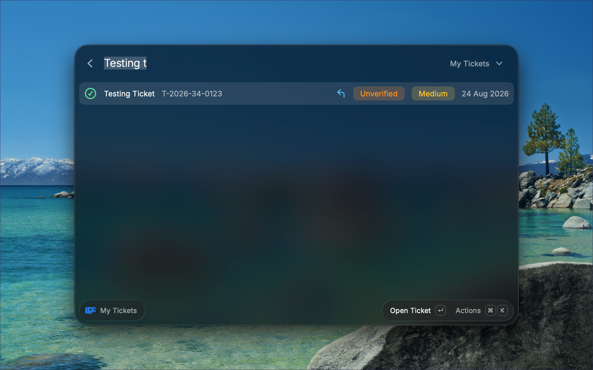

### Create a ticket

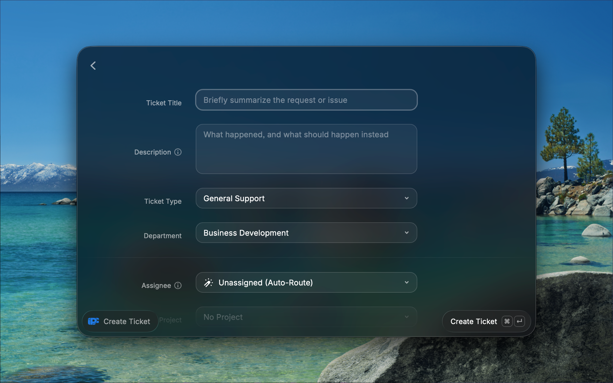

### Ticket detail

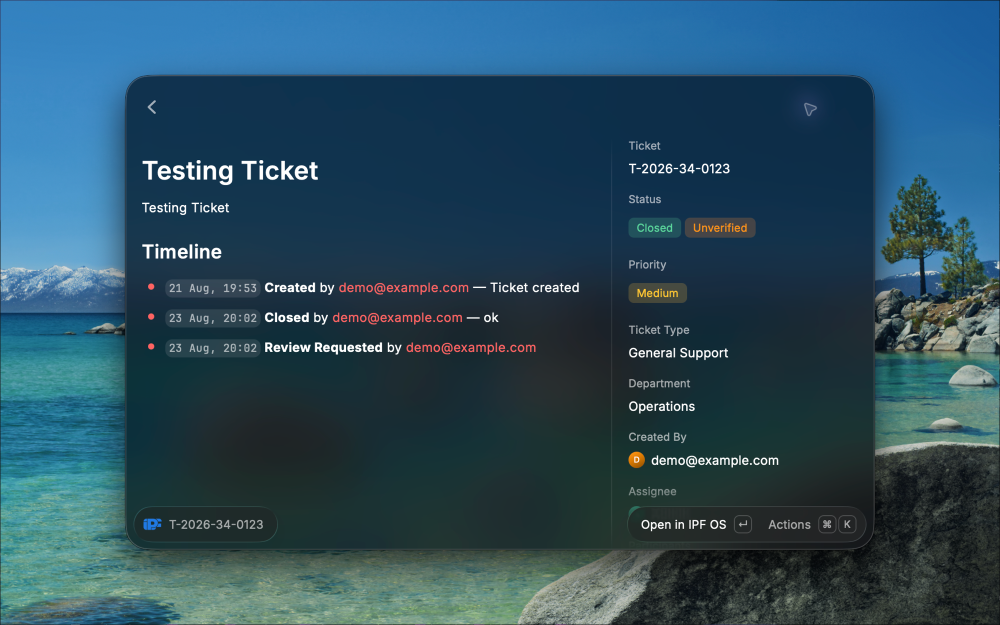

### Saved meal history

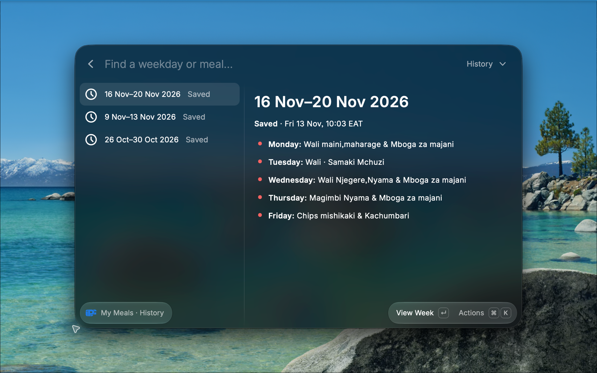

### Plan a week

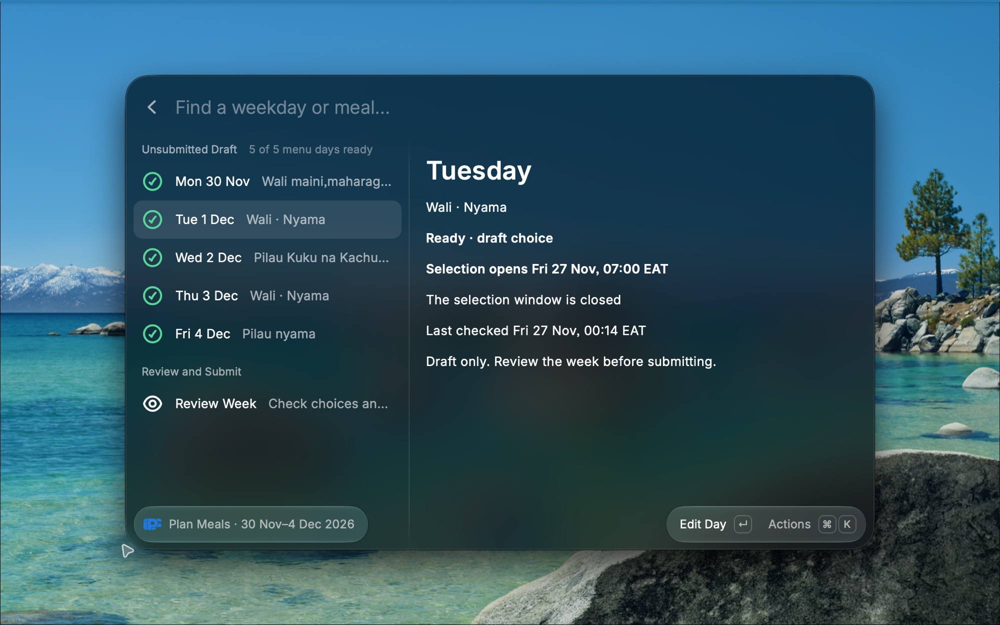

### Review the full meal plan

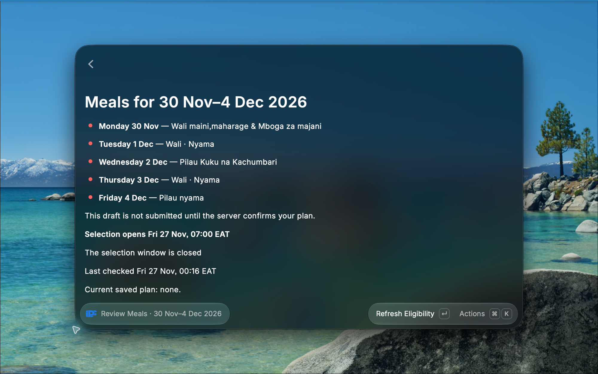

## Supporting Meals views

These four images supplement the three Meals images in the Store carousel. Preferences and absence forms were captured without submitting changes.

### Today’s meal and offered menu

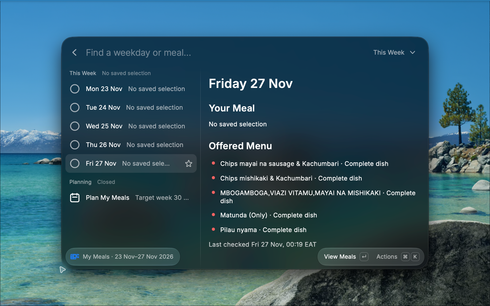

### Edit a day’s meal

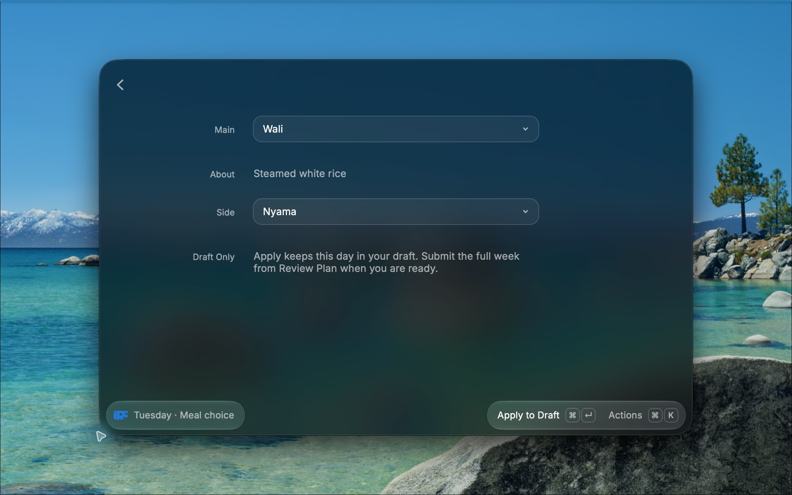

### Availability and reminders

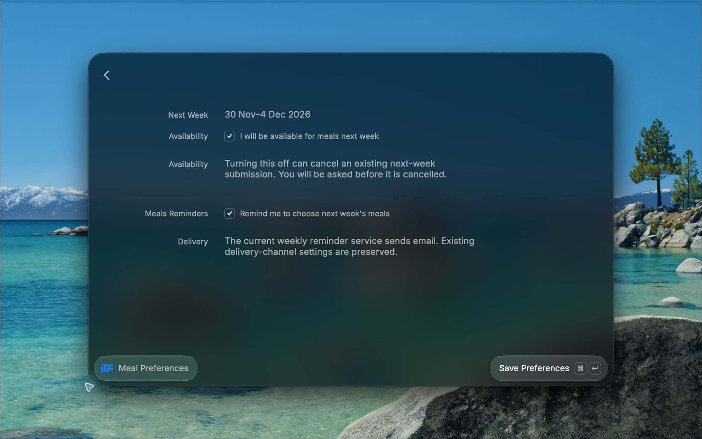

### Notify an absence

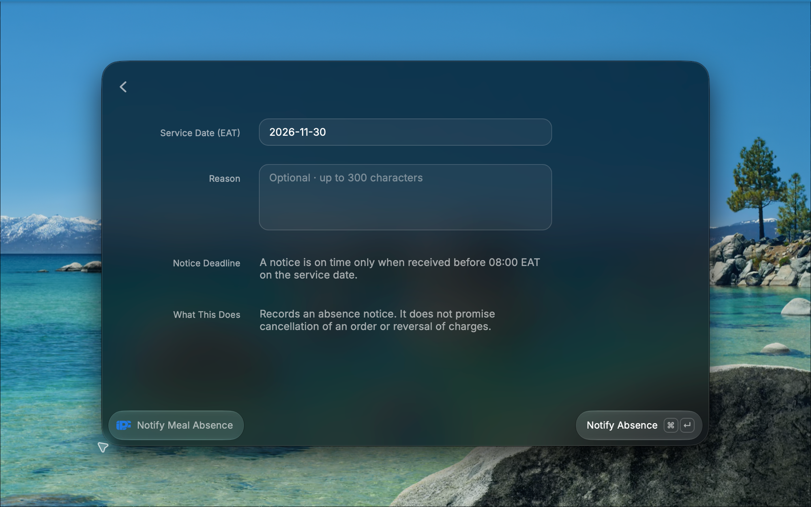

## Supporting ticket views

### Ticket actions

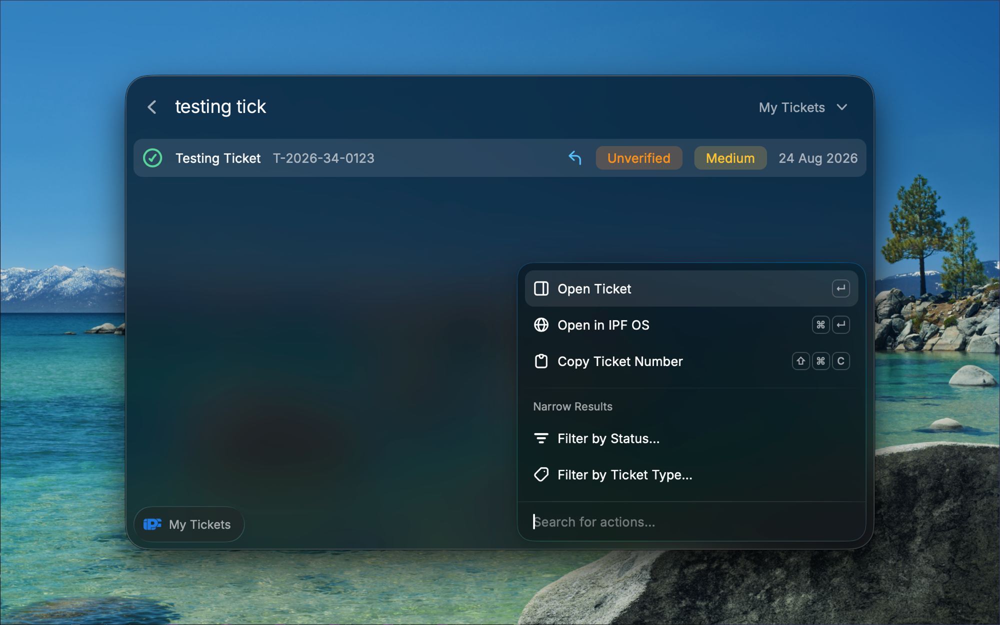

### Ticket due-date actions

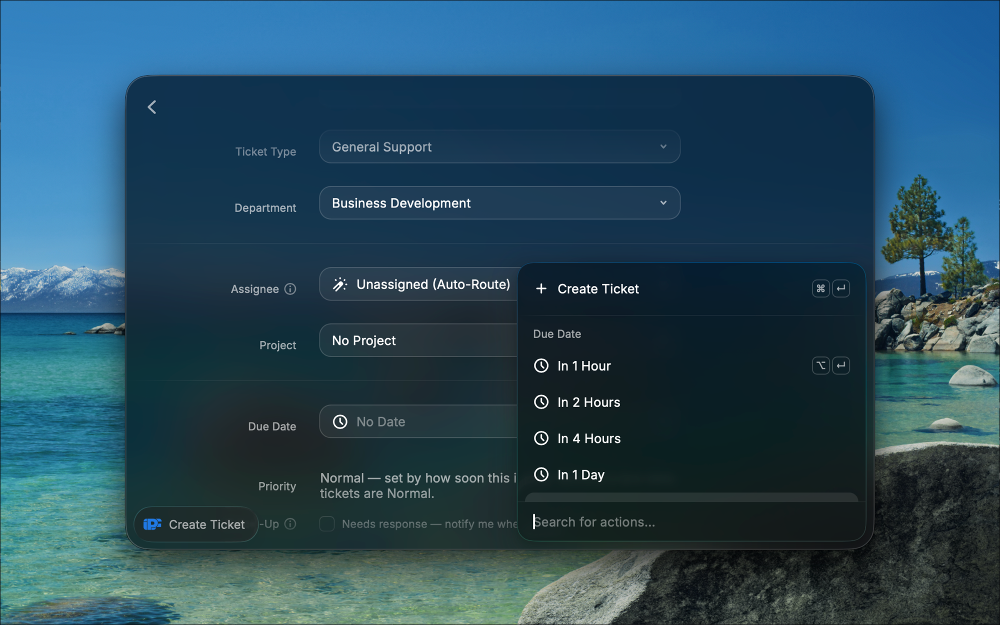
