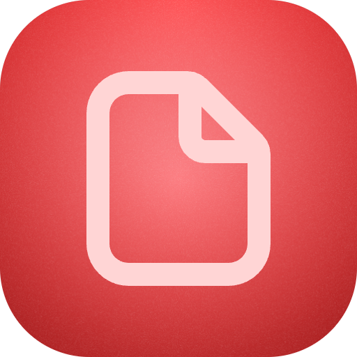

     
     
    
    <h3>JSON Resume</h3>
    
Parse JSON Resume

     
     

A Raycast extension for saving, editing, validating, and viewing JSON Resume documents.

## Save and edit resumes

Use **Create Resume** to enter a display title and paste JSON. Use **List Saved Resumes** to open a local resume, edit its full JSON, copy JSON, or delete it from its detail view. Saved documents work offline and remain available after closing the command. Schema errors leave the saved document unchanged.

Use **Open Resume** to load a JSON Resume URL. Bookmarks appear in **Saved URLs**. After loading a valid resume, choose **Save Local Copy** to create an independent document. Editing that copy does not change the remote source or its bookmark. Multiple documents may share a title.

The standalone creation form supports Raycast drafts. Raycast does not support drafts for nested edit forms, so save edits before leaving those forms. Simultaneous edits to the same document use the last successful save.

## Use with AI

Ask Raycast AI to list saved resumes, read one, save supplied text or JSON inside the extension, edit a saved resume, rename it, or delete it. AI uses stable IDs and asks you to choose when titles match. Saving, updating, and deleting require tool confirmation.

Conversion alone returns JSON without saving it. An explicitly requested file path uses the existing conversion tool's file output and never overwrites an existing file. See [tool inputs and behavior](src/tools/README.md).

What is JSON Resume?

JSON Resume is an open-source standard for storing resume/CV data as structured JSON. It lets tools validate, transform, and render resumes consistently across platforms.

How this project works

- Load: the UI accepts a resume document in the JSON Resume format (a JSON file/object).
- Validate: resumes are checked against the JSON Resume schema (https://jsonresume.org/schema) and the TypeScript types in `src/types/`; the validator is in `src/utils/validateResume.ts`.
- Store: `src/utils/resumeDocuments.ts` stores complete local documents. `src/utils/storage.ts` keeps URL bookmarks separately.
- Render/Search: UI components in `src/` (for example `open-resume.tsx` and `search-resumes.tsx`) provide basic viewing and searching functionality.

## Key features

- Schema validation against the JSON Resume types.
- Create, edit, search, and view local resumes with schema validation.
- Keep URL bookmarks and save independent local copies.
- AI tools for listing, reading, saving, updating, and deleting local resumes.

## Project layout

- `src/` — source files and UI components.
- `src/utils/` — helpers such as `validateResume.ts` and `storage.ts`.
- `src/types/` — JSON Resume schema and TypeScript definitions.

