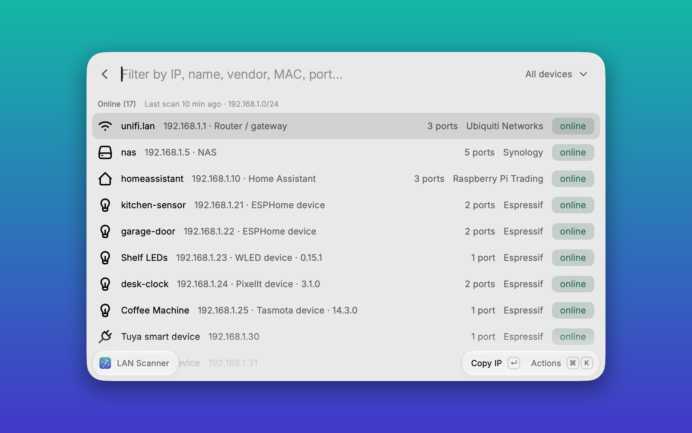
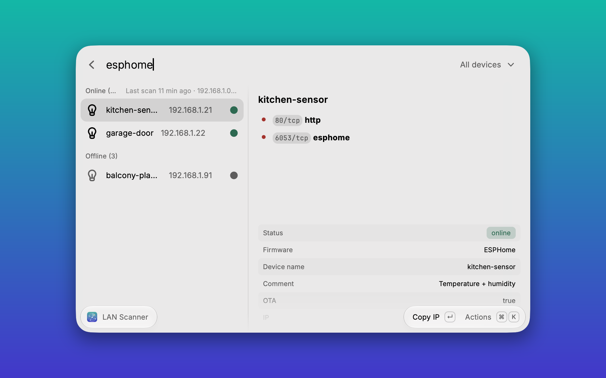
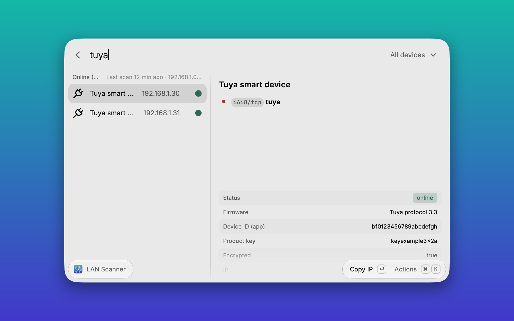
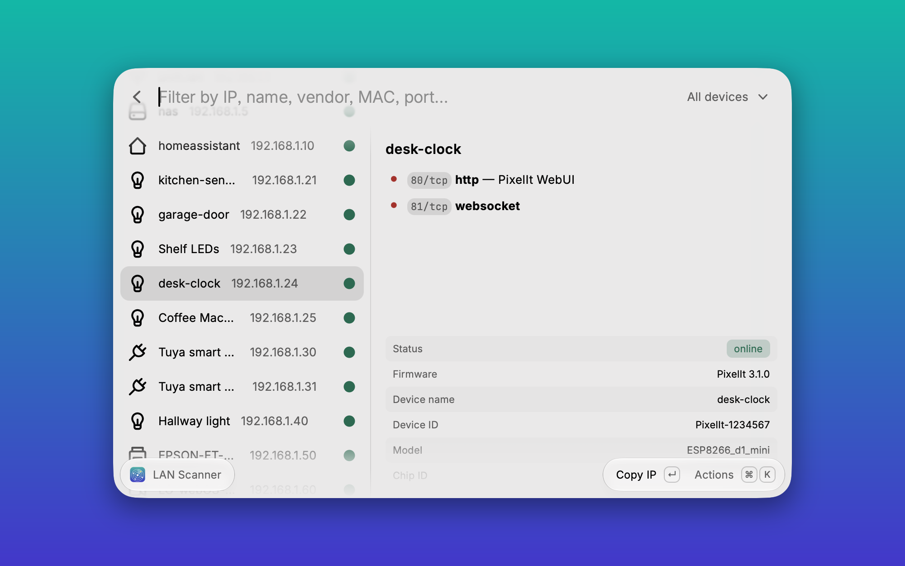
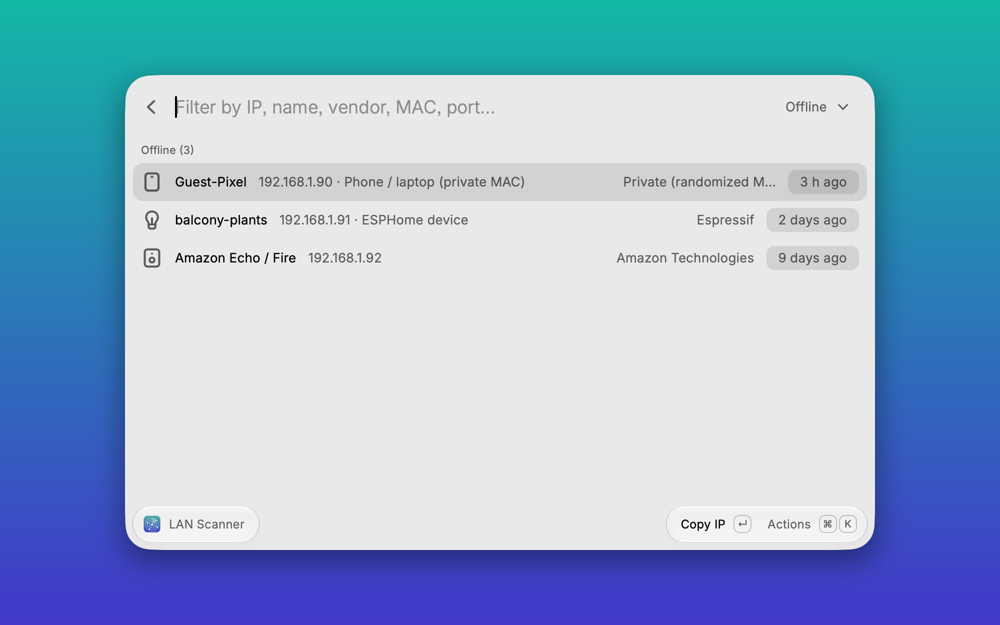

# LAN Scanner for Raycast



A Raycast extension that scans your local network, remembers every device it has ever seen, and tries to work out
what each device is: MAC vendor, mDNS/DNS name, open ports and services, and the firmware of common IoT devices.

The scan runs as a detached process. You can close Raycast and it keeps going; the next time you open the list
you see the latest result straight away.

## Features

- **Device history.** Online and offline sections. For each device you see when it was first seen and how long ago it
  was last seen.
- **Port scan** of live hosts with `nmap` (TCP connect scan, no root needed): the top 300 ports plus common IoT ports, with
  service and version detection and HTTP page titles.
- **Vendor lookup** from nmap's OUI database. Randomised MACs (phones, laptops) are flagged as private.
- **Firmware fingerprinting** for ESP-based and smart-home devices, using read-only requests only:

  | Firmware | How it's identified | What you get |
  |---|---|---|
  | ESPHome | web UI marker, first `ping` event on `/events` | node name, comment |
  | PixelIt | `/api/matrixinfo` | device ID, hostname, version, board |
  | Tasmota | `/cm?cmnd=Status 0` | device name, version, hardware |
  | WLED | `/json/info` | name, version, arch, LED count |
  | Shelly | `/shelly` | model, name, firmware, ID |
  | ESPEasy | `/json` | unit name, build |
  | AWTRIX 3 | `/api/stats` | version, current app |
  | Tuya / Smart Life | passive UDP broadcasts on 6666/6667 | device ID (same as in the app), product key, protocol version |

- **Device type guess** from all of the above, for example *Home Assistant*, *ESPHome device*, *Tuya smart device*,
  *Printer*, *TV*, *iPhone / iPad*, *Network gear*.
- **Filtering** by IP, name, vendor, MAC, firmware, device ID or port in the search bar. A dropdown switches between
  All, Online, Offline, New (24 h) and With open ports.
- **Custom names** (`⌘E`). They are stored separately, so a scan never overwrites them.

## Commands

| Command | What it does |
|---|---|
| **Scan Network** | Shows the device list. Opening it starts a new scan if the last one is older than 15 min (configurable). |
| **Background Network Scan** | Scans every 30 min, even when Raycast is closed. You can switch it off in the extension preferences (*Background scan*) or by disabling the command in Raycast. Running it manually always scans. |

### Shortcuts in the list

| Shortcut | Action |
|---|---|
| `⌘R` | Scan now |
| `⌘⇧R` | Full scan, re-scanning all ports |
| `⌘D` | Show or hide the detail panel (ports, firmware, first and last seen) |
| `⌘O` | Open the device's web interface |
| `⌘⇧C` | Copy MAC |
| `⌘⇧T` | SSH (only if port 22 is open) |
| `⌘⇧P` | Re-scan this one device |
| `⌘E` | Rename |
| `⌃X` | Forget the device |
| `⌘⇧,` | Extension settings |

## Preferences

| Preference | Default | Meaning |
|---|---|---|
| Background scan | on | Lets the 30-min background command run |
| Auto-scan when older than (min) | 15 | Opening the list starts a scan when the last one is older than this. `0` turns it off. |
| Re-scan ports after (hours) | 12 | Known devices keep their port list until it's older than this, or until their IP changes |

## How a scan works

1. Finds the default interface and subnet (capped at a /22).
2. Ping sweep with 48 pings in parallel, then reads `arp -anx`. This also catches devices that ignore ping but answer ARP.
3. Resolves names with reverse DNS via the gateway and mDNS (`224.0.0.251:5353`).
4. Runs `nice nmap -sT -sV --version-light`, 3 hosts at a time, only for new devices or devices whose port data is stale.
5. Identifies firmware over HTTP and from Tuya broadcasts, which it collects during the whole scan.

A full scan of a /24 with ~30 devices takes about 4–5 minutes at roughly 2 % CPU. Later scans that only need to
refresh presence take about 20 s. Only one scan runs at a time, guarded by an atomic lock file.

Data lives in Raycast's support folder for the extension
(`~/Library/Application Support/com.raycast.macos/extensions/lan-scanner/`):
`state.json` (devices), `names.json` (your names) and `scan.log`.

## Requirements

- macOS and [Raycast](https://raycast.com)
- [nmap](https://nmap.org): `brew install nmap`. Without it a small built-in TCP connect check is used instead, with no
  service detection and no vendor database.

## Install (development mode)

```bash
git clone https://github.com/erikmeliska/lan-scanner.git
cd lan-scanner
npm install
npm run dev
```

`npm run dev` imports the extension into Raycast. It stays there after you stop the dev server.

## Screenshots

| | |
|---|---|
|  |  |
|  |  |

The screenshots use a fictional demo network (`scripts/demo-state.mjs`).

## Command line

The scanner has no dependencies and also runs on its own:

```bash
node assets/scanner.mjs <dataDir> [--force-ports] [--host <ip>] [--port-max-age-h <hours>]
```

## Scan responsibly

Only scan networks you own or are allowed to scan. Port scanning other people's networks can be against the rules
or the law.

## License

MIT
