# Lancetta for Raycast

> **This extension needs the free Lancetta app for macOS.** Show Quota, Agent Sessions and Token Usage show in Raycast what Lancetta reads, and without the app they have nothing to show. Codex Processes reads the process table itself and works without it; reclaiming the orphaned ones is done in the app.
>
> **[Download Lancetta](https://lancetta.app/download)** · free · macOS 15 Sequoia or later · Universal · signed and notarized · [lancetta.app](https://lancetta.app)

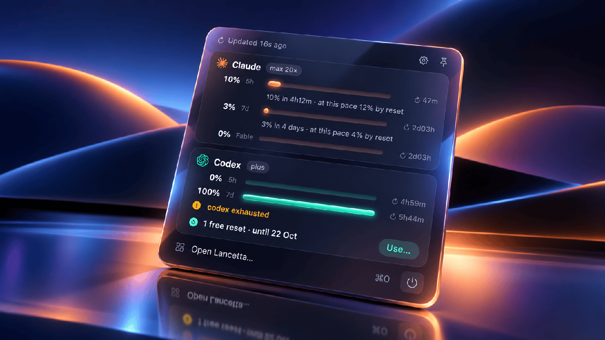

[Lancetta](https://lancetta.app) is a native macOS menu bar app that tells you **when and how to use your coding agents, Claude Code and Codex**: push on, slow down, or switch agent. It reads each account's quota without spending any, works out on your Mac whether your pace runs out before the reset, and says what to do about it, while there is still time to act. No model is asked and no token is used.

This extension brings Lancetta into Raycast: your quota with Lancetta's own charts and clock, its suggestions, the agent sessions waiting on you, Claude Code's daily tokens and the Codex processes holding memory, plus `@lancetta` for Raycast AI.

## Watch Lancetta in 35 seconds

[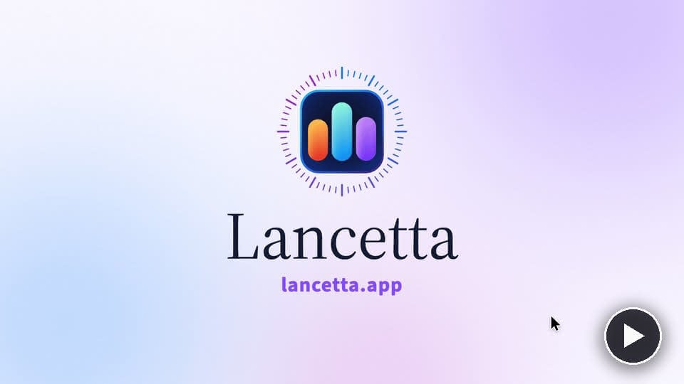](https://www.youtube.com/watch?v=UPD99NTXu2M)

## Get started

1. **[Download Lancetta](https://lancetta.app/download)** and drag it to Applications. It is free.
2. Open it and connect your agents: [Getting started](https://lancetta.app/docs/getting-started), or watch [Install Lancetta and connect your agents](https://www.youtube.com/watch?v=8kRewaOwGLM).
3. Install this extension and run **Show Quota**.

The extension reads what Lancetta writes on your Mac (`~/Library/Application Support/Lancetta/`) and never asks Claude or Codex itself: no second keychain prompt, no extra requests against your quota. Keep Lancetta running: when it has not written for a quarter of an hour, the extension says so and how old the numbers are.

## Commands

### Show Quota

Each agent's 5-hour and 7-day windows, each model's own week, a refusal by the account, and Lancetta's suggestions: "At this pace Claude stops in 3h29m, then waits 16h14m for its reset", with the steps that help.

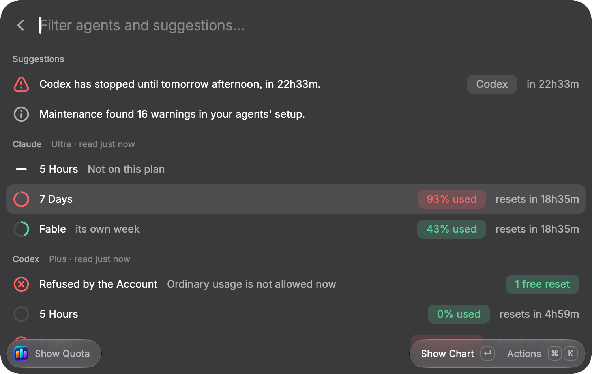

Press ↵ on a window for Lancetta's chart: the week so far, last week dotted, the pace carried forward to where it runs out, the stretch you would be stopped for hatched in amber. The 5-hour window is drawn as Lancetta's clock.

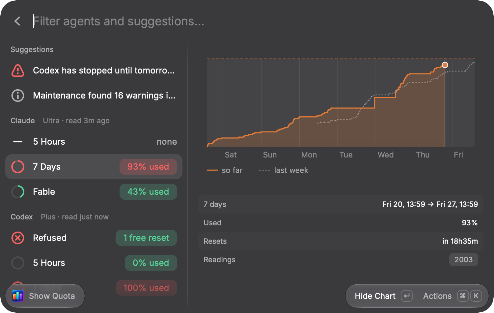

Copy the status line Lancetta prints for terminals and bars, open a problem's troubleshooting page, or jump to Lancetta to spend a Codex free reset.

### Agent Sessions

The Claude Code and Codex sessions on Lancetta's wall: the ones working, and the ones waiting on you (a question, an approval, a finished turn). Open one in your terminal with the command Lancetta uses (`claude attach`, `claude --resume` or `codex resume`), or copy it. [How sessions work](https://lancetta.app/docs/sessions).

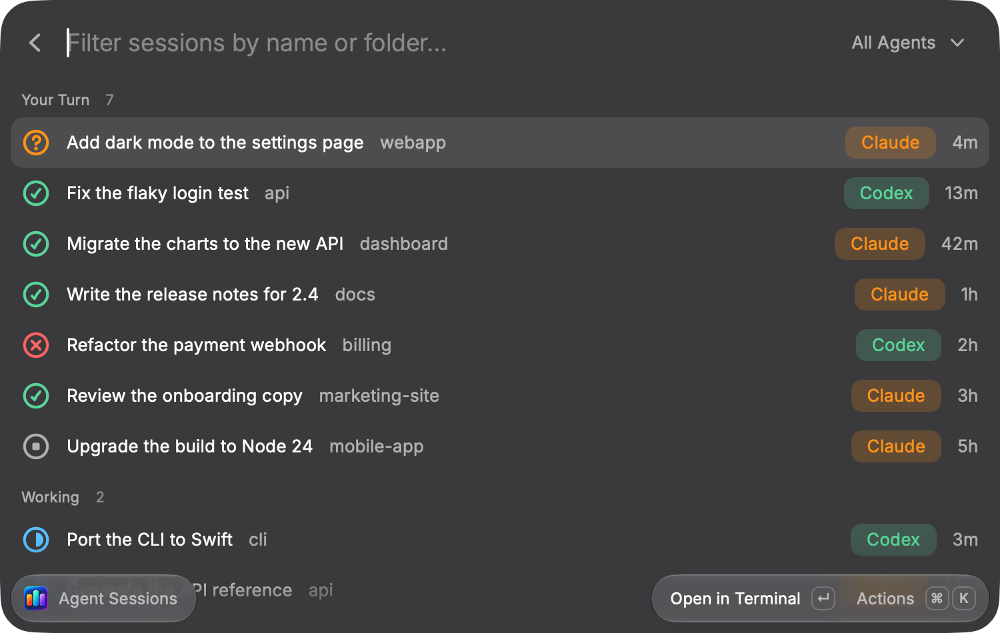

### Token Usage

Claude Code's tokens per day and per project, counted as Lancetta counts them: input, output and cache writes, without the cache reads that would drown everything else.

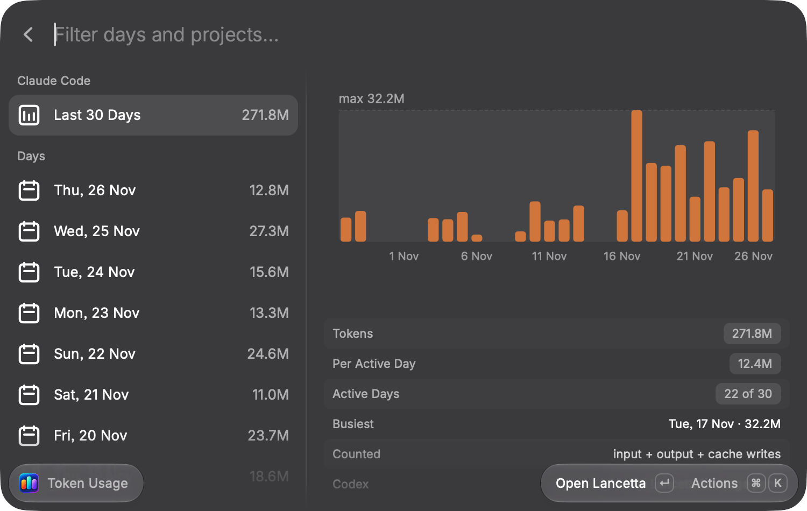

### Codex Processes

The Codex plugin's app-server trees, the memory each holds, and the orphans whose folder is gone. Lancetta reclaims them safely: it reads every process exactly before it stops one.

## Ask `@lancetta`

In Raycast AI:

- "Can I start a long Codex run now?"
- "Which agent sessions are waiting on me?"
- "How many tokens did Claude Code use this week, and on which project?"
- "Is Codex holding memory it should not?"

Every tool is read-only.

## Preferences

- **Show Quota**: show what is used or what is left, or follow Lancetta's own setting.
- **Agent Sessions**: the terminal app a session opens in, and whether done sessions are listed.
- **Token Usage**: the period, from 7 to 90 days.

## More in the Lancetta app

Raycast is the quick look. The app does the rest: suggestions in a notification before an agent stops, the island under the notch, desktop widgets, Maintenance for the files your agents load at every start, reclaiming orphaned processes (the list first, then your word), and Codex's own token history.

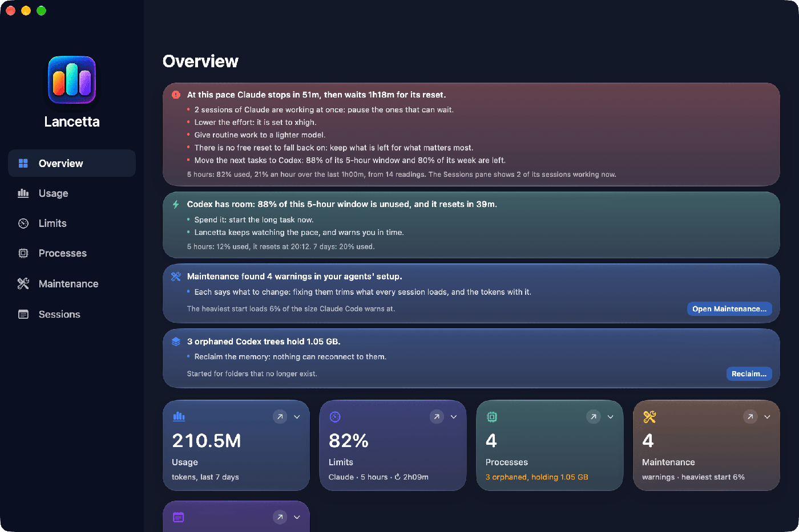

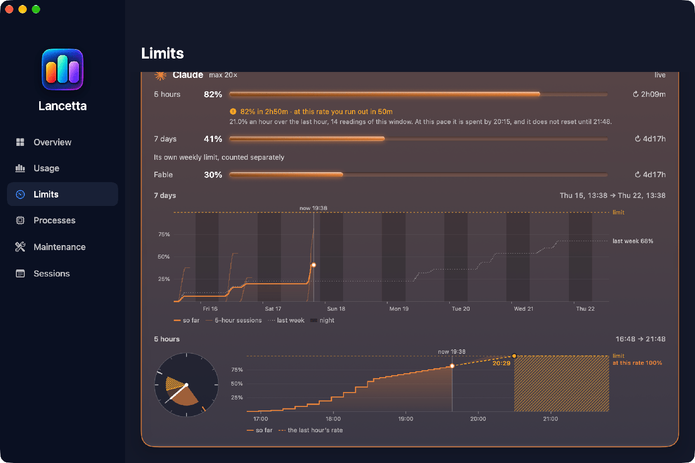

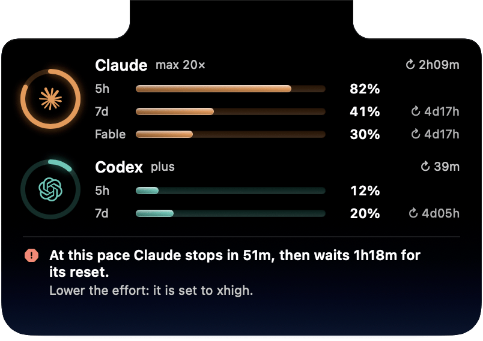

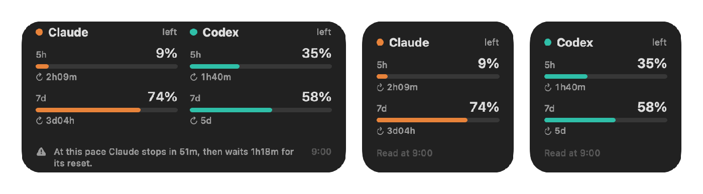

## Videos

| | |
| --- | --- |
| [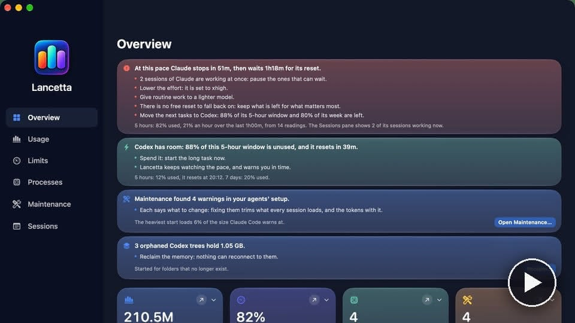](https://www.youtube.com/watch?v=KJ6PqrHH59E) | [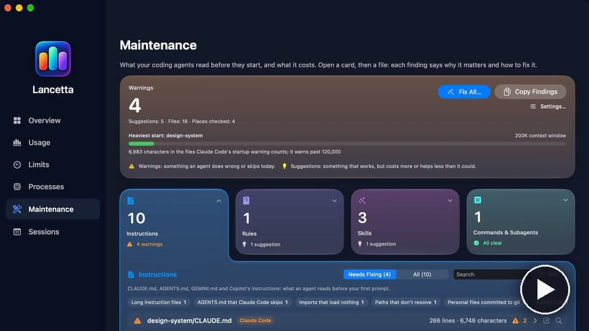](https://www.youtube.com/watch?v=P8Shkj70KPo) |
| **When to push on, when to slow down** | **Fix what your agents load, free what they leave behind** |
| [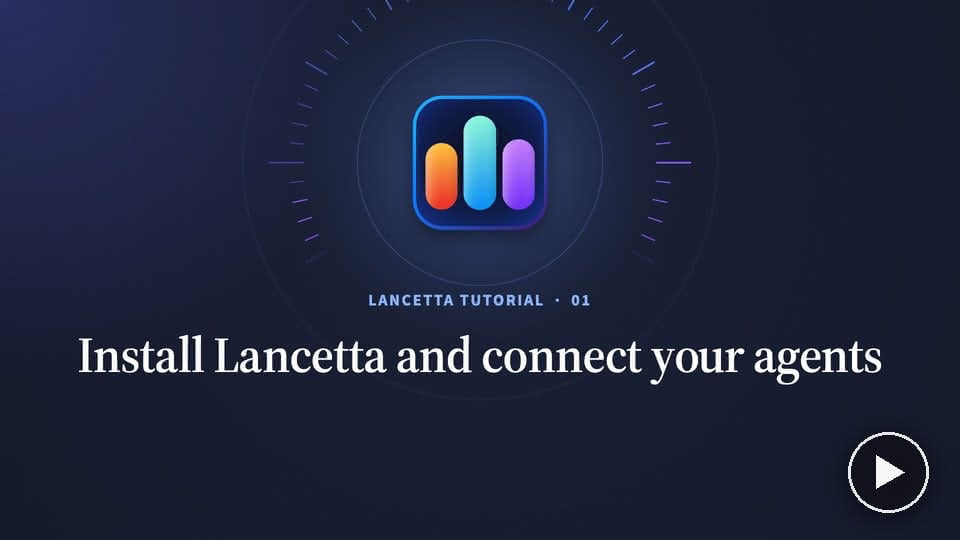](https://www.youtube.com/watch?v=8kRewaOwGLM) | [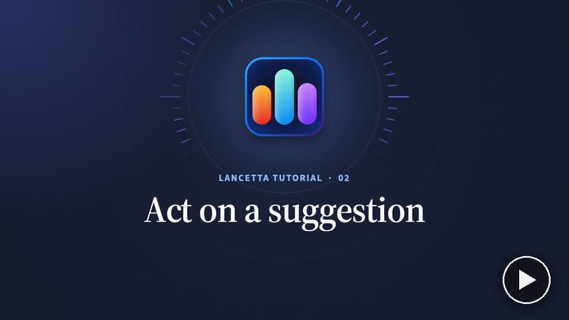](https://www.youtube.com/watch?v=KUTP3krjJi4) |
| **Tutorial 01** · Install Lancetta and connect your agents | **Tutorial 02** · Act on a suggestion |
| [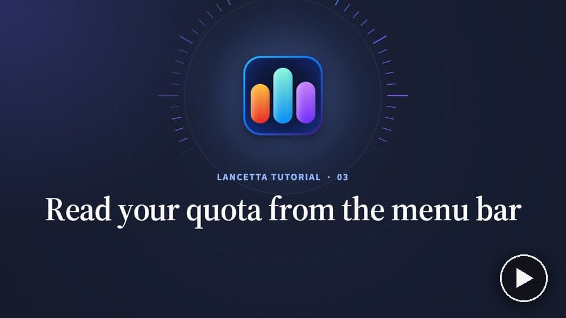](https://www.youtube.com/watch?v=LWlc2akiO7o) | [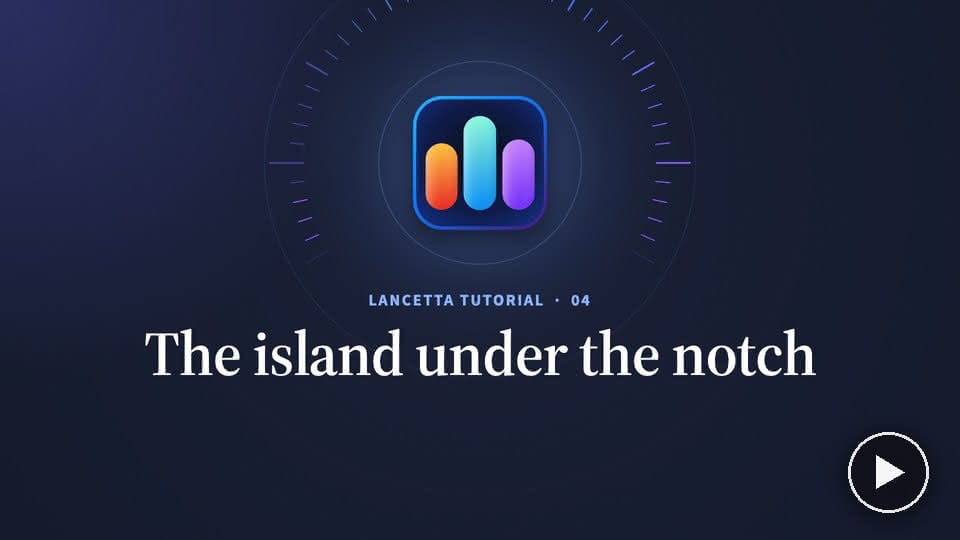](https://www.youtube.com/watch?v=-PFOdupUYP4) |
| **Tutorial 03** · Read your quota from the menu bar | **Tutorial 04** · The island under the notch |
| [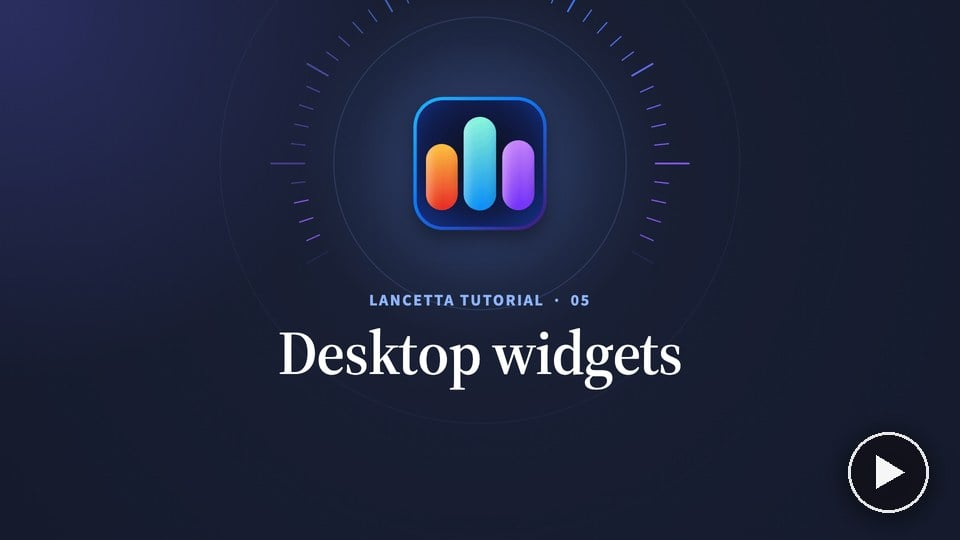](https://www.youtube.com/watch?v=AM-rM0UuQX4) | |
| **Tutorial 05** · Desktop widgets | |

More on the [Lancetta YouTube channel](https://www.youtube.com/@Lancetta-app).

## Privacy

The extension reads Lancetta's files on your Mac and sends nothing anywhere. When you ask `@lancetta`, Raycast AI receives what the tool returns, as with any AI extension. Lancetta's own [privacy page](https://lancetta.app/docs/privacy) covers the app.

## Links

- [lancetta.app](https://lancetta.app) · [Download](https://lancetta.app/download) · [Documentation](https://lancetta.app/docs/) · [FAQ](https://lancetta.app/docs/faq)
- [How Lancetta reads your quota](https://lancetta.app/docs/how-it-reads) · [Suggestions](https://lancetta.app/docs/suggestions) · [Command line](https://lancetta.app/docs/command-line)
- [Release notes](https://lancetta.app/docs/release-notes) · [Roadmap](https://lancetta.app/docs/roadmap)
- [YouTube](https://www.youtube.com/@Lancetta-app) · [@gfazioli on X](https://x.com/gfazioli)
- Lancetta is free. If it saves you a stalled afternoon, consider [sponsoring it](https://github.com/sponsors/gfazioli).
